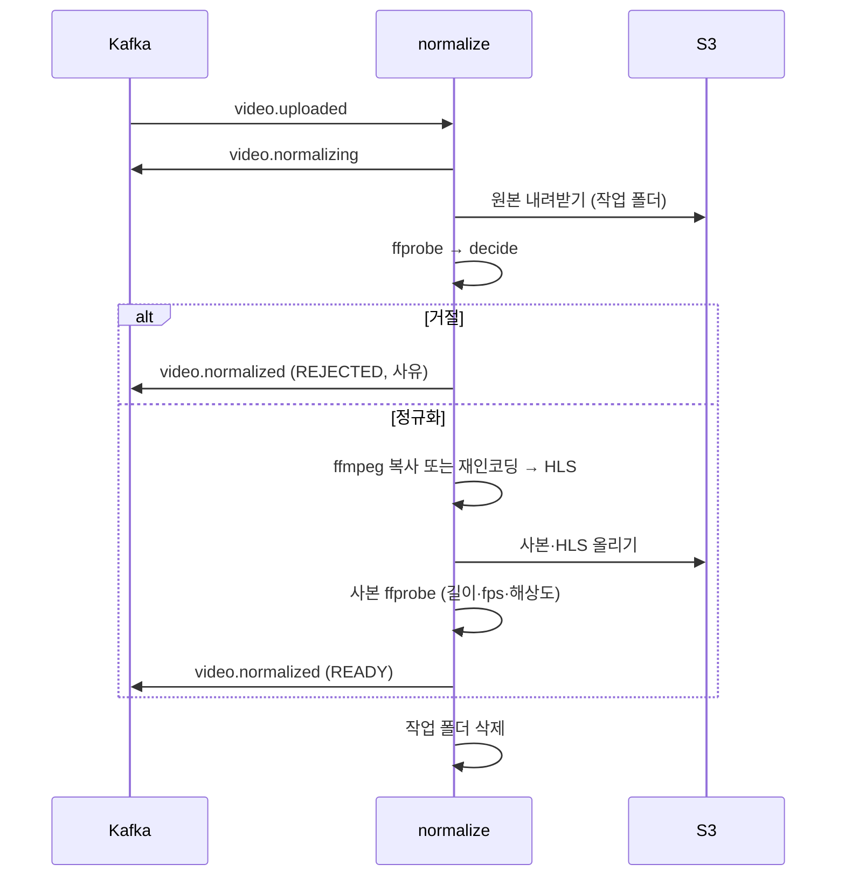

# Plan: SPEC-007 영상 정규화 — ai

- spec: docs 레포 `docs/specs/SPEC-007-video-normalize/spec.md`
- 계약: docs 레포 `docs/contracts/events/video.normalizing.schema.json`, `video.normalized.schema.json`, `docs/contracts/asyncapi/normalize.yaml`

## 1. 요약

새 워커 `services/normalize`가 `video.uploaded`를 받아 `video.normalizing`을 발행하고, 원본을 내려받아 ffprobe로 검증한다. 거절 조건이면 사유와 함께 `video.normalized(REJECTED)`를, 아니면 복사 또는 재인코딩으로 정규화 사본을 만들고 HLS를 잘라 저장한 뒤 `video.normalized(READY)`를 발행한다. ffprobe·ffmpeg는 시스템 명령을 subprocess로 부르고, 판정 규칙은 ffmpeg 없이 테스트할 수 있는 순수 함수로 둔다. `libs/contracts`에 두 이벤트 모델, `libs/common`에 워커 health 서버를 더한다.

## 2. 담당 요구사항

| 요구사항 | 담당 모듈 / 컴포넌트 | 검증 테스트 |
| --- | --- | --- |
| R-1 | `normalize.service` | `test_service.py::test_r1_publishes_normalizing_before_probe` |
| R-2 | `normalize.service`, `normalize.ffmpeg` | `test_service.py::test_r2_accepted_video_is_stored`, `test_ffmpeg.py::test_r2_*` |
| R-3 | `normalize.decision`, `normalize.ffmpeg` | `test_decision.py::test_r3_*`, `test_ffmpeg.py::test_r3_h264_cfr_is_copied` |
| R-4 | `normalize.decision`, `normalize.ffmpeg` | `test_decision.py::test_r4_*`, `test_ffmpeg.py::test_r4_*` |
| R-5 | `normalize.ffmpeg`, `normalize.service` | `test_ffmpeg.py::test_r5_hls_playlist_and_segments`, `test_service.py::test_r5_*` |
| R-6 | `normalize.service`, `vlm_contracts.events` | `test_service.py::test_r6_ready_event_payload`, 계약 테스트 |
| R-7 | `normalize.probe`, `normalize.service` | `test_probe.py::test_r7_*`, `test_ffmpeg.py::test_r7_corrupt_file` |
| R-8 | `normalize.decision` | `test_decision.py::test_r8_*`, `test_ffmpeg.py::test_r8_audio_only` |
| R-9 | `normalize.decision` | `test_decision.py::test_r9_*` |
| R-10 | `normalize.decision` | `test_decision.py::test_r10_*`, `test_ffmpeg.py::test_r10_half_second` |
| R-11 | `normalize.decision` | `test_decision.py::test_r11_*` |
| R-12 | `normalize.service` | `test_service.py::test_r12_decode_failure_rejects` |
| R-13 | `normalize.service`, `vlm_messaging` | `test_service.py::test_r13_storage_error_propagates`, `test_worker_e2e.py::test_r13_*` |
| R-14 | `normalize.ids` | `test_ids.py::test_r14_*` |
| R-22 | `vlm_common.health` | `test_health.py::test_r22_*` |
| R-23 | `vlm_common.health`, `vlm_messaging.worker` | `test_health.py::test_r23_*`, `test_worker.py::test_r23_ready_after_subscribe` |
| NFR-1, NFR-2 | `normalize.ffmpeg` | `scripts/bench_normalize.sh` 수동 측정(결과를 PR에 기록) |
| NFR-3 | `vlm_messaging.worker` | 기존 `test_worker.py::test_stop_during_processing_leaves_offset_uncommitted` |
| NFR-4 | `normalize.service` | `test_service.py::test_nfr4_logs_have_no_file_name` |
| NFR-5 | `normalize.service` | `test_service.py::test_nfr5_work_dir_removed_on_success_and_failure` |

R-15~R-21, NFR-6은 backend(media-service) 담당이다.

## 3. 원칙 점검

| 원칙 | 준수 | 비고 |
| --- | --- | --- |
| I 스펙 우선 — spec이 Approved 상태인가 | ☑ | docs#48 머지 |
| II 계약 우선 — 계약 변경이 먼저 머지됐는가 | ☑ | docs#49 머지 |
| III 테스트 우선 — 모든 R-*에 테스트가 매핑되고, 태스크가 요구사항 단위 TDD 사이클로 나뉘었는가 | ☑ | NFR-1·2는 성능 측정 스크립트로 확인 |
| IV 서비스 자율성 — 다른 서비스 DB나 코드에 직접 의존하지 않는가 | ☑ | 결과는 이벤트와 S3로만 내보냄 |
| V 단순성 — 새 의존성이나 추상화가 정당한가 | ☑ | 새 파이썬 의존성 없음. ffmpeg는 시스템 패키지(사용자 확인). `MediaTool` 프로토콜은 ffmpeg 없는 단위 테스트에 필요해서 둠 |
| VI 관측 가능성 — 로그, 추적, health를 갖췄는가 | ☑ | JSON 로그, traceparent 전달, `/health`·`/ready` |
| VII 보안 — 입력 검증, 인가, 비밀값 처리를 했는가 | ☑ | 이벤트는 계약 모델로 검증, ffmpeg 인자는 목록으로 넘겨 셸을 거치지 않음, 비밀값 없음 |
| VIII 문서·주석 — spec·계약·plan과 구현이 일치하고, 주석이 왜를 설명하는가 | ☑ | |
| IX GitOps — AWS 변경은 infra, 클러스터 변경은 gitops 레포를 거치는가 | ☑ | 배포 매니페스트는 이후 gitops에서 |

## 4. 기술 설계

### 변경 대상

| 경로 | 변경 |
| --- | --- |
| `libs/contracts/src/vlm_contracts/events.py` | `VideoNormalizing`, `VideoNormalized`(결과별 null 규칙 검증), `RejectReason` 추가 |
| `libs/common/src/vlm_common/health.py` | `HealthState`(beat, ready), `serve_health(state, port)` — 표준 라이브러리 HTTP 서버를 데몬 스레드로 |
| `libs/messaging/src/vlm_messaging/worker.py` | 선택 인자 `health`: 루프마다 `beat()`, 구독 시작 후 `mark_ready()` |
| `services/normalize/src/normalize/settings.py` | `NormalizeSettings`: Kafka, 그룹, 작업 폴더, 길이 하한·상한, fps 상한, HLS 조각 길이, health 포트 |
| `services/normalize/src/normalize/probe.py` | ffprobe JSON → `ProbeResult`(영상 유무, 코덱, 길이, 평균·기본 fps, 해상도) |
| `services/normalize/src/normalize/decision.py` | `decide(probe, limits)` → `Reject(reason)` 또는 `Normalize(mode=copy\|transcode, fps)` |
| `services/normalize/src/normalize/ffmpeg.py` | `MediaTool` 프로토콜과 `FfmpegTool`(probe, normalize, make_hls). `MediaReadError`, `DecodeError` |
| `services/normalize/src/normalize/ids.py` | 저장 경로·이벤트 ID(uuid5) 결정 함수 |
| `services/normalize/src/normalize/service.py` | `NormalizeService.handle(event, ctx)` 처리 순서 전체 |
| `services/normalize/src/normalize/__main__.py` | 설정·로그·health·저장소·발행기·워커 연결 |
| `services/normalize/Dockerfile` | `runtime`(ffmpeg, non-root), `test`(개발 의존성) 단계 |
| `libs/testing` | 테스트 전용 testcontainers 도우미(Kafka·SeaweedFS). libs·서비스 테스트가 같이 쓴다 |
| `.github/workflows/checks.yml` | hadolint, normalize 이미지 `test` 단계 실행 job |
| 루트 `pyproject.toml` | 멤버 `services/normalize` 추가, mypy `files`에 `services` 추가 |

### 데이터 모델

해당 없음(DB 없음). 저장 경로는 결정적이다.

- 정규화 사본: `sources/<sourceId>/normalized/video.mp4`
- HLS: `sources/<sourceId>/normalized/hls/index.m3u8`, `seg_00000.ts` …

### API / 이벤트

- 소비: `video.uploaded` (그룹 `normalize`, 재시도 `video.uploaded.normalize.retry`, DLQ `normalize.dlq`)
- 발행: `video.normalizing`, `video.normalized` (키 sourceId, traceparent 이어 감)
- 이벤트 ID: `uuid5(NAMESPACE_URL, "vlm:<eventType>:<sourceId>")`

### 상호작용

판정 규칙(`decide`)

| 순서 | 조건 | 결과 |
| --- | --- | --- |
| 1 | ffprobe 실패 | `UNREADABLE` (probe 단계에서) |
| 2 | 영상 스트림 없음 | `NO_VIDEO_STREAM` |
| 3 | 길이 또는 평균 fps 없음·0 이하 | `MISSING_METADATA` |
| 4 | 길이 < 하한 | `TOO_SHORT` |
| 5 | 길이 > 상한 | `TOO_LONG` |
| 6 | H.264이고 평균 fps와 기본 fps(`r_frame_rate`)가 1% 안에서 같음. 평균 fps는 `-count_packets`의 패킷 수 ÷ 영상 스트림 길이(mkv는 `avg_frame_rate`가 가변 프레임률을 숨긴다) | 복사 |
| 7 | 그 밖 | 재인코딩, fps = min(평균 fps, 상한) |

- ffmpeg가 0이 아닌 코드로 끝나면 `DECODE_FAILED`로 거절한다. 저장소·Kafka 오류는 예외를 그대로 던져 워커가 재시도한다(R-13).
- 원본이 저장소에 없으면(이미 삭제된 영상) 아무것도 더 발행하지 않고 끝낸다. 먼저 발행한 `video.normalizing`은 media-service가 `DELETED`라 무시한다(R-18).
- 재인코딩: `libx264`, `-preset veryfast`, `-crf 23`, `yuv420p`, 고정 fps. 음성은 AAC면 복사, 아니면 AAC로 인코딩. 모든 경우 `-movflags +faststart`.
- HLS: 정규화 사본을 `-c copy`로 잘라 VOD 재생 목록을 만든다. 조각 경계는 키프레임이라 길이가 설정 값과 조금 다를 수 있다.

## 5. 대안과 선택 이유

| 대안 | 장점 | 단점 | 선택 |
| --- | --- | --- | --- |
| 시스템 ffmpeg + subprocess | 새 파이썬 의존성 없음, 운영과 같은 ffmpeg로 테스트 | 로컬에 ffmpeg 필요 → Docker로 테스트 | ✅ (사용자 확인) |
| PyAV | 시스템 설치 불필요 | 내장 빌드의 x264·라이선스 확인, HLS 옵션 직접 구현 | |
| VFR을 프레임 간격 분석으로 판정 | 정확함 | 전체 프레임 읽기라 느림 | |
| 패킷 수로 잰 평균 fps와 기본 fps 비교로 VFR 판정 | ffprobe 한 번(디코딩 없음) | 패킷을 끝까지 읽음 | ✅ (컨테이너가 적은 avg_frame_rate만 보면 mkv VFR을 놓쳐서 바꿈) |

## 6. 테스트 전략

- 단위(로컬, ffmpeg 불필요): `probe`(ffprobe JSON 고정 데이터), `decision`, `ids`, `service`(가짜 `MediaTool`·`InMemoryStorage`·기록용 발행기), `health`
- ffmpeg 통합(Docker `test` 단계): `FfmpegTool`에 ffmpeg `lavfi`로 만든 짧은 영상(H.264 CFR, VFR, MPEG-4, 음성만, 0.5초, 깨진 파일)
- 워커 E2E(Docker `test` 단계 + testcontainers Kafka·SeaweedFS): `video.uploaded` 발행 → `video.normalizing`·`video.normalized` 수신, 저장 경로 확인
- 계약: `libs/contracts` 계약 테스트에 두 이벤트 등록
- 성능(NFR-1·2): `scripts/bench_normalize.sh`로 1080p 10분 영상을 만들어 Docker에서 측정하고 PR에 기록한다(CI에서 돌리기엔 길다).

## 7. 리스크와 롤백

- 리스크: 컨테이너 안 testcontainers는 형제 컨테이너 주소를 맞춰야 한다 → 테스트 컨테이너에 Docker 소켓과 `host.docker.internal`을 연결하고 Kafka 광고 주소를 같은 호스트로 둔다.
- 리스크: 4시간 영상 재인코딩은 오래 걸려 Kafka 재배치가 잦을 수 있다 → 워커는 처리 중에도 poll을 계속하므로 그룹에서 빠지지 않는다(1단계 messaging).
- 롤백: normalize 배포를 내리면 영상이 `UPLOADED`에 머문다. 다시 올리면 DLQ·재시도로 남은 메시지를 처리한다.

## 8. 배포 고려사항

- 환경변수: `KAFKA_BOOTSTRAP`, `S3_BUCKET`, `S3_ENDPOINT_URL`, `S3_PATH_STYLE`, `S3_REGION`, `NORMALIZE_MAX_DURATION_S` 등. 레포 `.env.example`과 루트 `local/.env.example`에 추가한다.
- 로컬 compose에 normalize 추가(docs 레포 `local/`), 토픽 `video.normalizing`, `video.normalized`, `video.uploaded.normalize.retry`, `normalize.dlq` 생성.
- 배포 순서: 계약 → media-service(이벤트 소비) → normalize. media-service가 먼저 없어도 이벤트는 Kafka에 남는다.
