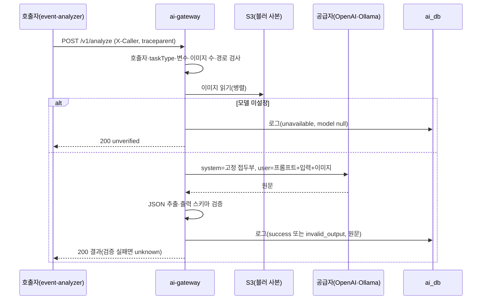

# Plan: SPEC-009 ai-gateway 분석 호출 — ai

- spec: docs 레포 `docs/specs/SPEC-009-ai-gateway-analyze/spec.md`
- 계약: docs 레포 `docs/contracts/openapi/ai-gateway.yaml`(0.1.0), `docs/contracts/prompts/`(`_prefix.md`, `event_judge/`), `docs/contracts/taxonomy/v1/`, `docs/contracts/events/video.deleted.schema.json`

## 1. 요약

`services/ai-gateway`를 FastAPI 서버로 만든다. `/v1/analyze`는 호출자 헤더와 이미지 경로를 검사하고, docs 계약에서 읽은 프롬프트(버전 ID는 내용 해시)로 프로필의 VLM Adapter를 부른 뒤, 응답의 JSON을 계약의 출력 스키마(jsonschema)로 검증해 돌려준다. 호출마다 결과와 모델 원문을 `ai.ai_call_log`(PostgreSQL, SQLAlchemy async + Alembic)에 남긴다. 같은 프로세스의 백그라운드 스레드에서 `libs/messaging`의 `KafkaWorker`로 `video.deleted`를 받아 그 영상의 원문을 지운다.

## 2. 담당 요구사항

| 요구사항 | 담당 모듈 / 컴포넌트 | 검증 테스트 |
| --- | --- | --- |
| R-1 | `api.py`, `analyze.py` | `test_analyze_api.py::test_r1_*` |
| R-2 | `api.py`(요청 모델), `prompts.py`(입력 스키마) | `test_analyze_api.py::test_r2_*` |
| R-3 | `api.py`, `prompts.py` | `test_analyze_api.py::test_r3_*` |
| R-4 | `analyze.py`, `profile.py` | `test_analyze_api.py::test_r4_*` |
| R-5 | `output.py` | `test_output.py` |
| R-6 | `output.py`, `analyze.py`, `prompts.py`(`PromptTask.fallback`) | `test_output.py`, `test_analyze_api.py::test_r6_*` |
| R-7 | 계약 출력 스키마(if/then) + `output.py` | `test_output.py::test_r7_*` |
| R-8 | `analyze.py` | `test_analyze_api.py::test_r8_*` |
| R-9, R-10 | `images.py` | `test_images.py`, `test_analyze_api.py::test_r9_*`, `test_r10_*` |
| R-11 | `images.py` | `test_analyze_api.py::test_r11_*` |
| R-12 | `prompts.py`, `adapters/openai.py` | `test_prompts.py::test_r12_*`, `test_openai_adapter.py` |
| R-13 | `prompts.py`(대체 결과 정의도 해시에 넣는다) | `test_prompts.py::test_r13_*` |
| R-14 | `profile.py`, `prompts.py`(예시·대체 결과 검증), `registry_bundle.py`(묶음 설정), `main.py`(lifespan) | `test_profile.py`, `test_prompts.py`, `test_registry_bundle.py`, `test_startup.py`, `test_startup_e2e.py` |
| R-15 | `profile.py` | `test_startup.py::test_r15_*` |
| R-16 | `api.py` | `test_analyze_api.py::test_r16_*` |
| R-17 | `call_log.py` | `test_call_log.py`(PostgreSQL) |
| R-18, R-19 | `adapters/openai.py` | `test_openai_adapter.py`(httpx2 MockTransport), `test_analyze_api.py::test_r18_*`, `test_r19_*` |
| R-20, R-21 | `deletion.py` | `test_deletion.py`(PostgreSQL), `test_deletion_e2e.py`(Kafka) |
| R-22, R-23 | `main.py`, `health.py` | `test_health.py` |
| R-24 | Registry 폴더 규약, `adapters/mock.py`(출력 예시) | `test_mock_adapter.py::test_spec009_r24_*`, `test_analyze_api.py::test_spec009_r24_*`(`extended_registry_dir`의 `sample_check`) |
| R-25 | `prompts.py`(`fallback.json`), `output.py`, `analyze.py` | `test_prompts.py::test_spec009_r25_*`, `test_analyze_api.py::test_spec009_r25_*` |
| R-26, R-27, R-28 | `registry_bundle.py`, `settings.py`, `main.py`, `libs/storage` `artifacts.fetch_file` | `test_registry_bundle.py`, `libs/storage/tests/test_artifacts.py::test_spec009_r2[678]_*`, `test_startup_e2e.py::test_spec009_r2[67]_*`(SeaweedFS) |
| R-29, R-30 | `prompts.py`(`taxonomy_version`), `analyze.py`, `api.py`, `call_log.py`, `db/migrations/versions/0003_*` | `test_prompts.py::test_spec009_r29_*`·`test_spec009_r30_*`, `test_analyze_api.py::test_spec009_r29_*`, `test_call_log.py::test_spec009_r17_saves_every_field`(PostgreSQL), `test_contract.py` |
| NFR-1 | 전체 | `test_overhead.py`(integration, mock Adapter, 이미지 10장) |
| NFR-2 | `adapters/` | `test_architecture.py`(openai import 위치 검사) |
| NFR-3 | `analyze.py`, 로그 | `test_analyze_api.py::test_nfr3_*`(caplog) |
| NFR-4 | `settings.py` | `test_startup.py::test_nfr4_*`(키가 `SecretStr`, repr에 노출 없음) |
| NFR-5 | `api.py`, `adapters/openai.py` | `test_openai_adapter.py::test_nfr5_*` |
| NFR-6 | `call_log.py`(uuid4 호출 ID) | `test_call_log.py::test_nfr6_*` |

## 3. 원칙 점검

| 원칙 | 준수 | 비고 |
| --- | --- | --- |
| I 스펙 우선 — spec이 Approved 상태인가 | ☑ | docs #53 머지, 미결 사항 없음 |
| II 계약 우선 — 계약 변경이 먼저 머지됐는가 | ☑ | docs #54 머지 |
| III 테스트 우선 — 모든 R-*에 테스트가 매핑되고, 태스크가 요구사항 단위 TDD 사이클로 나뉘었는가 | ☑ | 2절, tasks.md |
| IV 서비스 자율성 — 다른 서비스 DB나 코드에 직접 의존하지 않는가 | ☑ | 자기 DB(ai_db)만 쓴다. 삭제는 `video.deleted` 이벤트로 받는다 |
| V 단순성 — 새 의존성이나 추상화가 정당한가 | ☑ | 새 의존성은 5절. Adapter 인터페이스는 ADR-0008 교체 원칙에 필요하다. 오류 핸들러는 HTTP 서비스가 하나뿐이라 `libs/common`이 아니라 서비스 안에 둔다(두 번째 HTTP 서비스가 생기면 옮긴다) |
| VI 관측 가능성 — 로그, 추적, health를 갖췄는가 | ☑ | JSON 로그, `traceparent` 이어 받기, `/health`·`/ready`, 호출 로그에 토큰 수·지연 |
| VII 보안 — 입력 검증, 인가, 비밀값 처리를 했는가 | ☑ | 요청·변수 스키마 검증, 호출자 허용 목록, 블러 경로 허용 패턴, API 키 `SecretStr` |
| VIII 문서·주석 — spec·계약·plan과 구현이 일치하고, 주석이 왜를 설명하는가 | ☑ | AGENTS.md의 프롬프트 위치(ai 레포 → docs 계약)를 이 PR에서 고친다 |
| IX GitOps — AWS 변경은 infra, 클러스터 변경은 gitops 레포를 거치는가 | ☑ | 이번 범위에 배포 변경 없음 |

## 4. 기술 설계

### 변경 대상

| 경로 | 변경 |
| --- | --- |
| `pyproject.toml` | workspace 멤버·mypy 대상에 `services/ai-gateway` 추가, dev 의존성(httpx, types-jsonschema), vlm-testing에 testcontainers[postgres] |
| `services/ai-gateway/pyproject.toml` | 새 멤버. fastapi, uvicorn, sqlalchemy[asyncio], asyncpg, alembic, openai, jsonschema, vlm-common·contracts·messaging·storage |
| `services/ai-gateway/src/ai_gateway/settings.py` | `GatewaySettings`(접두사 `AI_GATEWAY_`): DB URL, 프로필 경로, 계약 폴더, mock 허용, Kafka 주소·그룹, 공급자 API 키(`SecretStr`) |
| `.../profile.py` | `GatewayProfile`(TOML, `vlm_common.profile`): 허용 호출자, 허용 이미지 패턴, `[adapters.<이름>]`(종류, base_url), `[tasks.<taskType>]`(Adapter, 모델, 출력 상한, 이미지 상한, 제한 시간, 재시도 수) |
| `.../prompts.py` | Prompt Registry: `_prefix.md`, `<taskType>/prompt.md`·`input.schema.json`·`output.schema.json`과 참조한 분류 체계를 읽어 검증기와 버전 ID(`<taskType>@<sha256 앞 12자리>`)를 만든다 |
| `.../images.py` | 경로 검사(R-9, R-10)와 저장소 읽기(R-11). 저장소는 동기 boto3라 `asyncio.to_thread`로 병렬로 읽는다 |
| `.../adapters/base.py` | `VlmAdapter` Protocol, `ProviderUnavailableError`, `ProviderFailedError`, 호출 결과(원문, 토큰 수) |
| `.../adapters/openai.py` | `openai`·`openai_compatible` 공통 구현(AsyncOpenAI, base_url만 다름). 고정 접두부는 system 메시지, 가변부(프롬프트+입력 JSON+이미지)는 user 메시지 |
| `.../adapters/mock.py` | taskType 출력 스키마의 첫 예시에, 입력 변수와 이름이 같은 필드만 입력값으로 바꿔 돌려준다(R-24). taskType별 코드가 없다. mock 허용 설정이 꺼져 있으면 기동 실패(R-15) |
| `.../output.py` | 응답에서 JSON 객체 추출(코드 블록·앞뒤 글 허용) → 출력 스키마 검증 → 실패 시 `PromptTask.fallback(..., "unknown")` |
| `registry/prompts/<taskType>/fallback.json` | 대체 결과 정의(R-25). 값 전체가 `"$status"`면 상태, `"$input.<변수>"`면 입력 변수로 바꾼다. 기동할 때 입력 스키마에 없는 변수를 쓰면 실패하고, 입력 예시로 채운 결과가 출력 스키마와 맞는지 두 상태 모두 확인한다(R-14) |
| `.../registry_bundle.py` | `build_bundle`: `prompts/`·`taxonomy/`·`profiles/*.toml`을 순서·시각·소유자를 고정한 tar.gz로 묶고 sha256을 돌려준다(같은 내용이면 같은 바이트). `open_bundle`: `fetch_file`로 받아 해시 확인 후 `data` 필터로 풀고, 다 푼 뒤 표시 파일을 남겨 다음 기동은 그 폴더를 쓴다(R-28). `resolve_sources`: 묶음 설정이 있으면 받아 푼 폴더와 그 안의 프로필, 없으면 이미지 경로(R-26). 키·해시 한쪽만, 절대 프로필 경로, 모델 버킷 없음은 `ProfileError`. CLI `python -m ai_gateway.registry_bundle`은 로컬 업로드 스크립트와 이후 CI가 쓴다 |
| `.../prompts.py`(분류 체계 버전) | taskType 스키마가 `$ref`로 참조한 파일 중 `taxonomy/<버전>/` 아래 파일의 버전 폴더 이름을 `taxonomy_version`으로 둔다(R-29). 참조가 없으면 None, 버전이 둘 이상이면 기동 실패(R-30) |
| `.../analyze.py` | 유스케이스: 경로 검사 → 이미지 읽기 → (모델 미설정이면 `unverified`) → Adapter → 출력 검증 → 호출 로그 |
| `.../call_log.py` | `ai.ai_call_log` 저장, 영상별 원문 삭제 |
| `.../api.py` | FastAPI 라우터, 요청·응답 Pydantic 모델(계약 일치), ProblemDetail 예외 핸들러 |
| `.../deletion.py` | `video.deleted` 핸들러와 `KafkaWorker` 조립. 워커는 자기 이벤트 루프를 쓰므로 DB 엔진을 따로 만든다 |
| `.../main.py` | `create_app`(lifespan), `build_production`(프로필·프롬프트·taskType 대응·DB 확인, 워커 스레드 시작), `production_app`(uvicorn factory), `/health`·`/ready` |
| `.../api.py`(traceparent) | `traceparent` 헤더 검증 후 공급자 호출 헤더·호출 로그 trace_id·완료 로그로 전달(별도 미들웨어 없음) |
| `.../db/` | 테이블 정의, Alembic 환경(`db/migrations/`, `0001_create_ai_call_log.py`), `python -m ai_gateway.db.migrate` |
| `services/ai-gateway/profiles/local.toml`, `local-mock.toml` | 로컬(Ollama `openai_compatible`), 모델 없는 로컬(mock) 프로필. 테스트는 코드에서 프로필을 만든다 |
| `services/ai-gateway/Dockerfile` | base·uv·build·runtime. runtime에 계약(`prompts/`, `taxonomy/`)을 `--build-context vlm-contracts:docs=<docs>/docs/contracts`로 복사(태그를 붙여야 hadolint DL3006·DL3022를 통과). 실행은 `uvicorn --factory ai_gateway.main:production_app` |
| `services/ai-gateway/prompts/.gitkeep` | 삭제(프롬프트는 docs 계약) |
| `.github/workflows/checks.yml` | service-images job에 ai-gateway runtime 빌드(계약 빌드 컨텍스트) |
| `AGENTS.md` | 프롬프트 위치·버전 규칙, ai-gateway 실행 명령 갱신 |
| `.env.example` | ai-gateway 환경변수 |

### 데이터 모델

`ai_db`의 스키마 `ai`(overview의 `ai.ai_call_log`). 마이그레이션 `migrations/versions/0001_create_ai_call_log.py`, 임베딩 호출용 `0002_call_log_embed.py`, 분류 체계 버전 `0003_call_log_taxonomy_version.py`.

| 컬럼 | 타입 | 비고 |
| --- | --- | --- |
| `call_id` | uuid PK | 요청마다 uuid4(NFR-6). Python 3.12에는 uuid7이 없다 |
| `caller` | text | `X-Caller` |
| `source_id` | uuid | 인덱스(R-20 삭제) |
| `task_type` | text | |
| `adapter` · `model_id` | text null | 모델 미설정이면 null |
| `prompt_version` | text | |
| `taxonomy_version` | text null | 결과 enum의 분류 체계 버전(R-29). 임베딩 호출·분류 체계를 참조하지 않는 taskType은 null |
| `status` | text | `success`·`unavailable`·`failed`·`invalid_output` (CHECK) |
| `error_code` | text null | `AI_PROVIDER_*` |
| `latency_ms` | integer | 요청 전체 |
| `image_keys` | text[] | 보낸 이미지 경로 |
| `request_config` | jsonb | 입력 설정(출력 상한, 제한 시간, 이미지 수) |
| `output` | jsonb null | 검증된 결과(출력 요약) |
| `raw_output` | text null | 모델 원문. `video.deleted` 때 null |
| `input_tokens` · `output_tokens` | integer null | 공급자 usage |
| `trace_id` | text null | |
| `created_at` | timestamptz | |

### API / 이벤트

- `POST /v1/analyze`(operationId `analyze`) — `docs/contracts/openapi/ai-gateway.yaml`
- 소비: `video.deleted`(그룹 `ai-gateway`, 재시도·DLQ는 `libs/messaging` 기본)
- `/health`, `/ready`: 계약 밖 운영 경로(포트 8000)

### 상호작용

## 5. 대안과 선택 이유

| 대안 | 장점 | 단점 | 선택 |
| --- | --- | --- | --- |
| 출력 검증: 계약 JSON Schema를 jsonschema로 그대로 사용 | 계약이 하나의 원본, taskType 추가 시 코드 변경 없음 | 의존성 추가 | ☑ (사용자 확인) |
| 출력 검증: Pydantic 모델로 다시 작성 | 타입이 코드에 드러남 | 계약과 이중 관리, 계약 테스트 별도 필요 | |
| `video.deleted` 소비: 같은 프로세스의 백그라운드 스레드 | 배포 단위 추가 없음(ADR-0009 "새 배포 단위 추가 안 함") | HTTP Pod 수만큼 소비자가 생김(같은 그룹이라 파티션 나눠 받음) | ☑ |
| `video.deleted` 소비: 별도 워커 배포 | 스케일 분리 | 배포 단위 추가, 서비스 카탈로그 변경 | |
| 공급자 일시 오류 재시도: openai SDK 내장 재시도(지수 백오프, 프로필 `max_retries`) | 직접 구현 없음 | SDK 동작에 의존 | ☑ |
| 프롬프트 반입: 이미지 빌드 시 docs 계약 복사 | 런타임에 docs 레포 접근 불필요, 이미지와 버전이 묶임 | 프롬프트만 바꿔도 이미지 재빌드 | ☑ |

## 6. 테스트 전략

- 단위: 경로 검사, Prompt Registry(버전 해시·고정 접두부·$ref 해석), 출력 추출·검증, 프로필 검증, openai Adapter(openai SDK 3.x가 쓰는 httpx2의 MockTransport로 HTTP 대체: 정상·429·5xx·시간 초과·4xx·traceparent 헤더)
- API: `httpx.AsyncClient` + `ASGITransport`, 저장소는 `InMemoryStorage`, Adapter는 가짜 구현, 호출 로그는 testcontainers PostgreSQL(integration)
- 통합: `video.deleted` → 원문 삭제(testcontainers Kafka + PostgreSQL), 운영 조립 `production_app`으로 기동·준비·mock 분석(PostgreSQL + Kafka + SeaweedFS)
- 계약: 응답 예시·요청 모델을 `ai-gateway.yaml` 스키마와 대조, 프롬프트 폴더의 예시가 스키마를 통과하는지(`CONTRACTS_DIR`)
- 성능: NFR-1은 mock Adapter·실제 PostgreSQL로 50회 p95 측정(integration)

## 7. 리스크와 롤백

- 리스크: 공급자마다 이미지 입력 형식이 달라 `openai_compatible`(Ollama)에서 실패할 수 있다. 로컬 Ollama로 수동 확인한 결과를 PR에 남긴다.
- 리스크: 출력 스키마의 `if/then`(R-7)을 모델이 자주 어기면 `unknown` 비율이 오른다. 호출 로그의 `invalid_output` 비율로 본다.
- 롤백: 새 서비스라 호출자가 아직 없다. 이미지 이전 태그로 되돌리고, 마이그레이션은 테이블 생성뿐이라 그대로 둔다.

## 8. 배포 고려사항

- 환경변수: `AI_GATEWAY_DATABASE_URL`, `AI_GATEWAY_PROFILE_PATH`, `AI_GATEWAY_CONTRACTS_DIR`, `AI_GATEWAY_ALLOW_MOCK`, `AI_GATEWAY_GROUP_ID`, `KAFKA_BOOTSTRAP`, `AI_GATEWAY_OPENAI_API_KEY`(비밀값). 레포 `.env.example`에 추가한다. 루트 `local/` compose 추가는 normalize 로컬 구성과 함께 머지한다(docs 브랜치 대기 중).
- 마이그레이션: 기동 전에 같은 이미지로 `python -m ai_gateway.db.migrate`를 한 번 실행한다. 운영 Job 구성은 배포 spec.
- 배포 순서: 호출자(event-analyzer)보다 먼저.
