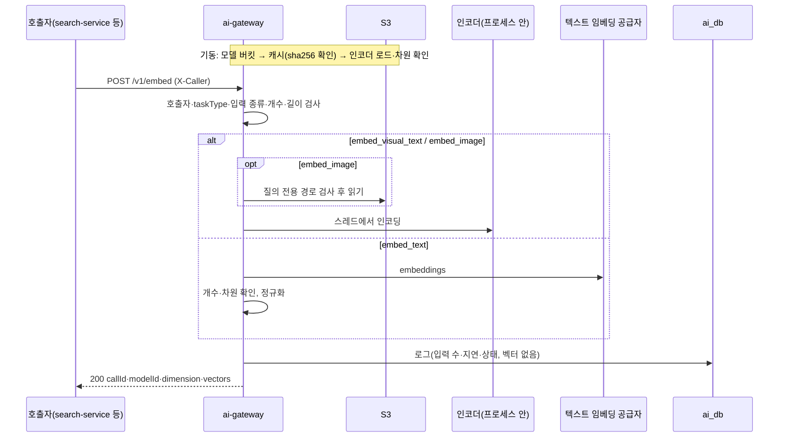

# Plan: SPEC-011 ai-gateway 벡터 생성 — ai

- spec: docs 레포 `docs/specs/SPEC-011-ai-gateway-embed/spec.md`
- 계약: docs 레포 `docs/contracts/openapi/ai-gateway.yaml`(0.2.0, `POST /v1/embed`)

## 1. 요약

ai-gateway에 `/v1/embed`를 더한다. `embed_visual_text`·`embed_image`는 새 공용 라이브러리 `libs/encoders`(`vlm_encoders`)의 `ImageTextEncoder`로 만들고, 기본 구현은 open_clip MobileCLIP2-S0다. 가중치는 기동할 때 모델 버킷에서 로컬 캐시로 받아 sha256을 확인한 뒤 한 번 로드한다. `embed_text`는 기존 Adapter(`openai`·`openai_compatible`·`mock`)에 임베딩 호출을 더해 쓴다. 호출 로그는 기존 `ai.ai_call_log`를 넓혀(영상 ID·프롬프트 버전을 비워 둘 수 있게, 입력 수 추가) 벡터와 문장 원문 없이 남긴다.

## 2. 담당 요구사항

경로의 `gw/`는 `services/ai-gateway/src/ai_gateway/`, `enc/`는 `libs/encoders/src/vlm_encoders/`다.

| 요구사항 | 담당 모듈 / 컴포넌트 | 검증 테스트 |
| --- | --- | --- |
| R-1 | `gw/embed.py`, `gw/api.py` | `test_embed_api.py::test_spec011_r1_*` |
| R-2 | `gw/embed.py`, `gw/images.py` | `test_embed_api.py::test_spec011_r2_*` |
| R-3 | `gw/embed.py`, `gw/adapters/openai.py` | `test_embed_api.py::test_spec011_r3_*`, `test_openai_adapter.py::test_spec011_r3_*` |
| R-4 | `gw/embed.py`(공급자 벡터), `enc/`(인코더 벡터) | `test_embed_api.py::test_spec011_r4_*`, `libs/encoders/tests/test_open_clip.py::test_spec011_r4_*` |
| R-5 | `enc/open_clip.py`, `enc/mock.py` | `test_open_clip.py::test_spec011_r5_*`, `test_mock_encoder.py` |
| R-6 | `enc/model_id.py`, `gw/embed.py` | `test_model_id.py`, `test_embed_api.py::test_spec011_r6_*` |
| R-7, R-26 | `gw/api.py`(요청 모델), `gw/embed.py` | `test_embed_api.py::test_spec011_r7_*`, `test_spec011_r26_*` |
| R-8 | `gw/embed.py` | `test_embed_api.py::test_spec011_r8_*` |
| R-9 | `gw/embed.py` | `test_embed_api.py::test_spec011_r9_*` |
| R-10, R-11 | `gw/images.py`(taskType별 패턴) | `test_images.py::test_spec011_*`, `test_embed_api.py::test_spec011_r10_*`, `test_spec011_r11_*` |
| R-12 | `enc/open_clip.py`(디코딩), `gw/embed.py` | `test_embed_api.py::test_spec011_r12_*`, `test_open_clip.py::test_spec011_r12_*` |
| R-13 | `gw/embed.py`(SPEC-009 호출자 검사 재사용) | `test_embed_api.py::test_spec011_r13_*` |
| R-14 | `gw/embed.py`, `gw/profile.py` | `test_embed_api.py::test_spec011_r14_*` |
| R-15, R-16 | `enc/weights.py`, `gw/main.py` | `libs/encoders/tests/test_weights.py`, `test_startup.py::test_spec011_r16_*` |
| R-17 | `enc/open_clip.py` | `test_open_clip.py::test_spec011_r17_*` |
| R-18 | `enc/weights.py` | `test_weights.py::test_spec011_r18_*` |
| R-19 | `gw/embed.py` | `test_embed_api.py::test_spec011_r19_*` |
| R-20, R-21 | `gw/adapters/openai.py` | `test_openai_adapter.py::test_spec011_r20_*`, `test_spec011_r21_*`, `test_embed_api.py` |
| R-22 | `gw/embed.py`, `gw/main.py` | `test_embed_api.py::test_spec011_r22_*` |
| R-23 | `gw/call_log.py`, `gw/embed.py` | `test_call_log.py::test_spec011_r23_*`(PostgreSQL) |
| R-24 | `gw/profile.py` | `test_profile.py::test_spec011_r24_*` |
| R-25 | `gw/main.py` | `test_startup.py::test_spec011_r25_*` |
| NFR-1, NFR-2 | 전체 | `test_embed_latency.py`(마커 `model`, 실제 가중치) |
| NFR-3 | `gw/embed.py`(스레드 실행) | `test_embed_api.py::test_spec011_nfr3_*` |
| NFR-4 | `libs/encoders` | `test_architecture.py::test_spec011_nfr4_*`(open_clip·torch import 위치) |
| NFR-5 | `gw/embed.py` | `test_embed_api.py::test_spec011_nfr5_*`(caplog) |
| NFR-6 | `Dockerfile` | 빌드 확인(가중치 파일 미포함), `test_architecture.py` |

## 3. 원칙 점검

| 원칙 | 준수 | 비고 |
| --- | --- | --- |
| I 스펙 우선 — spec이 Approved 상태인가 | ☑ | docs #62 머지, 미결 사항 없음 |
| II 계약 우선 — 계약 변경이 먼저 머지됐는가 | ☑ | docs #62(`ai-gateway.yaml` 0.2.0) |
| III 테스트 우선 — 모든 R-*에 테스트가 매핑되고, 태스크가 요구사항 단위 TDD 사이클로 나뉘었는가 | ☑ | 2절, tasks.md |
| IV 서비스 자율성 — 다른 서비스 DB나 코드에 직접 의존하지 않는가 | ☑ | 자기 DB(ai_db)만 쓴다. 인코더는 서비스가 아니라 `libs/`에 둬 frame-encoder와 공유한다(AGENTS.md "자체 실행 모델") |
| V 단순성 — 새 의존성이나 추상화가 정당한가 | ☑ | 새 의존성 open_clip_torch·torch·torchvision(사용자 확인). `ImageTextEncoder`는 ADR-0008 교체 원칙과 frame-encoder 공유에 필요하다. 가중치 전달은 문서 규칙(S3 다운로드) 그대로이고 OCI 이미지 볼륨은 미뤘다(사용자 결정) |
| VI 관측 가능성 — 로그, 추적, health를 갖췄는가 | ☑ | 호출 로그(입력 수·지연·상태·토큰), `embed completed` 구조화 로그, `traceparent`, 인코더 로드 시간 로그 |
| VII 보안 — 입력 검증, 인가, 비밀값 처리를 했는가 | ☑ | 입력 개수·길이 상한, 호출자 허용 목록, taskType별 경로 패턴, 가중치 sha256 확인, 문장 원문·벡터를 로그에 남기지 않음 |
| VIII 문서·주석 — spec·계약·plan과 구현이 일치하고, 주석이 왜를 설명하는가 | ☑ | AGENTS.md 구조(`libs/encoders`)와 마커(`model`)를 이 PR에서 고친다 |
| IX GitOps — AWS 변경은 infra, 클러스터 변경은 gitops 레포를 거치는가 | ☑ | 이번 범위에 배포 변경 없음. 모델 버킷·캐시 디스크는 배포 때 infra·gitops로 한다 |

## 4. 기술 설계

### 변경 대상

| 경로 | 변경 |
| --- | --- |
| `pyproject.toml` | workspace 멤버·mypy 대상에 `libs/encoders`. PyTorch CPU 인덱스(`[[tool.uv.index]] pytorch-cpu`, `explicit = true`)와 Linux에서만 torch·torchvision을 그 인덱스에서 받는 `[tool.uv.sources]`(PyPI의 Linux torch는 CUDA 판이라 이미지가 수 GB가 된다). pytest 마커 `model` |
| `libs/encoders/` | 새 멤버 `vlm-encoders`. 의존성 open_clip_torch, torch, torchvision, safetensors, vlm-storage |
| `enc/base.py` | `ImageTextEncoder` Protocol(`model_id`, `dimension`, `encode_texts(list[str])`, `encode_images(list[bytes])` → 길이 1 벡터 목록), `EncoderLoadError`, `ImageDecodeError` |
| `enc/model_id.py` | 모델 ID `<라이브러리>:<아키텍처>:<가중치>:<집계>` 해석(`open_clip:MobileCLIP2-S0:dfndr2b:mean-4`). 집계(`mean-4`)는 frame-encoder가 쓰는 부분이고 질의 벡터에는 쓰지 않지만, 같은 인덱스를 찾도록 ID는 그대로 돌려준다(R-6) |
| `enc/weights.py` | `fetch_weights(storage, key, sha256, cache_dir) -> Path`: 캐시 파일의 sha256이 맞으면 그대로(R-18), 아니면 임시 파일로 받아 해시를 확인한 뒤 이름을 바꾼다. 다르면 `EncoderLoadError`(R-16) |
| `enc/open_clip.py` | `OpenClipEncoder.load(model_id, weights_path, dimension)`: `open_clip.create_model_and_transforms(arch, pretrained=<로컬 경로>, image_mean=…, image_std=…, image_interpolation=…, image_resize_mode=…)`. 로컬 경로로 읽으면 전처리 값이 비므로 `open_clip.get_pretrained_cfg(arch, tag)`에서 가져와 넘긴다. 로드 뒤 텍스트·이미지 쪽 출력 차원을 한 번 계산해 프로필 차원과 비교한다(R-17). `torch.inference_mode`, eval 모드. 이미지 디코딩은 Pillow, 실패하면 `ImageDecodeError`(R-12) |
| `enc/mock.py` | `MockEncoder`: 입력의 sha256으로 결정적 벡터를 만들어 정규화한다. CI·로컬 mock 프로필 전용 |
| `gw/profile.py` | `[encoder]`(종류 `open_clip`·`mock`, 모델 ID, 차원, 가중치 키, sha256) 선택 항목. `[embed.<taskType>]`: 공통 `max_inputs`, 문장 taskType은 `max_text_chars`, `embed_image`는 `allowed_patterns`, `embed_text`는 `adapter`·`model`·`dimension`·`timeout_s`·`max_retries`. 인코더 taskType인데 `[encoder]`가 없으면 모델 미설정(R-14). `check_profile`에 mock 인코더 규칙(R-24) |
| `gw/settings.py` | `models_bucket`(모델 버킷, 기본 없음), `model_cache_dir`(기본 `/var/cache/vlm-models`, 이미지에서 실행 사용자 소유로 만든다. 공유 `/tmp`는 ruff S108에 걸린다) |
| `gw/adapters/base.py` | `TextEmbeddingAdapter` Protocol(`embed(model, texts, timeout_s, max_retries, traceparent) -> Embeddings`), `Embeddings`(벡터 목록, 입력 토큰 수), 둘을 합친 `Adapter` Protocol(`build_adapters`의 반환 타입) |
| `gw/adapters/openai.py` | `embed`: `client.embeddings.create`, 응답은 `index`로 입력 순서를 맞춘다. 오류 분류는 `complete`와 함께 쓰는 `_provider_error`(R-20, R-21) |
| `gw/adapters/mock.py` | `embed`: `MockEncoder`로 만든 결정적 벡터. 차원은 `build_adapters`가 프로필의 `embed_text` 차원으로 넘긴다 |
| `gw/images.py` | 경로 검사를 패턴 목록을 받는 함수로 나눠 `embed_image` 패턴에도 쓴다. 영상 폴더 검사(SPEC-009 R-10)는 `/v1/analyze`에만 적용 |
| `gw/embed.py` | 유스케이스: 호출자 → taskType → 입력 종류·개수·길이 → (모델 미설정이면 오류) → 경로 검사·이미지 읽기 → 인코더(스레드, NFR-3) 또는 Adapter → 차원·개수 확인(R-19)·정규화(R-4) → 호출 로그. VLM Adapter 상태를 보지 않는다(R-22) |
| `gw/errors.py` | `TooManyInputsError`(`AI_TOO_MANY_INPUTS`), `ImageUnreadableError`(`AI_IMAGE_UNREADABLE`), `ModelNotConfiguredError`(`AI_MODEL_NOT_CONFIGURED`, 503) |
| `gw/api.py` | `EmbedRequest`·`EmbedResponse`, `POST /v1/embed`. 중복된 `_valid_traceparent`를 analyze와 함께 쓰도록 정리 |
| `gw/call_log.py`, `gw/db/` | `CallLogEntry`의 `source_id`·`prompt_version`을 비워 둘 수 있게, `input_count` 추가. 마이그레이션 `0002_call_log_embed.py` |
| `gw/main.py` | `GatewayDeps`에 `encoder: ImageTextEncoder | None`, `embedders`. `load_encoder(profile, models, cache_dir)`(모델 버킷을 주입받아 단위 테스트 가능)를 `build_production`이 스레드에서 부른다. 로드가 끝나야 lifespan이 끝나므로 그 전에는 `/ready`에 응답하지 않는다(R-25) |
| `profiles/local.toml` | `[encoder]` open_clip MobileCLIP2-S0(가중치 키·sha256), `[embed.*]`, Ollama `bge-m3`(1024차원) |
| `profiles/local-mock.toml` | `[encoder] kind = "mock"`, `embed_text`는 mock Adapter |
| `services/ai-gateway/pyproject.toml`, `Dockerfile` | `vlm-encoders` 의존성. 가중치는 넣지 않는다(NFR-6). 캐시 폴더는 쓰기 가능한 `/tmp` 아래 |
| `AGENTS.md`, `.env.example` | `libs/encoders`, 마커 `model`, 새 환경변수 |

### 데이터 모델

마이그레이션 `migrations/versions/0002_call_log_embed.py`(되돌리기 가능).

| 컬럼 | 변경 | 이유 |
| --- | --- | --- |
| `source_id` | NOT NULL → NULL 허용 | 질의 문장·검색용 이미지에는 영상 ID가 없다. 원문 삭제(SPEC-009 R-20)는 원문이 있는 행만 대상이라 영향 없음 |
| `prompt_version` | NOT NULL → NULL 허용 | 임베딩에는 프롬프트가 없다 |
| `input_count` | 추가, integer NULL | 임베딩 입력 수(R-23). `/v1/analyze`는 null |

`request_config`에는 상한·제한 시간을, `output`에는 `{"dimension": n}`만 넣는다. 벡터와 문장 원문은 넣지 않는다(R-23).

### API / 이벤트

- `POST /v1/embed`(operationId `embed`) — `docs/contracts/openapi/ai-gateway.yaml` 0.2.0
- 이벤트 변경 없음

### 상호작용

## 5. 대안과 선택 이유

| 대안 | 장점 | 단점 | 선택 |
| --- | --- | --- | --- |
| 인코더: open_clip + torch(CPU) | 아키텍처 기본값 그대로, 모델 ID 규칙(`open_clip:`)과 맞음 | 이미지 약 1GB 증가 | ☑ (사용자 확인) |
| 인코더: ONNX Runtime | 이미지가 가벼움 | 변환·전처리를 직접 맞춰야 하고 모델 ID 규칙이 달라짐 | |
| 가중치: 기동 시 S3 다운로드 + sha256 | 문서 규칙 그대로, `libs/storage` 재사용, 로컬·운영 같은 코드 | Pod마다 약 300MB 받음 | ☑ (사용자 결정, 필요하면 OCI 이미지 볼륨으로 바꿈) |
| 임베딩 설정을 `[tasks.*]`에 함께 둠 | 설정 표가 하나 | `[tasks.*]`는 프롬프트와 1:1(`check_tasks`)이고 출력 상한·이미지 상한 같은 분석 전용 값이 필수라 맞지 않음 | |
| 임베딩 설정을 `[embed.*]`로 분리 | 필수 값이 taskType에 맞음 | 표가 하나 늘어남 | ☑ |
| 호출 로그 테이블을 따로 만듦 | 컬럼이 깔끔 | 호출자별 사용량을 두 곳에서 합쳐 봐야 함(overview는 호출 로그 하나) | |
| 기존 `ai_call_log`를 넓힘 | 사용량을 한 곳에서 봄 | 두 컬럼의 NOT NULL을 푼다 | ☑ |

## 6. 테스트 전략

- 단위: 모델 ID 해석, 가중치 받기(메모리 저장소: 해시 일치·불일치·캐시 재사용), mock 인코더, open_clip 인코더(무작위 초기화한 MobileCLIP2-S0를 임시 safetensors로 저장해 로드: 차원 확인·정규화·결정성·디코딩 실패. 실제 가중치를 내려받지 않는다), 이미지 벡터가 공식 pretrained 설정의 전처리로 만든 벡터와 같은지, 프로필 검증, openai Adapter `embed`(httpx2 MockTransport). 무작위 초기화 모델은 이미지가 달라도 거의 같은 벡터를 내서, 이미지 입력 순서는 픽셀 평균을 내는 가짜 모델을 생성자에 넣어 확인한다
- API: `httpx.AsyncClient` + `ASGITransport`, mock 인코더·가짜 Adapter·메모리 저장소. 호출 로그는 testcontainers PostgreSQL(integration)
- 통합: `production_app`으로 SeaweedFS 모델 버킷에서 가중치(무작위 초기화 파일)를 받아 기동·`/ready`·`/v1/embed`
- 실제 모델(마커 `model`, CI 제외): 실제 가중치로 성공 지표("a forklift"가 지게차 이미지와 더 가까움)와 NFR-1·NFR-2 지연. 로컬에서 실행해 PR 본문에 결과를 남긴다
- 계약: 요청·응답 모델과 응답 예시를 `ai-gateway.yaml` 0.2.0 스키마와 대조

## 7. 리스크와 롤백

- 리스크: 로컬 경로로 읽을 때 전처리 값을 잘못 넘기면 벡터가 조용히 틀어진다. 전처리 값 비교 테스트와 실제 모델 테스트로 막는다.
- 리스크: torch가 CPU 코어를 모두 잡아 analyze 처리나 health 응답이 늦어질 수 있다. 인코딩은 스레드에서 하고(NFR-3), 스레드 수는 Pod CPU 제한에 맞춘다(배포 spec).
- 리스크: 이미지 크기 증가로 CI service-images job이 느려진다. uv 캐시로 줄이고 시간을 PR에 남긴다.
- 롤백: 호출자가 아직 없어 이미지 이전 태그로 되돌린다. 마이그레이션 `0002`는 downgrade가 있다(NULL 행이 있으면 지운 뒤 되돌린다).

## 8. 배포 고려사항

- 환경변수: `AI_GATEWAY_MODELS_BUCKET`, `AI_GATEWAY_MODEL_CACHE_DIR`. 레포 `.env.example`과 루트 `local/.env.example`·compose에 추가한다(docs PR).
- 로컬: SeaweedFS에 모델 버킷을 만들고 가중치를 한 번 올리는 절차를 docs `local/`에 둔다. Ollama `bge-m3` pull 안내를 README에 더한다.
- 운영: 모델 버킷 읽기 권한(IRSA), 캐시용 `emptyDir`(300MB 이상)는 배포 때 infra·gitops로 한다.
- 마이그레이션 `0002`를 앱보다 먼저 실행한다(기존 `ai-gateway-migrate` 단계).
