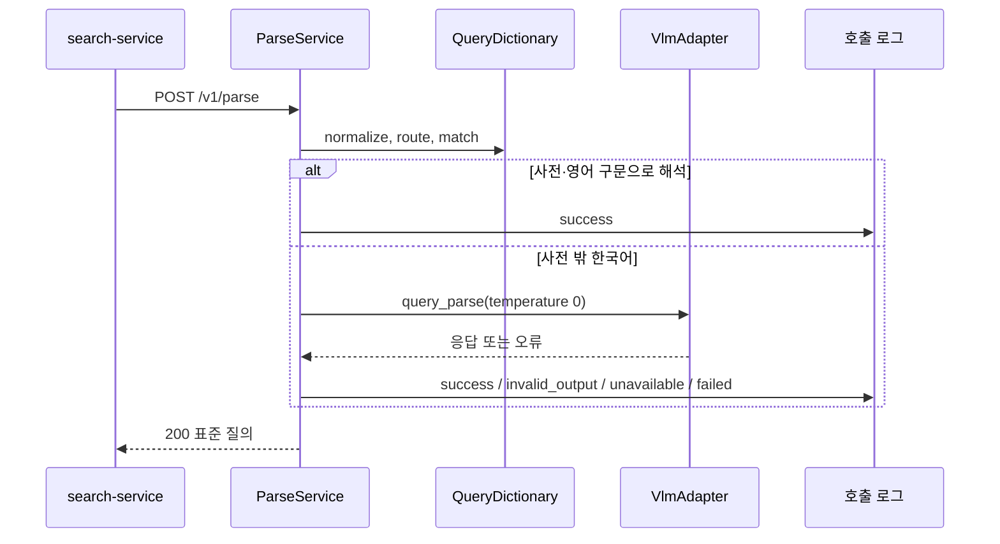

# Plan: SPEC-012 ai-gateway 질의 해석 — ai

- spec: docs 레포 `docs/specs/SPEC-012-ai-gateway-parse/spec.md`
- 계약: docs 레포 `service-contracts/openapi/ai-gateway.yaml`(0.3.0, `POST /v1/parse`), 계약 묶음 2.7.0

## 1. 요약

ai-gateway에 `/v1/parse`를 더한다. 질의 사전(`registry/query/dictionary.json`)을 기동할 때 읽어 검증하고, 요청마다 정규화 → route 결정 → 사전 매칭 → 영어 구문 → `query_parse` LLM → 안전 대체 순서로 표준 질의를 만든다. `query_parse`는 Prompt Registry의 taskType 폴더 하나로 두고(버전 ID·출력 검증·대체 결과를 기존 방식 그대로 쓴다), 모델·한도는 프로필의 새 `[parse]` 항목에 둔다. 호출 로그는 기존 `ai.ai_call_log`에 컬럼 추가 없이 남긴다.

## 2. 담당 요구사항

경로의 `gw/`는 `services/ai-gateway/src/ai_gateway/`, `t/`는 `services/ai-gateway/tests/`, `reg/`는 `services/ai-gateway/registry/`다.

| 요구사항 | 담당 모듈 / 컴포넌트 | 검증 테스트 |
| --- | --- | --- |
| R-1 | `gw/parse.py`, `gw/api.py` | `t/test_parse_api.py::test_spec012_r1_*`, `t/test_contract.py::test_spec012_*` |
| R-2 | `gw/query_dictionary.py`(`normalize`) | `t/test_query_dictionary.py::test_spec012_r2_*` |
| R-3, R-4, R-15 | `gw/query_dictionary.py`(`route`) | `test_query_dictionary.py::test_spec012_r3_*`·`r4_*`, `test_parse_api.py::test_spec012_r15_*` |
| R-5, R-6, R-7 | `gw/query_dictionary.py`(`match`) | `test_query_dictionary.py::test_spec012_r5_*`·`r6_*`·`r7_*` |
| R-8, R-9 | `gw/query_dictionary.py`(`english_phrase`), `gw/parse.py` | `test_query_dictionary.py::test_spec012_r8_*`, `test_parse_api.py::test_spec012_r9_*` |
| R-10, R-11 | `gw/parse.py`, `reg/prompts/query_parse/`, `gw/adapters/`(temperature) | `test_parse_api.py::test_spec012_r10_*`·`r11_*`, `t/test_openai_adapter.py::test_spec012_r10_*` |
| R-12, R-13, R-14 | `gw/parse.py` | `test_parse_api.py::test_spec012_r12_*`·`r13_*`·`r14_*` |
| R-16, R-17, R-18, R-19 | `gw/parse.py`, `gw/query_dictionary.py`(`visual_query`) | `test_parse_api.py::test_spec012_r16_*`~`r19_*` |
| R-20, R-21, R-22 | `gw/parse.py`, `gw/api.py` | `test_parse_api.py::test_spec012_r20_*`~`r22_*` |
| R-23, R-24, R-29 | `gw/query_dictionary.py`(`load`) | `test_query_dictionary.py::test_spec012_r23_*`·`r24_*`·`r29_*` |
| R-25 | `gw/main.py`(사전 로드가 lifespan 안) | `t/test_startup.py::test_spec012_r25_*` |
| R-26 | `gw/parse.py`(사전 해석은 Adapter를 부르지 않음) | `test_parse_api.py::test_spec012_r26_*` |
| R-27 | `gw/parse.py` | `test_parse_api.py::test_spec012_r27_*`, `t/test_call_log.py::test_spec012_r27_*`(PostgreSQL) |
| R-28 | `gw/profile.py`(`check_profile`) | `t/test_profile.py::test_spec012_r28_*` |
| R-30, R-31 | `gw/query_dictionary.py`, `gw/main.py`(`check_parse`) | `test_query_dictionary.py::test_spec012_r30_*`, `test_startup.py::test_spec012_r31_*` |
| NFR-1 | `gw/parse.py` | `test_parse_api.py::test_spec012_nfr1_*`(인메모리 호출 로그 기준 p95), 로컬 compose 측정(p95 3.8ms) |
| NFR-2 | `gw/parse.py`(Adapter에 프로필 제한 시간 전달) | `test_parse_api.py::test_spec012_nfr2_*` |
| NFR-3 | `gw/parse.py`(로그 필드) | `test_parse_api.py::test_spec012_nfr3_*` |
| NFR-4 | `reg/query/dictionary.json` | `test_query_dictionary.py::test_spec012_nfr4_*`(예시 세트) |

## 3. 원칙 점검

| 원칙 | 준수 | 비고 |
| --- | --- | --- |
| I 스펙 우선 — spec이 Approved 상태인가 | ☑ | docs #95 |
| II 계약 우선 — 계약 변경이 먼저 머지됐는가 | ☑ | 계약 묶음 2.7.0, 잠금 파일을 올린다 |
| III 테스트 우선 — 모든 R-*에 테스트가 매핑되고, 태스크가 요구사항 단위 TDD 사이클로 나뉘었는가 | ☑ | 2절, tasks.md |
| IV 서비스 자율성 — 다른 서비스 DB나 코드에 직접 의존하지 않는가 | ☑ | |
| V 단순성 — 새 의존성이나 추상화가 정당한가 | ☑ | 새 의존성·DB 마이그레이션 없음. `query_parse`는 기존 Prompt Registry 방식 |
| VI 관측 가능성 — 로그, 추적, health를 갖췄는가 | ☑ | 호출 로그·`parse completed` 로그, traceparent 전달 |
| VII 보안 — 입력 검증, 인가, 비밀값 처리를 했는가 | ☑ | 호출자 허용 목록, 길이 상한, 원문 미기록(NFR-3) |
| VIII 문서·주석 — spec·계약·plan과 구현이 일치하고, 주석이 왜를 설명하는가 | ☑ | |
| IX GitOps — AWS 변경은 infra, 클러스터 변경은 gitops 레포를 거치는가 | ☑ | 운영 프로필 변경 없음 |

## 4. 기술 설계

### 변경 대상

| 경로 | 변경 |
| --- | --- |
| `reg/query/dictionary.schema.json`, `reg/query/dictionary.json` | 질의 사전 v1. 이벤트 유형은 분류 체계 v2 `detectableEventType`을 `$ref`로 참조한다(R-30). 첫 내용은 vlm_project `KOREAN_RULES`와 이벤트 유형 8종 표현 |
| `reg/prompts/query_parse/` | `prompt.md`, `input.schema.json`(`query`), `output.schema.json`(`targets` 1~3개, `eventTypes`), `fallback.json`(`person`, 빈 목록) |
| `gw/prompts.py` | 스키마 읽기·참조 파일·분류 체계 버전 함수를 공개해 질의 사전도 같은 방식으로 검증한다(동작 불변) |
| `gw/query_dictionary.py` | `QueryDictionary.load`(스키마 검증, 표현 중복·정규형 검사, 버전 `<이름>@<내용 해시 12자리>`), `normalize`, `route`, `match`(긴 표현 우선, 사전 순서, 대상어 3개), `english_phrase`, `visual_query` |
| `gw/parse.py` | `ParseService`: 호출자·길이 검사 → 정규화 → 해석 → 표준 질의 문자열 → 호출 로그·`parse completed` 로그 |
| `gw/api.py` | `POST /v1/parse`, `ParseRequest`·`ParseResponse` |
| `gw/profile.py` | `[parse]`(`max_query_chars`, 선택 `adapter`·`model`, `max_output_tokens`, `timeout_s`, `max_retries`). Adapter 참조·mock 허용 검사(R-28) |
| `gw/adapters/base.py`, `openai.py`, `mock.py` | `complete`에 선택 인자 `temperature`. `/v1/analyze`는 지금처럼 보내지 않는다 |
| `gw/analyze.py` | 프로필 `[tasks]`에 없는 taskType(`query_parse`)은 `AI_UNKNOWN_TASK_TYPE` |
| `gw/main.py` | `check_tasks`가 `query_parse`를 `[parse]` 설정으로 본다. 사전 로드·`check_parse`(R-31)·`ParseService` 조립 |
| `gw/registry_bundle.py`, `Dockerfile` | Registry 묶음과 이미지에 `query/` 폴더 |
| `profiles/local.toml`, `local-mock.toml` | `[parse]`(로컬 Ollama `qwen3-vl:4b-instruct`, mock) |
| `service-contracts.lock` | 2.7.0 |

### 표준 질의 문자열

`qv1:<route>|<대상어,…>|<이벤트 유형,…>|<해석 방법>|<사전 버전>|<분류 체계 버전>[|<프롬프트 버전>]`. 대상어는 계약 pattern상 `|`·`,`가 없어 값이 다르면 문자열도 다르다(R-18). 앞의 `qv1`은 형식 버전이라 형식을 바꾸면 올린다.

### 영어 대상어 길이

계약은 대상어를 64자 이하로 둔다. 영어 구문(R-8)이 길면 64자 안의 마지막 단어 경계에서 자른다.

### 데이터 모델

변경 없음. 해석 호출은 `task_type = 'query_parse'`, `source_id`·`raw_output` NULL, `image_keys` 빈 목록이다. 해석 방법·사전 버전·route·이벤트 유형은 `output`(JSONB)에, LLM 설정은 `request_config`에 넣는다. 대상어는 영어 구문일 때 검색 문장과 거의 같아 넣지 않는다(R-27).

### API / 이벤트

- 제공: `POST /v1/parse`(계약 `parse`)
- 발행·구독: 없음

### 상호작용

## 5. 대안과 선택 이유

| 대안 | 장점 | 단점 | 선택 |
| --- | --- | --- | --- |
| `query_parse`를 `[tasks.query_parse]`로 설정 | 기존 설정 그대로 | `max_images`가 필요 없는데 필수이고, `/v1/analyze`로도 부를 수 있게 된다 | |
| `[parse]` 항목을 따로 둠 | 길이 상한과 LLM 설정을 한곳에 둔다 | `check_tasks`에 예외 하나 | 선택 |
| 호출 로그에 해석 방법·사전 버전 컬럼 추가 | 조회가 쉽다 | DB 스키마 변경 | |
| `output` JSONB에 넣음 | 마이그레이션이 없다 | JSON 경로로 조회 | 선택 |

## 6. 테스트 전략

- 단위: `test_query_dictionary.py`(정규화·route·매칭·영어 구문·로드 검증·NFR-4 예시 세트, 실제 사전 파일)
- API: `test_parse_api.py`(가짜 Adapter·기록용 호출 로그), `test_contract.py`(응답을 계약 `ParseResponse`로 검증)
- 통합(PostgreSQL testcontainers): 해석 호출 로그 저장
- 로컬 compose: "안전모 안 쓴 작업자" 해석 → `embed_visual_text`, Ollama 정지 상태의 `industrial-rule`·`safe-fallback`

## 7. 리스크와 롤백

- 리스크: 부분 문자열 매칭이라 짧은 표현이 다른 단어 안에서 맞을 수 있다(예: "개"). 사전에 두 글자 이상 표현만 두고, 예시 세트로 확인한다.
- 리스크: `_prefix.md`는 이벤트 확인용 공통 규칙이라 `query_parse`에도 붙는다. 작업 지시에서 출력 형식을 다시 적는다.
- 리스크: 작은 로컬 모델은 추상적인 질문에 이벤트 유형 이름을 대상어로 내기도 한다(로컬 compose에서 확인). 출력 검증이 막아 safe-fallback이 되고, 작업 지시에 금지 문장을 넣었다.
- 롤백 방법: PR revert. 사전·프롬프트만 문제면 Registry 파일을 되돌린다.
