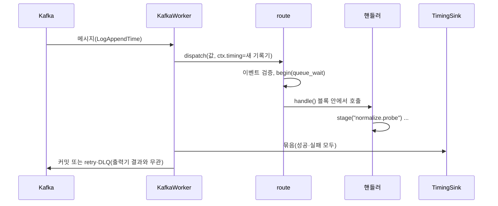

# Plan: SPEC-013 처리 단계 측정 — ai

- spec: docs 레포 `docs/specs/SPEC-013-stage-timing/spec.md`
- 계약: docs 레포 `service-contracts/stages/v1/`(단계 ID 목록, `StageTiming`), `events/stage.timing.schema.json`, `events/_envelope.schema.json`(`producedAt`), `asyncapi/stage-timing.yaml` (계약 묶음 2.3.0)

## 1. 요약

`libs/messaging`에 측정 기록기(`StageRecorder`)를 더한다. 워커가 메시지마다 기록기를 만들어 `MessageContext.timing`으로 넘기고, 경로(`route`)가 이벤트를 검증한 뒤 큐 대기와 핸들러 전체를 잰다. 서비스는 `ctx.timing.stage("<단계 ID>")` 블록으로 세부 단계를 잰다. 핸들러가 끝나면 워커가 기록을 묶어 출력기(`TimingSink`)로 보낸다. 기본은 JSON 로그, 설정을 켜면 `stage.timing` Kafka 발행이다. 발행기는 이벤트 봉투에 `producedAt`을 채운다. normalize는 probe·transcode·hls·store를 단계 블록으로 감싼다.

## 2. 담당 요구사항

경로의 `msg/`는 `libs/messaging/src/vlm_messaging/`, `con/`은 `libs/contracts/src/vlm_contracts/`다.

| 요구사항 | 담당 모듈 / 컴포넌트 | 검증 테스트 |
| --- | --- | --- |
| R-1, R-2 | `msg/timing.py`(`StageRecorder.begin`), `msg/worker.py`(브로커 적재 시각) | `libs/messaging/tests/test_timing.py::test_spec013_r1_*`·`r2_*`, `test_worker.py::test_spec013_r1_*`(Kafka) |
| R-3, R-4 | `msg/timing.py`(`handle`, `stage`), `msg/worker.py`(`route`) | `test_timing.py::test_spec013_r3_*`·`r4_*` |
| R-5 | `msg/timing.py`(`LogTimingSink`, `KafkaTimingSink`), `msg/worker.py` | `test_timing.py::test_spec013_r5_*`, `test_worker.py::test_spec013_r5_*`(Kafka, 계약 스키마 검증) |
| R-6 | `msg/worker.py` | `test_worker.py::test_spec013_r6_*`(Kafka) |
| R-7 | `msg/timing.py`(uuid5) | `test_timing.py::test_spec013_r7_*` |
| R-8 | `msg/publisher.py` | `test_publisher.py::test_spec013_r8_*`(Kafka) |
| R-9 | `services/normalize/src/normalize/service.py` | `services/normalize/tests/test_service.py::test_spec013_r9_*` |
| R-10 | `con/stages.py`(`StageId`), `msg/worker.py`(소비 그룹 단계 확인) | `libs/contracts/tests/test_stage_contracts.py`, `test_timing.py::test_spec013_r10_*` |
| NFR-1 | `con/stages.py`(측정 대상 필드) | `test_stage_contracts.py`(계약에 없는 필드 금지), `test_timing.py::test_spec013_nfr1_*` |
| NFR-2 | `msg/timing.py` | `test_timing.py::test_spec013_nfr2_*` |

## 3. 원칙 점검

| 원칙 | 준수 | 비고 |
| --- | --- | --- |
| I 스펙 우선 — spec이 Approved 상태인가 | ☑ | docs #85 |
| II 계약 우선 — 계약 변경이 먼저 머지됐는가 | ☑ | 계약 묶음 2.3.0, 잠금 파일을 올린다 |
| III 테스트 우선 — 모든 R-*에 테스트가 매핑되고, 태스크가 요구사항 단위 TDD 사이클로 나뉘었는가 | ☑ | 2절, tasks.md |
| IV 서비스 자율성 — 다른 서비스 DB나 코드에 직접 의존하지 않는가 | ☑ | 공통 코드는 `libs/` |
| V 단순성 — 새 의존성이나 추상화가 정당한가 | ☑ | 새 의존성 없음. 출력기는 로그·Kafka 두 구현이라 Protocol 하나만 둔다 |
| VI 관측 가능성 — 로그, 추적, health를 갖췄는가 | ☑ | 기록에 traceId를 싣는다 |
| VII 보안 — 입력 검증, 인가, 비밀값 처리를 했는가 | ☑ | 기록에 소유자·경로를 싣지 않는다(NFR-1) |
| VIII 문서·주석 — spec·계약·plan과 구현이 일치하고, 주석이 왜를 설명하는가 | ☑ | |
| IX GitOps — AWS 변경은 infra, 클러스터 변경은 gitops 레포를 거치는가 | ☑ | 토픽·운영 설정은 이후 infra·gitops |

## 4. 기술 설계

### 변경 대상

| 경로 | 변경 |
| --- | --- |
| `con/events.py` | `Event.produced_at: AwareDatetime \| None`(선택 필드) |
| `con/stages.py` | `StageId`(계약 목록과 같은 `Literal`), `StageSubject`, `StageVersions`, `StageTiming`, `StageTimingBatch` |
| `msg/publisher.py` | `publish`가 발행 직전 시각을 `produced_at`에 채운 사본을 보낸다(R-8). 시계는 주입한다 |
| `msg/timing.py` | `StageRecorder`: `begin(event)`(측정 대상, queue_wait), `handle()`·`stage()` 블록(단조 시계, 경로 스택, 예외 시 `error`), `batch()`(uuid5 ID). `TimingSink` Protocol, `LogTimingSink`(`stage timing` 로그 한 줄), `KafkaTimingSink`(`stage.timing`, 키는 sourceId 또는 batchId) |
| `msg/worker.py` | `MessageContext.timing`(기본은 소비 그룹 없는 기록기). 워커가 메시지마다 기록기를 만들고(받은 시각, LogAppendTime), 핸들러가 끝나면 묶음을 출력기로 보낸다. 출력기 실패는 경고 로그만(R-6). 생성할 때 `<group>.queue_wait`·`<group>.handle`이 단계 목록에 없으면 `ValueError`(R-10). `WorkerConfig.service`(묶음의 서비스 이름, 기본은 소비 그룹) |
| `services/normalize/.../service.py`, `__main__.py`, `settings.py` | 단계 블록 4개(R-9), `STAGE_TIMING_PUBLISH` 설정으로 Kafka 출력기 선택 |
| `services/ai-gateway/.../deletion.py`, `settings.py` | `AI_GATEWAY_STAGE_TIMING_PUBLISH` 설정으로 출력기 선택 |
| `service-contracts.lock` | 2.3.0 |
| `.env.example`(normalize·ai-gateway) | 발행 설정 |

### 데이터 모델

해당 없음

### API / 이벤트

- 발행: `stage.timing`(`asyncapi/stage-timing.yaml` `publishStageTiming`), 설정을 켠 서비스만
- 모든 발행 이벤트 봉투에 `producedAt`

### 상호작용

## 5. 대안과 선택 이유

| 대안 | 장점 | 단점 | 선택 |
| --- | --- | --- | --- |
| 기록기를 `MessageContext`로 넘김 | 핸들러 서명이 그대로다. 테스트는 기본 기록기를 쓴다 | 문맥 객체가 바뀌는 상태를 가진다 | 선택 |
| `contextvars`로 현재 기록기를 찾음 | 함수 인자를 늘리지 않는다 | `asyncio.to_thread`로 넘긴 스레드에서 문맥이 복사돼 흐름이 숨는다 | |
| 단계 ID를 실행 중 계약 파일로 검사 | 목록이 바뀌어도 코드 수정이 없다 | 모든 워커 이미지에 계약 파일을 넣어야 한다 | |
| 단계 ID를 `Literal`로 두고 계약 테스트로 맞춤 | mypy가 잘못된 ID를 잡는다. 이미지에 계약이 필요 없다 | 목록을 바꾸면 코드도 고친다 | 선택 |

## 6. 테스트 전략

- 단위: `test_timing.py`(시계 주입, 경로·상태·ID·queue_wait·출력기), normalize `test_service.py`(가짜 미디어 도구로 단계 기록 확인), 계약 `test_stage_contracts.py`
- 통합(Kafka testcontainers): 발행 `producedAt`, 워커가 로그·Kafka로 묶음을 보냄, 계약 스키마 검증, 출력기 실패가 커밋을 바꾸지 않음
- 로컬 compose: 영상 하나를 올려 normalize 로그의 `stage timing` 한 줄 확인

## 7. 리스크와 롤백

- 리스크: Kafka 발행을 켜면 메시지마다 브로커 확인을 한 번 더 기다린다. 기본은 로그라 영향이 없고, 운영에서 켤 때 지연을 확인한다.
- 리스크: 재시도 토픽에서 받은 메시지의 queue_wait은 원래 발행 시각(`producedAt`) 또는 재시도 토픽 적재 시각 기준이라 백오프 대기가 섞일 수 있다. 시도 번호로 나눠 본다.
- 롤백 방법: 발행 설정을 끈다. 코드 롤백은 PR revert.
