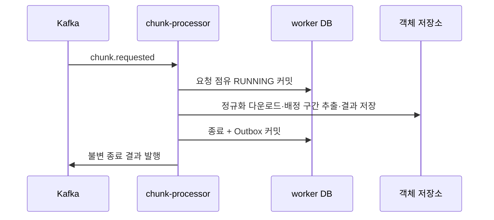

# Plan: SPEC-014 실행 워커와 종료 전달 — ai 경로

- 명세: docs `docs/specs/SPEC-014-execution-results/spec.md` (docs #87·#88 선행 머지)
- 계약: service-contracts 2.5.1, chunk.requested / chunk.execution.finished
- 담당은 ADR-0009에 따른 backend다. AI Gateway 담당의 구현과 겹치지 않는다.

## 1. 요약

기존 KafkaWorker/KafkaPublisher·S3Storage·normalize 이미지를 재사용한다. chunk-processor 기존 빈 경로를 uv 멤버로 구현한다. worker 자체 PostgreSQL에서 요청 점유를 먼저 내구 커밋하고, 실제 추출과 test 추론 대역이 끝나면 결과 객체 저장 후 종료/Outbox를 한 트랜잭션으로 저장한다. Outbox는 독립 주기와 재전달에서 같은 payload로 발행한다.

## 2. 담당 요구사항

| 요구사항 | 대상 | 검증 |
| --- | --- | --- |
| R-1 | normalize 최초 스냅샷 | ai #32 선행 머지, READY/REJECTED·재시작·broker 실패 |
| R-2 R-3 | ExecutionStore.claim | 실제 PostgreSQL 동시 점유·변경 입력 충돌 |
| R-4 | worker DB 시각·기한 | test_service.expired_never_starts |
| R-5 R-6 | ProcessingService·store.finish | 성공/확실한 실패·원자 종료/Outbox |
| R-7 | OutcomeUnknownError | 불명 timeout RUNNING 유지·재점유 0회 |
| R-8 | store.publish_pending | 전송 후 DB 실패·새 발행기의 같은 payload |
| NFR-2 NFR-3 | 실제 이미지·Kafka·trace·시간 매핑 | worker 이미지 추출 테스트 + backend ChunkLifecycleKafkaTest |

## 3. 원칙 점검

| 원칙 | 준수 | 근거 |
| --- | --- | --- |
| I 스펙 우선 | 예 | 명세/추가 stage ID 계약 선행 |
| II 계약 우선 | 예 | 고정 릴리스 2.5.1 checksum 확인 |
| III 테스트 우선 | 예 | Outbox 0건 Red 후 실제 DB Green |
| IV 서비스 자율성 | 예 | worker 자체 DB. Pipeline은 결과 Kafka로만 연결 |
| V 단순성 | 예 | 기존 sqlalchemy/asyncpg 버전 재사용, 신규 외부 라이브러리 없음 |
| VI 관측 | 예 | 기존 health/JSON logging/StageRecorder 및 traceparent |
| VII 보안 | 예 | SecretStr DB, 원 요청 검증·argv shell 미사용·test 대역 production 거부 |
| VIII 문서 | 예 | 계획/tasks·README·명세와 일치 |
| IX GitOps | 예 | 운영 배포/활성화/offset 변경 없음 |

## 4. 기술 설계

### 변경 대상

chunk_processor/service.py, store.py, processor.py, settings.py, __main__.py. libs/contracts에 요청/종료 모델과 두 worker stage ID 추가. 공통 worker/기존 AI Gateway는 수정하지 않는다.

### 데이터 모델

worker DB 전용 migrations/001_execution.sql과 checksum 버전 원장. 모든 테이블 BIGINT IDENTITY PK, created_at/updated_at. processor_executions는 execution_id unique·전체 요청 JSONB·RUNNING/SUCCEEDED/FAILED·최초 결과 JSONB. processor_outbox는 event_id/execution_id unique·payload·trace_parent·published_at이다. 마이그레이션 잠금은 worker DB 안의 advisory(14,0)이며 타 서비스 DB는 사용하지 않는다.

claim은 INSERT ON CONFLICT 후 JSONB 입력 비교를 같은 트랜잭션에서 수행한다. 승자만 실행한다. 결과 파일 저장 이후 RUNNING→종료와 Outbox INSERT가 한 트랜잭션이다. 실패하면 종료가 롤백되고 RUNNING은 남으므로 실제 AI를 임의 재실행하지 않는다.

### API / 이벤트

기존 KafkaWorker가 chunk.requested와 retry를 소비한다. 같은 실행 RUNNING 중복은 새 실행을 하지 않는다. 성공/확실한 실패만 chunk.execution.finished를 생성한다. eventId는 executionId 기반 UUID5, occurredAt은 최초 종료 시각을 저장해 재발행에서 재생성하지 않는다. 독립 발행 주기는 FOR UPDATE SKIP LOCKED로 Outbox를 처리한다. 전송 확인 전 장애는 재발행될 수 있다.

실제 AI HTTP 계약은 정의하지 않는다. verification adapter는 environment=test AND enabled=true를 명시해야만 기동한다. 기본 production/unconfigured는 활성 기동을 거부한다. 실제 영상은 S3 참조로 받아 FFmpeg로 processingRange만 추출한다. ffprobe가 보고한 첫 프레임의 실제 PTS를 기록하고 setpts=PTS-STARTPTS로 입력 청크를 만든다. 요청 시작 시각과 실제 PTS가 같다고 가정하지 않는다. 결과 artifact의 output은 검증 표시만 담고 모델 예측으로 취급하지 않는다.

### 상호작용

## 5. 대안과 선택 이유

Pipeline DB 직접 갱신은 서비스 경계를 깨므로 worker 자체 DB와 결과 이벤트를 사용한다. SQLite/메모리 원장은 다중 worker 동시성·재시작 내구성이 부족해 PostgreSQL을 선택한다. 기존 workspace의 SQLAlchemy/asyncpg를 재사용한다. 처리 timeout의 자동 임대 회수는 외부 AI 생존 여부가 불명확하므로 하지 않는다.

## 6. 테스트 전략

실제 PostgreSQL 점유·충돌·동시·종료 저장 실패·Outbox 재발행. 실제 ffmpeg 이미지에서 요청 55ms/실제 첫 프레임100ms를 검증한다. backend 실제 Kafka 통합은 normalize→v2→계획→배정→worker→종료→슬롯 반환→다음 요청과 결과 DB 실패/offset을 확인한다. 모델·프로필·AI 추론은 변경하지 않아 model suite 대상이 아니다.

## 7. 리스크와 롤백

불명 RUNNING은 자동 재점유하지 않는다. 실제 작업 종료 확인 후 Pipeline 복구 CLI가 필요하며, worker 원장 삭제/재실행은 후속 운영 절차다. 완료 저장 실패 후 객체만 남을 수 있지만 결과가 확정되기 전 발행하지 않는다. 워커를 끄고 결과/원장은 보존한다.

## 8. 배포 고려사항

CHUNK_PROCESSOR_ENABLED=false 기본. database_url은 worker 전용 DB, 환경·adapter는 production/unconfigured 기본. 테스트는 verification 성공/실패/불명 대역만 사용한다. 운영 이미지 기동/실제 추론 adapter 연결·DB/IAM/GitOps는 별도 준비다. 로컬 compose 자동 활성화는 추가하지 않는다. 새 uv 멤버는 CI의 필수 lint/type/pytest·서비스 이미지 테스트에 포함한다.

실제 Kafka 연결에서 producedAt 덮어쓰기 Red를 확인했다. docs #89 설명 보완 후 공통 prepare_event로 시각을 먼저 저장하고 Publisher는 기존 값을 보존한다. 같은 eventId 전체 입력 비교는 유지한다.

검증 결과: ruff/check·format·mypy(123 source files) 통과, 필수 pytest 478개 통과(기존 모델/별도 ffmpeg 대상 14개는 표준 marker 분리), normalize 이미지 전체 65개 및 chunk-processor 이미지 전체 13개 통과. backend 실제 연결 테스트와 전체 506개/Pipeline158개가 통과했다. 모델·프롬프트 변경은 없으며 model suite 대상이 아니다. 실제 운영 기동과 추론 연결 완료로 기록하지 않는다.

검사 예외: processor.py의 subprocess argv 호출과 test_processor.py의 두 ffmpeg/ffprobe 호출에 S603만 한 줄 단위로 허용했다(#33). 입력은 코드가 생성한 argv/UUID 경로·숫자 구간이고 shell=False다. 기존 검사 기준을 낮추거나 전체 규칙을 끄지 않았다.
