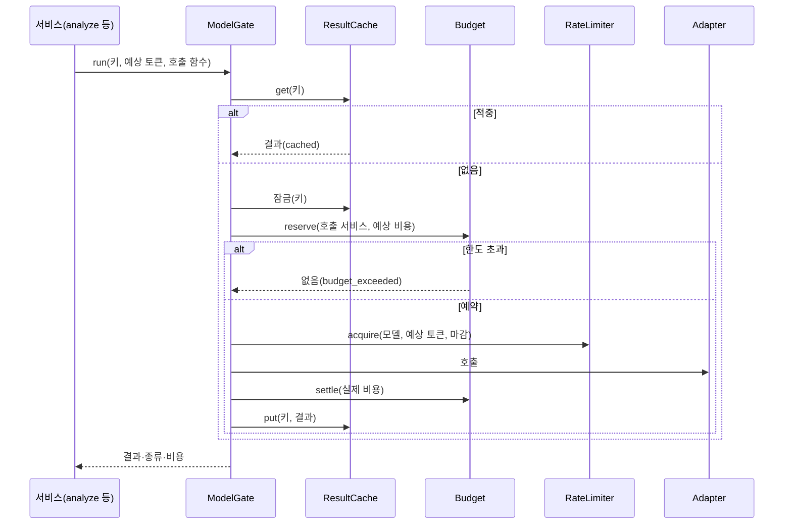

# Plan: SPEC-016 ai-gateway 결과 캐시·예산·호출 한도 — ai

- spec: docs 레포 `docs/specs/SPEC-016-ai-gateway-cache-budget/spec.md`
- 계약: docs 레포 `service-contracts/openapi/ai-gateway.yaml`(0.4.0, `AI_BUDGET_EXCEEDED`), 계약 묶음 2.8.0

## 1. 요약

외부 모델 호출 하나를 감싸는 `ModelGate`를 더한다. 순서는 캐시 조회(Redis → DB) → 동시 호출 합치기(Redis 잠금) → 예산 예약(DB) → 분당 한도(Redis 분 단위 창) → Adapter → 정산·캐시 저장이다. `/v1/analyze`, `/v1/parse`의 `query_parse`, `embed_text`가 이 게이트를 쓴다. Redis는 선택이고, 없거나 끊기면 DB 캐시·Pod별 한도로 동작한다. 예산은 DB 조건부 갱신으로 여러 Pod가 동시에 예약해도 한도를 넘지 않는다.

## 2. 담당 요구사항

경로의 `gw/`는 `services/ai-gateway/src/ai_gateway/`, `t/`는 `services/ai-gateway/tests/`다.

| 요구사항 | 담당 모듈 / 컴포넌트 | 검증 테스트 |
| --- | --- | --- |
| R-1, R-2, R-3, R-6 | `gw/result_cache.py`, `gw/gate.py` | `t/test_result_cache.py`(PostgreSQL·Redis), `t/test_gate.py`, `t/test_analyze_api.py::test_spec016_*` |
| R-4 | `gw/analyze.py`(이미지 내용 해시 키) | `test_analyze_api.py::test_spec016_r4_*` |
| R-5 | `gw/embed.py` | `t/test_embed_api.py::test_spec016_r5_*` |
| R-7, R-8 | `gw/gate.py`, `gw/result_cache.py`(잠금) | `test_gate.py::test_spec016_r7_*`·`r8_*`, `test_result_cache.py`(Redis) |
| R-9 | `gw/deletion.py`, `gw/result_cache.py` | `t/test_deletion.py::test_spec016_r9_*`, `test_result_cache.py` |
| R-10~R-14, R-21, R-22, NFR-2 | `gw/budget.py`, `gw/gate.py` | `t/test_budget.py`(PostgreSQL, 동시 예약 100건), `test_gate.py` |
| R-11(경로별 결과) | `gw/analyze.py`, `gw/parse.py`, `gw/embed.py`, `gw/errors.py` | `test_analyze_api.py`, `t/test_parse_api.py`, `test_embed_api.py`의 `test_spec016_r11_*` |
| R-15, R-16 | `gw/rate_limit.py`, `gw/gate.py` | `t/test_rate_limit.py`(가짜 시계, Redis) |
| R-17, R-18 | `gw/result_cache.py`, `gw/rate_limit.py`, `gw/main.py` | `test_result_cache.py`·`test_rate_limit.py`의 `r17_*`, `t/test_startup_e2e.py::test_spec016_r18_*` |
| R-19 | `gw/call_log.py`, 각 서비스 | `test_analyze_api.py::test_spec016_r19_*`, `t/test_call_log.py`(PostgreSQL) |
| R-20 | `gw/profile.py` | `t/test_profile.py::test_spec016_r20_*` |
| NFR-1, NFR-4 | `gw/gate.py` | 로컬 compose 측정 |
| NFR-3 | 각 서비스 로그 | 기존 로그 테스트에 캐시 적중 경우 추가 |

## 3. 원칙 점검

| 원칙 | 준수 | 비고 |
| --- | --- | --- |
| I 스펙 우선 — spec이 Approved 상태인가 | ☑ | docs #98 |
| II 계약 우선 — 계약 변경이 먼저 머지됐는가 | ☑ | 계약 묶음 2.8.0 |
| III 테스트 우선 — 모든 R-*에 테스트가 매핑되고, 태스크가 요구사항 단위 TDD 사이클로 나뉘었는가 | ☑ | 2절, tasks.md |
| IV 서비스 자율성 — 다른 서비스 DB나 코드에 직접 의존하지 않는가 | ☑ | 자기 DB(ai 스키마)와 Redis 키 접두사 `aigw:` |
| V 단순성 — 새 의존성이나 추상화가 정당한가 | ☑ | `redis`(redis-py, 사용자 승인). 분당 한도는 토큰 버킷 대신 분 단위 고정 창으로 단순하게 지킨다 |
| VI 관측 가능성 — 로그, 추적, health를 갖췄는가 | ☑ | 호출 로그에 캐시 적중·비용, Redis 장애 경고 로그 |
| VII 보안 — 입력 검증, 인가, 비밀값 처리를 했는가 | ☑ | 캐시 결과는 로그에 넣지 않음, 영상 삭제 시 캐시 삭제, Redis URL은 비밀값 설정 |
| VIII 문서·주석 — spec·계약·plan과 구현이 일치하고, 주석이 왜를 설명하는가 | ☑ | |
| IX GitOps — AWS 변경은 infra, 클러스터 변경은 gitops 레포를 거치는가 | ☑ | 운영 Redis는 이후 infra |

## 4. 기술 설계

### 변경 대상

| 경로 | 변경 |
| --- | --- |
| `gw/db/migrations/versions/0004_cache_budget.py`, `gw/db/tables.py` | `ai.ai_result_cache`, `ai.ai_budget_usage`, 호출 로그 `cache_hit`·`reserved_cost_usd`·`settled_cost_usd` |
| `gw/result_cache.py` | `ResultCache`: DB 저장소 + 선택 Redis 앞단, `get`·`put`·`delete_source`, 동시 호출 잠금(`SET NX PX`) |
| `gw/budget.py` | `Budget`: 하루(UTC)·범위(호출 서비스, 전체 `*`)별 조건부 갱신 예약, 정산, 되돌림 |
| `gw/rate_limit.py` | `RateLimiter`: Adapter·모델별 분당 요청·토큰. Redis `INCR` 분 창, 끊기면 Pod별 메모리 창 |
| `gw/gate.py` | `ModelGate.run`: 위 셋을 정해진 순서로 묶음. 결과 종류(`called`·`cached`·`budget_exceeded`)와 비용을 돌려줌 |
| `gw/analyze.py`, `gw/parse.py`, `gw/embed.py` | 게이트 사용, 경로별 예산 초과 결과(R-11), 호출 로그 항목(R-19) |
| `gw/adapters/base.py`, `openai.py` | `ProviderUnavailableError.sent`(보내지 못한 연결 오류만 False, R-13·R-22) |
| `gw/errors.py` | `BudgetExceededError`(503 `AI_BUDGET_EXCEEDED`), `RateLimitedError`(응답은 `AI_PROVIDER_UNAVAILABLE`, 로그 코드 `AI_RATE_LIMITED`) |
| `gw/profile.py` | `[cache]`(보관 기간, 앞단 TTL), `[budget]`(전체·호출 서비스별 하루 한도 USD), `[prices.<adapter>.<model>]`(100만 토큰당 USD), `[rate_limits.<adapter>.<model>]`(rpm·tpm·Pod별), taskType별 예상 입력 토큰 |
| `gw/settings.py` | `AI_GATEWAY_REDIS_URL`(선택) |
| `gw/deletion.py` | `video.deleted`에 캐시 삭제 추가 |
| `gw/main.py` | 조립. Redis는 `/ready` 조건이 아니다 |
| `profiles/*.toml`, `.env.example` | 로컬 값 |

### 캐시 키

`sha256(canonical JSON{taskType, adapter, model, promptVersion, input})`. `/v1/analyze`의 input은 이미지마다 내용 sha256(보낸 순서)과 입력 변수, `query_parse`는 정규화 문장, `embed_text`는 문장과 차원이다. 저장 값은 결과와 모델 ID·프롬프트 버전·분류 체계 버전이다.

### 예상 비용

`(예상 입력 토큰 + max_output_tokens) × 단가`. `embed_text`는 문장 수 × 문장당 예상 토큰, 출력 없음. 단가가 없으면 0(R-14). 정산은 공급자 토큰으로 하고, 없으면 예상 비용 그대로다(R-12, R-22).

### 데이터 모델

| 테이블 | 컬럼 |
| --- | --- |
| `ai.ai_result_cache` | `cache_key` PK, `task_type`, `source_id`(NULL, 인덱스), `value` JSONB, `created_at` |
| `ai.ai_budget_usage` | (`day`, `scope`) PK, `spent_usd` NUMERIC(18,6) |
| `ai.ai_call_log` | `cache_hit` BOOLEAN, `reserved_cost_usd`·`settled_cost_usd` NUMERIC(18,6), 모두 NULL 허용 |

### 상호작용

## 5. 대안과 선택 이유

| 대안 | 장점 | 단점 | 선택 |
| --- | --- | --- | --- |
| 예산을 Redis 원자 연산으로 | 빠르다 | Redis가 없으면 예산을 못 지킨다(R-17과 충돌) | |
| 예산을 DB 조건부 갱신으로 | Redis와 무관하게 정확하다 | 호출마다 DB 왕복 2번(예약·정산) | 선택 |
| 분당 한도를 토큰 버킷(Lua)으로 | 순간 몰림을 고르게 편다 | Lua 스크립트와 시계 처리가 필요하다 | |
| 분 단위 고정 창(`INCR`) | 단순하고 "분당 N 이하"를 그대로 지킨다 | 분 경계에 몰릴 수 있다 | 선택 |

## 6. 테스트 전략

- 단위: `test_gate.py`(가짜 저장소·가짜 시계), `test_rate_limit.py`(메모리 창, 가짜 시계), 프로필 검증
- 통합: PostgreSQL(캐시·예산·동시 예약 100건·호출 로그), Redis(앞단·잠금·분 창, 연결 끊김 시 대체) — testcontainers
- API: 기존 `gateway()` 도우미에 메모리 게이트를 넣어 경로별 결과 확인
- 로컬 compose: 같은 analyze 두 번, 작은 예산, Redis 정지

## 7. 리스크와 롤백

- 리스크: 정산 비용이 예상보다 크면 그날 한도를 조금 넘을 수 있다. 예상 토큰을 넉넉히 두고, 넘은 뒤 예약은 막는다(NFR-2).
- 리스크: `/v1/analyze` 캐시 키에 이미지를 다 읽어야 한다. 원래도 모델에 보내려 읽으므로 추가 읽기는 없다.
- 롤백 방법: 프로필에서 `[budget]`·`[rate_limits]`를 지우고 `AI_GATEWAY_REDIS_URL`을 비우면 예전 동작에 가깝다. 코드는 PR revert, 마이그레이션 0004는 downgrade로 되돌린다.
