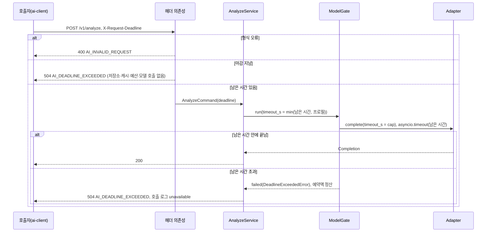

# Plan: SPEC-021 내부 동기 호출 규약 적용 (ai-gateway 마감 시간, 생성 클라이언트, 재시도 규칙) — ai

- spec: docs 레포 `docs/specs/SPEC-021-internal-call-rules/spec.md`
- 계약: `openapi/ai-gateway.yaml` 1.4.0(`X-Request-Deadline`, 504 `AI_DEADLINE_EXCEEDED`), `openapi/_common.yaml` ProblemDetail (계약 묶음 4.1.0. spec은 3.1.0에서 넣었고 뒤 spec들이 taskType과 `unverifiedReason`을 더했다. 다른 워커 작업의 선행 PR이라 잠금을 4.1.0까지 올렸다)
- 근거: docs `architecture/overview.md` "통신 규칙"의 내부 동기 호출 규약, ADR-0002, ADR-0014, handoff 3절(내부 호출 클라이언트는 생성, 재시도·마감)

## 1. 요약

세 곳을 규약에 맞춘다.

- ai-gateway: 세 operation이 `X-Request-Deadline`을 요청 경계에서 읽는다. 형식이 틀리면 400, 이미 지났으면 저장소·캐시·예산·Adapter를 부르기 전에 504로 끝낸다. 남은 시간은 Adapter 제한 시간과 게이트 대기 시간을 줄이고, 그 안에 끝나지 않으면 504로 답하며 호출 로그·예산은 공급자 시간 초과와 같은 경로로 처리한다.
- `libs/ai-client`: 요청·응답 모델을 잠금 계약에서 datamodel-code-generator로 생성해 커밋하고, 다시 생성한 결과와 다르면 pytest가 실패한다(CI는 이미 잠금 계약으로 pytest를 돌린다). 호출부는 얇은 httpx 코드만 남긴다. 모든 호출에 같은 마감을 싣고, 재시도 규칙을 호출 종류(analyze / embed·parse)로 나눈다. `embed`·`parse` 메서드를 더한다.
- event-analyzer: 바뀐 클라이언트 규칙을 그대로 쓰고, 504를 호출 실패로 기록한다(지금 코드도 4xx만 메시지를 거절하므로 동작은 같다. 테스트로 고정한다).

## 2. 담당 요구사항

경로의 `gw/`는 `services/ai-gateway/src/ai_gateway/`, `gwt/`는 `services/ai-gateway/tests/`, `ac/`는 `libs/ai-client/src/vlm_ai_client/`, `act/`는 `libs/ai-client/tests/`, `ea/`·`t/`는 `services/event-analyzer/src/event_analyzer/`·`tests/`다.

| 요구사항 | 담당 모듈 / 컴포넌트 | 검증 테스트 |
| --- | --- | --- |
| R-1 | `gw/deadline.py` `Deadline.cap`, `gw/analyze.py`·`embed.py`·`parse.py`(Adapter `timeout_s`), `gw/gate.py`(대기 시간) | `gwt/test_deadline_api.py`, `gwt/test_gate.py` |
| R-2 | `gw/api.py` 헤더 의존성 `request_deadline`, `gw/errors.py` `DeadlineExceededError` | `gwt/test_deadline_api.py`(가짜 저장소·캐시·예산·Adapter 호출 수 0) |
| R-3 | `gw/adapters/base.py` `DeadlineExceededError`(공급자 시간 초과 하위 클래스), 각 서비스의 `asyncio.timeout` | `gwt/test_deadline_api.py`, `gwt/test_contract.py`(504 본문) |
| R-4 | `gw/deadline.py` `parse_deadline_header` | `gwt/test_deadline_api.py` |
| R-5 | `Deadline` 없음 = 프로필 값 그대로 | `gwt/test_deadline_api.py`, 기존 `test_analyze_api.py`·`test_embed_api.py`·`test_parse_api.py` |
| R-6 | `ac/models.py`(생성 코드), `ac/client.py`가 생성 모델만 씀 | `act/test_ai_client_models.py`(생성 모듈 밖 `BaseModel` 없음, 왕복) |
| R-7 | `scripts/generate-clients.sh`, `libs/ai-client/pyproject.toml` `[tool.datamodel-codegen]` | `act/test_ai_client_generated.py`(잠금 계약으로 다시 생성해 비교) |
| R-8 | `vlm_common/http_call.py` `Deadline`(첫 시도 시각 + `timeout_s`), `call_with_retry` | `act/test_ai_gateway_client.py`, `libs/common/tests/test_http_call.py` |
| R-9 | `vlm_common/http_call.py` `NON_IDEMPOTENT`, `failure_of` | `act/test_ai_gateway_client.py`, `libs/common/tests/test_http_call.py` |
| R-10 | `vlm_common/http_call.py` `READ_ONLY` | `act/test_ai_gateway_client.py`, `libs/common/tests/test_http_call.py` |
| R-11 | `vlm_common/http_call.py` `call_with_retry`(재시도 전 남은 시간 확인) | `act/test_ai_gateway_client.py`, `libs/common/tests/test_http_call.py` |
| R-12 | `ac/client.py` `AiGatewayError` | `act/test_ai_gateway_client.py` |
| R-13 | `ac/client.py` `embed`, `parse` | `act/test_ai_gateway_client.py` |
| R-14 | `ea/service.py`(5xx는 실패 기록), `ea/settings.py`(재시도 설명) | `t/test_analyzer_service.py`, `t/test_analyzer_main.py` |
| NFR-1 | 헤더 의존성이 서비스 호출 전에 끝냄 | `gwt/test_deadline_latency.py`(mock 프로필, 200회 p95) |
| NFR-2 | 기존 성능 테스트 | `gwt/test_overhead.py`, `gwt/test_embed_latency.py` 그대로 통과 |

## 3. 원칙 점검

| 원칙 | 준수 | 비고 |
| --- | --- | --- |
| I 스펙 우선 | ☑ | SPEC-021 Approved (docs #116) |
| II 계약 우선 | ☑ | docs #116 머지. 묶음 3.14.0에 헤더·504가 있다. 구현 첫 태스크에서 잠금을 3.14.0으로 올린다 |
| III 테스트 우선 | ☑ | R-1~R-14, NFR-1·NFR-2 테스트 매핑. 태스크마다 요구사항 하나의 Red→Green |
| IV 서비스 자율성 | ☑ | 클라이언트는 계약에서 생성하고 ai-gateway 코드를 import하지 않는다 |
| V 단순성 | ☑ | 새 패키지는 합의된 datamodel-code-generator(개발 의존성) 하나. 마감은 값 객체 하나와 헤더 의존성 하나로 끝낸다. 미들웨어를 두지 않는다 |
| VI 관측 가능성 | ☑ | 504도 호출 로그·JSON 로그에 `AI_DEADLINE_EXCEEDED`로 남는다(R-2는 JSON 로그만, 4.2절). 클라이언트 재시도 로그에 남은 시간 |
| VII 보안 | ☑ | 헤더는 경계에서 정수 형식만 받는다. 비밀값 변경 없음 |
| VIII 문서·주석 | ☑ | 생성 파일 머리 주석에 "생성 코드, 손으로 고치지 않음"과 생성 명령. README 갱신 |
| IX GitOps | ☑ | 환경변수 이름은 바뀌지 않는다. 운영 배포는 사용자 지시 시 |

## 4. 기술 설계

### 4.1 변경 대상

| 경로 | 변경 |
| --- | --- |
| `service-contracts.lock` | 4.1.0 |
| `libs/contracts/.../stages.py`, `events.py` | 4.1.0 계약과 맞춘다(단계 ID 전체, `EventAnalyzed`의 `detectorCandidate`·`rule`·`rule+carry`·`rule+vlm*` 판정 방식·판정 방식별 `judgments` 개수·`unverifiedReason`·`carriedFromEventId`, 청크 실행 이벤트의 `jobType`, `event.candidate.vector`의 `droppedCount`). 잠금을 올리면 기존 계약 테스트가 깨지기 때문이다(7절) |
| `gw/deadline.py` (새 파일) | `Deadline`(받은 시각, 마감 epoch ms), `remaining_s()`, `cap(timeout_s)`, `expired()`, 헤더 파싱 |
| `gw/api.py` | 세 operation에 `X-Request-Deadline` 헤더 의존성. 형식 오류 400, 지난 마감 504. 명령 객체에 `deadline` |
| `gw/errors.py`, `gw/adapters/base.py` | `DeadlineExceededError` |
| `gw/analyze.py`, `gw/embed.py`, `gw/parse.py` | Adapter 제한 시간·게이트 대기에 남은 시간 반영, 504 처리 |
| `gw/gate.py` | `GateCall.deadline`. 잠금·분당 한도 대기를 부를 때마다 남은 시간으로 줄이고, Adapter 호출 전체를 `asyncio.timeout(남은 시간)`으로 감싼다(세 경로가 같은 코드를 쓴다) |
| `gwt/gateway_support.py` | `post_*`에 `headers` 인자 |
| `libs/ai-client/pyproject.toml` | `[tool.datamodel-codegen]` 생성 옵션 |
| 루트 `pyproject.toml`, `uv.lock` | dev 그룹에 `datamodel-code-generator`, 생성 파일 `libs/*-client/src/*/models.py`만 `E501` per-file-ignores, pytest `pythonpath`에 `libs/ai-client/tests` |
| `libs/common/src/vlm_common/http_call.py` (새 파일) | 내부 호출 규약 공용 코드: `Deadline`, `CallRetry`, `Failure`·`failure_of`, 규칙 `NON_IDEMPOTENT`·`READ_ONLY`, `call_with_retry`, `CallFailedError`. analysis-api·stream-service 클라이언트(SPEC-027)도 같은 코드를 쓴다 |
| `scripts/generate-clients.sh` (새 파일) | 계약(인자, `CONTRACTS_DIR`, 작업 공간 순)으로 클라이언트 lib의 `models.py`를 다시 만든다. lib → 계약 파일 표에 한 줄을 더해 다른 클라이언트도 만든다 |
| `ac/models.py` (생성) | `AnalyzeRequest`, `ImageRef`, `AnalyzeResponse`, `EmbedRequest`, `EmbedImageRef`, `EmbedResponse`, `ParseRequest`, `ParseResponse`, `ProblemDetail` 등 |
| `ac/client.py` | 손 작성 모델 삭제, `analyze`·`embed`·`parse`, `vlm_common.http_call`로 마감 헤더와 호출 종류별 재시도 |
| `ea/service.py`, `ea/__main__.py`, `ea/settings.py` | 생성 모델 import, 재시도 설명 갱신 |
| `services/ai-gateway/README.md`, `libs/ai-client` README(없으면 pyproject description), `services/event-analyzer/README.md` | 마감·재시도 규칙 |

### 4.2 ai-gateway 마감 처리

헤더 의존성 `request_deadline(x_request_deadline: Header)`이 요청마다 한 번 돈다.

1. 헤더가 없으면 `None`(R-5). 서비스는 지금처럼 프로필 값만 쓴다.
2. 값이 `^[0-9]{1,16}$`가 아니면 `InvalidRequestError`(400 `AI_INVALID_REQUEST`, `errors[].field = "X-Request-Deadline"`)(R-4). 계약 parameter의 pattern과 같다.
3. 받은 시각(`time.time()` ms)이 마감 이상이면 `DeadlineExceededError`(504)(R-2). 의존성은 서비스 메서드보다 먼저 돌므로 호출자 확인·이미지 읽기·캐시·예산·Adapter 어느 것도 부르지 않는다.
4. 그 밖이면 `Deadline(received_at, deadline_ms)`를 명령 객체에 넣는다.

- 검사 순서는 400(형식) → 504(마감)이다. 형식이 틀린 값은 마감으로 해석할 수 없기 때문이다.
- R-2의 504는 호출 로그 DB에 남기지 않고 JSON 로그(`analyze rejected`, `code`, `caller`, `deadline_lag_ms`)만 남긴다. spec이 "저장소를 부르지 않는다"고 했고 호출 로그도 DB 저장소이기 때문이다(보고 항목).
- 시계: 마감은 호출자 시계, 비교는 ai-gateway 시계다. 같은 클러스터의 NTP 오차(수 ms)는 무시한다.

R-1: 외부 모델 호출 직전에 `deadline.cap(settings.timeout_s)` = `min(남은 시간, 프로필 제한 시간)`을 Adapter의 `timeout_s`로 넘긴다. 이미지 읽기·캐시 확인에 쓴 시간이 빠지도록 "받은 시각부터 마감까지"를 호출 시점에 다시 계산한다.

- OpenAI SDK는 `timeout_s`를 시도마다 적용하고 프로필 `max_retries`만큼 다시 시도한다. 그래서 Adapter 호출 전체를 `asyncio.timeout(deadline.remaining_s())`로 한 번 더 감싼다. 시도별 제한과 전체 마감을 모두 지킨다.
- 게이트의 기다림(같은 입력의 잠금 대기 `wait_for`, 분당 한도 `acquire`, 잠금 TTL)도 `GateCall.timeout_s`를 같은 `cap` 값으로 받는다. 이 대기에서 남은 시간이 다 되면 `DeadlineExceededError`다.
- 대상은 공급자 Adapter를 부르는 경로다: `/v1/analyze`, `/v1/embed`의 `embed_text`, `/v1/parse`의 LLM 해석. 사전 해석·인코더(`embed_image`·`embed_visual_text`) 경로는 외부 모델이 아니고 스레드의 CPU 작업은 중간에 멈출 수 없어 R-2(받을 때 검사)만 적용한다(보고 항목).

R-3: `DeadlineExceededError`는 `ProviderUnavailableError`의 하위 클래스다(`status = 504`, `code = log_code = "AI_DEADLINE_EXCEEDED"`, `sent = True`).

- `asyncio.timeout`이 끊었거나, Adapter가 공급자 시간 초과(`ProviderUnavailableError`)로 끝났는데 그 시점에 마감이 지났으면 `DeadlineExceededError`로 바꾼다. 마감이 남았는데 프로필 제한 시간이 먼저 끝났으면 지금처럼 503이다.
- 게이트는 이 예외를 공급자 오류와 같은 `failed`로 받는다. `sent = True`라 예산은 예약액으로 정산하고(SPEC-016 R-22), 호출 로그는 status `unavailable`, `error_code` `AI_DEADLINE_EXCEEDED`다. 공급자 시간 초과와 같은 처리이고 코드만 원인을 구분한다.
- 게이트 대기 중(Adapter를 부르기 전) 마감이 지나면 `sent = False`로 던져 예약을 되돌린다. 공급자에 보내지 않았기 때문이다(SPEC-016 R-13).
- `/v1/parse`: 지금은 공급자 실패면 200 `safe-fallback`이다(SPEC-012). R-3과 계약 504에 따라 `DeadlineExceededError`만 fallback 대신 504로 던진다. 호출 로그는 남긴다.
- 응답 본문은 공통 ProblemDetail 핸들러가 만든다(`title` `Gateway Timeout`).



### 4.3 ai-client 생성 모델

- 생성기: datamodel-code-generator(합의됨, 루트 dev 그룹). 실행 이미지에는 들어가지 않는다. 생성 결과만 커밋한다.
- 입력: `<CONTRACTS_DIR>/openapi/ai-gateway.yaml`. `_common.yaml` 상대 `$ref`는 생성기가 따라간다. `CONTRACTS_DIR`이 없으면 다른 계약 테스트처럼 작업 공간의 `../../service-contracts`다.
- 옵션은 `libs/ai-client/pyproject.toml`의 `[tool.datamodel-codegen]` 한 곳에 둔다. 스크립트가 그 폴더에서 생성기를 실행해 이 설정을 읽고, 비교 테스트는 스크립트를 부른다.
  - `input-file-type = "openapi"`, `openapi-scopes = ["schemas", "paths"]`(`_common.yaml`의 `ProblemDetail`도 만든다), `output-model-type = "pydantic_v2.BaseModel"`, `target-python-version = "3.12"`
  - `snake-case-field`(별칭은 계약 camelCase), `allow-population-by-field-name`(호출부가 snake_case로 만든다), `use-standard-collections`, `use-union-operator`, `field-constraints`, `use-annotated`
  - `use-object-type`: 자유 객체(`variables`, `output`)가 `dict[str, Any]` 대신 `dict[str, object]`가 된다. 생성 코드에 `Any`가 없다(8절 (b)).
  - `use-type-alias`, `enum-field-as-literal = "all"`: `TaskType`·`EmbedTaskType`(열린 목록, ADR-0014)은 `str` 별칭, enum은 `Literal` 별칭이 된다. 호출부는 문자열을 그대로 쓰고 비교한다.
  - `allow-remote-refs`: `../taxonomy/v2` 상대 참조를 따라간다(잠금 체크섬으로 고정한 로컬 파일).
  - `type-overrides = { DetectableEventType = "vlm_contracts.events.DetectableEventType" }`: 생성기가 분류 체계의 `allOf` + `not: other`를 풀지 못해 빈 모델을 만든다. 같은 정의를 계약 테스트로 맞춘 `vlm_contracts` 모델로 바꾼다. 그래서 ai-client가 `vlm-contracts`를 의존한다.
  - `disable-timestamp`, `custom-file-header`: 입력 경로가 로컬·CI에서 달라 생성기 기본 머리글을 쓰면 비교가 늘 실패한다. 머리글은 "생성 코드. `scripts/generate-clients.sh`로 만든다. 손으로 고치지 않는다"로 고정한다.
  - `formatters = []`: 생성기 안의 ruff는 임시 경로에서 레포 설정을 찾지 못해 결과가 달라진다. 스크립트가 `ruff check --fix-only`·`ruff format`을 `--config <루트 pyproject.toml>`로 직접 실행한다.
  - 계약 `description`이 `Field` 문자열로 들어가 줄 길이(E501)만 넘는다. 생성 파일 `libs/*-client/src/*/models.py`만 `E501`을 per-file-ignores로 허용하고 `.claude/rules/lint.md` "설정 단위 예외"에 적었다(#44). 그 밖의 ruff 규칙과 mypy strict는 그대로 통과한다.
  - 응답 모델은 `model_config`가 없어 Pydantic 기본값(모르는 필드 무시)이고, 요청은 `additionalProperties: false`가 `extra="forbid"`로 반영된다(`act/test_ai_client_models.py`).
- R-7 비교: `act/test_ai_client_generated.py`가 같은 설정으로 `tmp_path`에 다시 생성해 `ac/models.py`와 바이트 비교한다. CI `python` job은 이미 `CONTRACTS_DIR`을 잠금 계약으로 주고 pytest를 돌리므로 workflow를 바꾸지 않는다. 로컬은 작업 공간 계약을 읽어서, docs 계약이 잠금보다 앞서 있으면 로컬에서 먼저 실패한다(다른 계약 테스트와 같다).
- R-6 확인: `act/test_ai_client_models.py`가 `vlm_ai_client` 패키지의 `models.py` 밖에 `BaseModel` 하위 클래스가 없는지 AST로 확인하고(`gwt/test_architecture.py`와 같은 방식), 계약 예시를 생성 모델로 왕복한다.

### 4.4 ai-client 호출부

```text
AiGatewayClient(base_url, *, caller, timeout_s, retry=CallRetry(), transport=None,
                sleep=asyncio.sleep, clock=time.time)
  analyze(AnalyzeRequest, *, traceparent=None) -> AnalyzeResponse   # 연결 실패만 재시도
  embed(EmbedRequest, *, traceparent=None) -> EmbedResponse         # 503·연결 실패 재시도
  parse(ParseRequest, *, traceparent=None) -> ParseResponse         # 503·연결 실패 재시도
```

- 마감(R-8): 메서드가 불릴 때 `deadline_ms = clock() + timeout_s`를 한 번 정하고 모든 시도에 같은 `X-Request-Deadline`을 싣는다. 시도마다 httpx 제한 시간은 `min(timeout_s, 남은 시간)`이다.
- 재시도 규칙은 호출 종류마다 하나의 판정 함수다. 횟수·첫 대기는 `CallRetry` 하나를 같이 쓴다(spec 기본 2회, 지수 대기 `base_delay_s × 2^(n-1)`).

| 결과 | analyze (R-9) | embed·parse (R-10) | 오류 코드 (R-12) |
| --- | --- | --- | --- |
| 연결하지 못함(`httpx.ConnectError`, `ConnectTimeout`, `PoolTimeout`) | 재시도 | 재시도 | `AI_CONNECTION_FAILED` |
| 보낸 뒤 연결이 끊김(`ReadError`, `WriteError`, `RemoteProtocolError`) | 안 함 | 재시도 | `AI_CONNECTION_FAILED` |
| 응답 대기 시간 초과(`ReadTimeout`, `WriteTimeout`) | 안 함 | 안 함 | `AI_TIMEOUT` |
| 503 | 안 함 | 재시도 | ProblemDetail `code`, 없으면 `AI_HTTP_503` |
| 502·504·그 밖 상태 | 안 함 | 안 함 | ProblemDetail `code`, 없으면 `AI_HTTP_<상태>` |
| 2xx인데 계약과 다름 | 안 함 | 안 함 | `AI_INVALID_RESPONSE` |

- "요청이 도착하지 않은 연결 실패"(spec 1절)는 연결 단계 실패만이다. 연결 시간 초과는 요청을 보내기 전이라 연결 실패로 본다. 쓰기 중 끊김은 요청 일부가 갔을 수 있어 analyze에서 재시도하지 않는다.
- R-11: 다음 대기가 끝나는 시각이 마감 이후면 대기하지 않고 마지막 오류를 던진다.
- `AiGatewayError(code, message, *, status, retryable, failure=None)`는 `vlm_common.http_call.CallFailedError`를 상속한다. `retryable`은 "그 호출 종류에서 다시 시도할 수 있는 실패였는지"다(재시도를 다 쓰거나 마감에 닿아 끝났으면 True).
- 마감·실패 분류·재시도 판정·대기 루프는 `vlm_common.http_call`에 둔다. 클라이언트는 시도 하나(httpx 호출과 오류 코드 변환)만 쓴다. SPEC-027의 analysis-api·stream-service 클라이언트가 같은 규칙을 쓰므로 처음부터 공용 lib에 둔다(SPEC-027 plan의 "ai-client에서 옮김" 리팩터링이 필요 없다).
- R-11 경계: 다음 대기가 남은 시간 이상이면(`delay >= remaining`) 기다리지 않는다. 대기 직후 남은 시간이 0인 시도는 의미가 없기 때문이다.
- 테스트는 지금처럼 httpx 내장 `MockTransport`, 가짜 `sleep`·`clock`으로 한다.

### 4.5 event-analyzer

- import를 `vlm_ai_client.models`(생성 모델)로 바꾼다. `AnalyzeImage`는 계약 이름 `ImageRef`가 된다.
- 504(`AI_DEADLINE_EXCEEDED`)는 5xx라 `_rejects_message`가 거절하지 않고 `Outcome.failed`로 기록된다(SPEC-020 R-12·R-13). 클라이언트가 analyze 504를 재시도하지 않으므로 호출은 한 번이다(R-14).
- `EVENT_ANALYZER_MAX_RETRIES`·`RETRY_BASE_DELAY_S`의 뜻이 "연결 실패 재시도"로 바뀐다. 환경변수 이름과 기본값은 그대로다. 설정 주석과 README를 고친다.
- 호출 제한 시간 `call_timeout_s`(180초)가 마감이 된다. ai-gateway 모델 제한 시간(로컬 120초)보다 길어 지금 동작과 같다.

### 4.6 데이터 모델

해당 없음. 호출 로그의 `status`·`error_code` 컬럼에 새 값 `AI_DEADLINE_EXCEEDED`가 들어갈 뿐 스키마는 같다.

### 4.7 API / 이벤트

`analyze`, `embed`, `parse` (docs `service-contracts/openapi/ai-gateway.yaml` 1.4.0). 이벤트 변경 없음.

## 5. 대안과 선택 이유

| 대안 | 장점 | 단점 | 선택 |
| --- | --- | --- | --- |
| 헤더를 FastAPI 의존성으로 검사 | 서비스 전에 끝나 R-2·NFR-1이 구조로 보장됨. operation마다 계약 parameter와 대응 | operation 세 곳에 인자 추가 | ☑ |
| ASGI 미들웨어로 검사 | 한 곳 | 계약에 없는 경로(`/health`)까지 걸림, 명령 객체로 값을 넘기기 번거로움 | |
| `DeadlineExceededError`를 `ProviderUnavailableError` 하위로 | 게이트·호출 로그·예산 정산이 시간 초과와 같은 경로(R-3) | 이름상 공급자 오류가 아닌 것도 포함 | ☑ |
| 별도 예외 + 게이트에 새 분기 | 의미가 분명 | 정산 규칙을 두 번 씀 | |
| 생성 결과를 커밋하고 pytest로 비교 | IDE·mypy가 바로 읽음, CI workflow 변경 없음 | 계약을 올릴 때 다시 생성해 커밋해야 함(그것이 R-7의 목적) | ☑ |
| 빌드 때마다 생성(커밋 안 함) | 어긋날 일이 없음 | 이미지·로컬·mypy 모두 생성 단계가 필요, 생성기가 런타임 이미지 빌드에 들어감 | |
| 재시도 판정을 호출 종류별 함수로 | 규칙이 표 한 장과 대응 | — | ☑ |
| `CallRetry`를 종류마다 따로 받음 | 횟수를 따로 조정 | spec은 두 종류 모두 기본 2회, 설정만 늘어남 | |

ADR이 필요한 결정은 없다. 생성기 선택은 handoff 3절에서 이미 정했다.

## 6. 테스트 전략

- 단위: `Deadline`(남은 시간·cap·지남), 헤더 파싱(빈 값, 음수, 소수, 17자리, 문자)
- ai-gateway API: `httpx.AsyncClient` + `ASGITransport`, 가짜 Adapter·저장소·캐시·예산이 받은 호출과 `timeout_s`를 기록. 마감이 지나는 상황은 가짜 시계와 느린 가짜 Adapter(`asyncio.sleep`)로 만든다. 모든 응답을 계약 ProblemDetail로 검증
- 게이트: 잠금 대기·분당 한도 대기가 남은 시간으로 끊기는지
- 클라이언트: `MockTransport`로 상태·예외별 재시도 표 전부, 마감 헤더 값, 재시도 대기와 마감, 생성 모델 왕복
- 생성: 잠금 계약으로 다시 생성해 비교(R-7). 계약 묶음이 바뀌면 이 테스트가 먼저 실패한다
- event-analyzer: 가짜 클라이언트가 504를 던질 때 실패 기록·호출 한 번, 조립 테스트에서 재시도 설정 전달
- 성능: NFR-1은 mock 프로필로 지난 마감 요청 200회의 p95, NFR-2는 기존 `test_overhead.py`·`test_embed_latency.py`
- 로컬 compose(성공 지표): 지난 마감으로 `/v1/analyze`를 불러 504와 호출 로그에 모델 호출이 없음을 확인하고 tasks.md "측정 기록"에 남긴다

## 7. 리스크와 롤백

- 잠금 3.14.0의 범위: 3.0.0 이후 묶음에 다른 spec(SPEC-022~035)의 계약이 같이 들어 있다. 잠금만 올리면 `test_stage_contracts.py`(단계 ID 집합 비교)와 `test_event_contracts.py`(`event.analyzed`)가 실패한다(2026-11-06 작업 공간 계약으로 확인: 4건 실패). 그래서 T001에서 `StageId` 전체 목록과 `EventAnalyzed` 모델을 계약에 맞춘다. 모델만 넓히고 event-analyzer의 탐지기·규칙 경로 동작(SPEC-023)은 만들지 않는다.
- 생성기 출력: T002에서 확인했다. 자유 객체는 `use-object-type`으로 `object`, 열린 목록은 `str` 별칭, `type: [string, "null"]` enum은 `Literal[...] | None`이다. 분류 체계 `detectableEventType`만 생성기가 풀지 못해 `type-overrides`로 바꿨다(4.3절).
- parse 504: 지금까지 parse는 공급자 문제에도 200이었다. 마감이 지난 경우에만 504가 된다. 호출자(search-service, 다른 담당자)는 아직 마감을 싣지 않으므로 지금 동작은 같다.
- 롤백: ai-gateway는 헤더가 없으면 지금과 같다(R-5). 클라이언트는 이전 커밋으로 되돌리면 된다.

## 8. 사용자 확인 결과 (handoff 6절 D-3·D-4·D-5, 2026-11-07)

- D-3 `Any`: 생성기 옵션 `use-object-type`으로 `Any`가 나오지 않아 예외가 필요 없다.
- D-4 ruff·mypy: mypy strict는 통과한다. ruff는 E501만 넘어 생성 파일 경로에 E501 per-file-ignores를 두고 `lint.md`를 고쳤다.
- D-5 datamodel-code-generator는 루트 dev 그룹에만 있다. 함께 lock에 들어온 개발 의존성: argcomplete, black, genson, inflect, isort, jaraco-functools, more-itertools, platformdirs, pytokens, typeguard.
- C-16 마감은 공급자 Adapter 경로에만 반영하고 인코더 경로는 받을 때 검사만 한다. C-17 parse의 503은 인프라 503으로 보고 클라이언트가 다시 시도한다(`READ_ONLY`).

아래는 결정 전 원문이다.

- 생성 코드의 `Any`: 계약의 자유 객체(`variables`, `output`, ProblemDetail 확장 필드)를 생성기가 `dict[str, Any]`로 만들 가능성이 높다. 루트 AGENTS.md는 `Any`에 줄마다 사유·이슈 번호를 요구하지만 생성 파일은 손으로 고치지 않는다. 선택지는 (a) 생성 파일만 이 규칙의 예외로 문서화(이슈 번호 하나, `lint.md`에 기록), (b) 생성기 옵션으로 `object`로 바꿀 수 있으면 그것을 씀(확인 후 가능하면 이쪽)이다. (b)가 안 될 때 (a)로 가도 되는지 확인이 필요하다.
- 생성 결과가 ruff·mypy strict를 통과하지 못하는 경우: 설정 단위 예외(생성 파일 제외)는 `lint.md`에 없는 예외라 새로 두려면 확인이 필요하다. 먼저 `formatters` 옵션과 생성 옵션으로 통과시키는 것을 시도한다.
- datamodel-code-generator가 함께 끌어오는 개발 의존성(예: black, isort, jinja2, inflect 등 버전에 따라 다름)이 lock에 추가된다. 생성기 자체는 합의됐지만 하위 패키지 목록은 T002의 `uv.lock` 변경으로 PR에 적는다.

## 9. 배포 고려사항

- 환경변수 추가 없음. `EVENT_ANALYZER_MAX_RETRIES`의 뜻만 바뀐다(설명 갱신).
- 배포 순서: ai-gateway를 먼저 배포한다. 새 클라이언트가 보내는 헤더를 이전 ai-gateway는 무시하므로 순서가 바뀌어도 깨지지 않지만, 504 처리를 먼저 갖추는 편이 규약 의도에 맞다.
- 로컬 compose 변경 없음.
