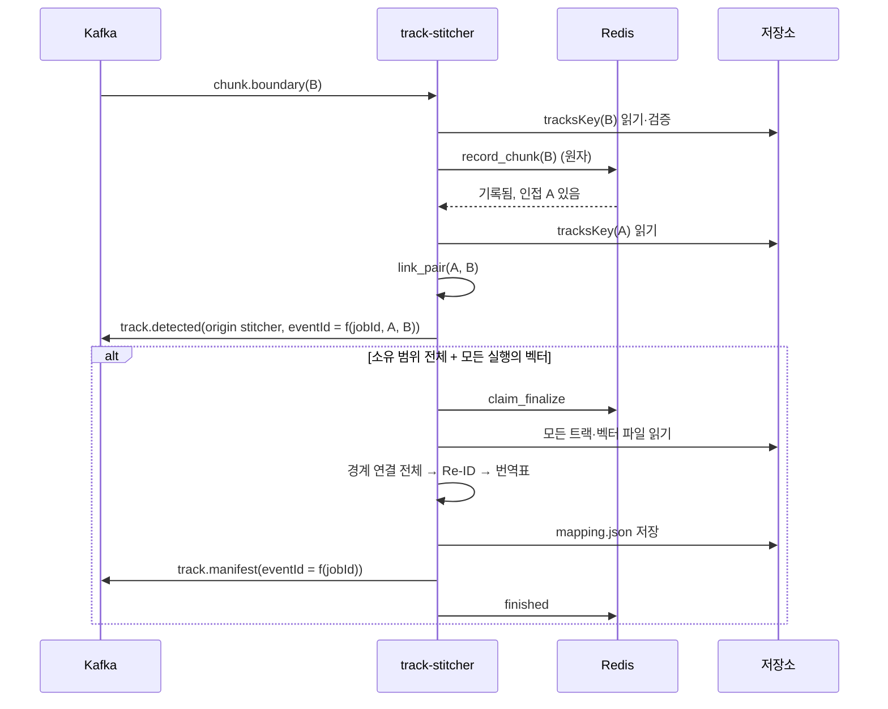

# Plan: SPEC-022 track-stitcher 경계 트랙 연결과 재등장 연결(Re-ID) — ai

- spec: docs 레포 `docs/specs/SPEC-022-track-stitcher/spec.md`
- 계약: `events/chunk.boundary`·`track.detected`·`track.manifest`·`segment.embedded`·`video.deleted`, `tracks/v1/chunk-tracks`·`track-mapping`, `vectors/v1/vector-file`, `asyncapi/track-stitcher.yaml` 1.0.0, `stages/v1/stages.schema.json` (계약 묶음 4.1.0)
- 근거: docs `architecture/overview.md` 분석 처리 흐름 7단계·"여러 Pod 운영 원칙", ADR-0009, ADR-0010, SPEC-013(단계 측정), SPEC-019(크롭 벡터 파일)

- v5.1(계약 묶음 4.0.0, 2026-11-07, ADR-0015): `chunk.boundary`·`segment.embedded`·`track.detected`에 선택 필드 `jobType`, `track.detected`에 `trackIdEpoch`가 더해졌다. 실시간 창은 stream-ingestor가 세션 전체에서 같은 트랙 ID를 유지하므로 `jobType: STREAM`이면 건너뛴다(R-23). 잠금은 4.1.0이다(아래 계약 수정 포함).

## 1. 요약

새 Kafka 워커 `services/track-stitcher`를 만든다. `chunk.boundary`·`segment.embedded`·`video.deleted`를 받아 Job별 대기 상태를 Redis(이미 ai-gateway가 쓰는 구성요소)에 둔다. 인접 청크 한 쌍이 모이면 겹침 구간 박스 IoU로 경계 연결을 하고 `track.detected`(origin `stitcher`)를 발행한다. Job의 소유 범위가 영상 전체를 덮고 모든 실행의 크롭 벡터가 모이면(또는 대기 제한 시간이 지나면) 경계 연결을 처음부터 다시 계산하고 Re-ID를 더해 번역표를 저장한 뒤 `track.manifest`를 한 번 발행한다.

연결 계산(인접·공통 관측·IoU·Re-ID·번역표·ID)은 입력 파일만 받는 순수 함수로 두어 순서·Pod와 상관없이 같은 결과를 낸다(NFR-2). Redis에는 파일 경로·범위 같은 색인만 두고 트랙 내용은 저장소 파일을 다시 읽는다. 기준값은 Git의 TOML 프로필이다(값은 AI 담당자 몫, 로컬 확인용 자리값만 둔다).

8절 1·2번의 계약 문제(겹침 박스 범위, 쌍 이벤트 `stitched`)는 계약 4.1.0(docs #137)에서 고쳐졌다. 구현은 고친 계약을 따른다.

## 2. 담당 요구사항

경로의 `ts/`는 `services/track-stitcher/src/track_stitcher/`, `t/`는 `services/track-stitcher/tests/`다.

| 요구사항 | 담당 모듈 / 컴포넌트 | 검증 테스트 |
| --- | --- | --- |
| R-1 | `ts/service.py` `on_chunk_boundary`, `ts/files.py`(트랙 파일 읽기), `ts/state.py` | `t/test_stitcher_service.py` |
| R-2 | `ts/state.py` `record_chunk`(먼저 기록한 실행 유지) | `t/test_stitcher_service.py`, `t/test_stitcher_redis.py` |
| R-3 | `ts/boundary.py` `adjacent_pairs` | `t/test_stitcher_boundary.py` |
| R-4 | `ts/boundary.py` `link_pair` | `t/test_stitcher_boundary.py` |
| R-5 | `ts/service.py`(쌍이 모이면 발행), `ts/ids.py` | `t/test_stitcher_service.py`(계약 스키마 통과, 순서 무관) |
| R-6 | `ts/boundary.py` `common_observations` | `t/test_stitcher_boundary.py` |
| R-7 | `ts/service.py` `on_segment_embedded`, `ts/state.py` | `t/test_stitcher_service.py` |
| R-8 | `ts/coverage.py`, `ts/service.py`(준비되면 확정) | `t/test_stitcher_coverage.py`, `t/test_stitcher_service.py` |
| R-9 | `ts/reid.py` `link_reappearances` | `t/test_stitcher_reid.py` |
| R-10 | `ts/reid.py`(벡터 없는 트랙 제외) | `t/test_stitcher_reid.py` |
| R-11 | `ts/finalize.py`(모델 ID 확인) | `t/test_stitcher_finalize.py` |
| R-12 | `ts/finalize.py`(저장 → 발행), `ts/ids.py` | `t/test_stitcher_finalize.py`, `t/test_stitcher_service.py` |
| R-13 | `ts/mapping.py` `build_mapping` | `t/test_stitcher_mapping.py` |
| R-14 | `ts/ids.py` `final_track_id` | `t/test_stitcher_ids.py`, `t/test_stitcher_mapping.py` |
| R-15 | `ts/sweeper.py`, `ts/coverage.py` `missing_ranges` | `t/test_stitcher_sweeper.py` |
| R-16 | `ts/redis_state.py` 확정 임대(lease) | `t/test_stitcher_redis.py`(integration) |
| R-17 | `ts/state.py` Job 상태 `finalized` | `t/test_stitcher_service.py` |
| R-18 | 워커 계약 검증(DLQ), `ts/files.py` → `NonRetryableError` | `t/test_stitcher_service.py`, `t/test_stitcher_worker_e2e.py` |
| R-19 | `ts/service.py` `on_video_deleted`, `ts/state.py` 삭제 표시 | `t/test_stitcher_service.py`, `t/test_stitcher_redis.py` |
| R-20 | 워커 재시도(SPEC-013 공통). 저장소·Redis·발행 오류를 그대로 던짐 | `t/test_stitcher_service.py` |
| R-21 | `ts/service.py`·`ts/finalize.py` 단계 블록 | `t/test_stitcher_service.py` |
| R-22 | `ts/profile.py`, `ts/__main__.py` | `t/test_stitcher_profile.py`, `t/test_stitcher_main.py` |
| R-23 | `ts/service.py`(`job_type == "STREAM"`이면 상태 없이 돌아옴, 건너뛴 수 계수), `vlm_contracts.events.ChunkBoundary`·`SegmentEmbedded`·`TrackDetected` | `t/test_stitcher_service.py::test_spec022_r23_*`(Redis 호출 0회, 발행 0건), `libs/contracts/tests/test_event_contracts.py` |
| NFR-1 | 순수 함수 계산, `asyncio.to_thread` | `t/test_stitcher_scale.py`(합성 1시간 영상) |
| NFR-2 | 순수 함수 + Redis 원자 기록 | `t/test_stitcher_redis.py`(두 서비스 인스턴스), `t/test_stitcher_service.py`(입력 순서 섞기) |
| NFR-3 | `ts/redis_state.py` 키 TTL 7일 | `t/test_stitcher_redis.py` |
| NFR-4 | 로그 필드 제한 | `t/test_stitcher_service.py`(caplog) |

## 3. 원칙 점검

| 원칙 | 준수 | 비고 |
| --- | --- | --- |
| I 스펙 우선 | ☑ | SPEC-022 Approved (docs #117). 8절의 계약 문제는 docs #137(4.1.0)에서 고쳐졌다 |
| II 계약 우선 | ☑ | docs #117·#137 머지, 묶음 4.1.0, 잠금 4.1.0 |
| III 테스트 우선 | ☑ | R-1~R-22, NFR-1~NFR-4 테스트 매핑 |
| IV 서비스 자율성 | ☑ | 다른 서비스 DB를 읽지 않는다. 입력은 이벤트와 저장소 파일, 상태는 track-stitcher 전용 Redis 키 접두사 |
| V 단순성 | ☑ | 새 패키지 없음(redis는 lock에 있음, ai-gateway가 씀). 벡터 계산은 표준 라이브러리(`math.sumprod`, D-6: 1시간 영상 확정 약 2.4초로 NFR-1 30초 안이라 numpy를 쓰지 않는다). 상태 저장소 Protocol 하나와 Redis·메모리 구현 둘 |
| VI 관측 가능성 | ☑ | 단계 `stitcher.boundary`·`reid`·`finalize`, health, `traceparent` 전파, 결과에 `stitchProfile`·`embeddingModel`·`detectorProfile` |
| VII 보안 | ☑ | 메시지·파일 모두 계약 모델로 검증, 파일 경로와 메시지 ID가 맞는지 확인. 좌표·벡터를 로그에 남기지 않음(NFR-4). Redis URL은 `SecretStr` |
| VIII 문서·주석 | ☑ | 기준값의 출처(자리값)를 프로필 주석에, 알고리즘의 결정 규칙을 docstring에 남김. README |
| IX GitOps | ☑ | 운영 배포·토픽은 사용자 지시 시 infra·gitops |

## 4. 기술 설계

### 4.1 패키지

| 경로 | 내용 |
| --- | --- |
| `libs/contracts/.../events.py` | `ChunkBoundary`, `TrackDetected`(origin별 필수 필드 검증), `StitchedTrack`, `TrackMember`, `TrackManifest` |
| `libs/contracts/.../tracks.py` (새 파일) | 파일 형식 `ChunkTracks`·`ChunkTrack`·`BoundaryBox`·`RepresentativeCrop`, `TrackMapping`·`MappedTrack`·`TrackLink` |
| `libs/contracts/.../stages.py` | `track-stitcher.queue_wait`·`handle`, `stitcher.boundary`·`reid`·`finalize` (SPEC-021 T001에서 이미 넣었으면 확인만) |
| `services/track-stitcher/pyproject.toml` | 의존성 `vlm-common`, `vlm-contracts`, `vlm-messaging`, `vlm-storage`, `redis`(lock에 있음) |
| `ts/settings.py` | 환경변수 `TRACK_STITCHER_`: 소비 그룹, 프로필 경로, Redis URL(`SecretStr`), 주기 확인 간격, 확정 임대 시간 |
| `ts/profile.py`, `services/track-stitcher/profiles/local.toml` | 기준값 프로필(4.3절) |
| `ts/files.py` | 트랙 파일·벡터 파일 읽기와 검증, 경로·ID 일치 확인 |
| `ts/boundary.py` | 인접 판단, 공통 관측, 쌍별 연결(순수 함수) |
| `ts/reid.py` | 트랙별 평균 벡터, 후보, 연결(순수 함수) |
| `ts/mapping.py` | 연결을 최종 트랙으로 묶고 번역표·근거 만들기(순수 함수) |
| `ts/coverage.py` | 소유 범위 합집합, 빈 범위 |
| `ts/ids.py` | eventId·trackId (uuid5) |
| `ts/model.py` | 내부 값 객체 `TrackRef`·`LocalTrack`, union-find `connected` |
| `ts/publishing.py` | 발행기 Protocol `EventPublisher` |
| `ts/state.py` | 상태 저장소 Protocol `JobStateStore`, 값 객체, 테스트용 `MemoryJobStateStore` |
| `ts/redis_state.py` | Redis 구현(동기 redis-py, Lua 스크립트로 원자 기록·확정 임대) |
| `ts/finalize.py` | Job 확정: 파일 읽기 → 경계 연결 → Re-ID → 번역표 저장 → `track.manifest` |
| `ts/service.py` | 세 핸들러 |
| `ts/sweeper.py` | 대기 제한 시간 주기 확인(별도 스레드, 동기 호출) |
| `ts/__main__.py` | 조립·기동 |

### 4.2 Redis 상태

키는 모두 `ts:{<sourceId>}:` 접두사다. 해시 태그 `{sourceId}`로 한 영상의 키가 같은 슬롯에 있어 Lua 스크립트 하나로 원자적으로 고친다(Redis Cluster여도 된다).

| 키 | 형식 | 내용 |
| --- | --- | --- |
| `ts:{s}:job:<jobId>:meta` | hash | `status`(`open`·`finalizing`·`finalized`), `normalizationId`, `ownerId`, `sourceDurationMs`, `lastInputMs`, `traceparent`(마지막 입력) |
| `ts:{s}:job:<jobId>:chunks` | hash | chunkId → JSON(executionId, ownedRange, processingRange, tracksKey, detectorProfile) |
| `ts:{s}:job:<jobId>:vectors` | hash | executionId → JSON(vectorsKey, embeddingModel) |
| `ts:{s}:jobs` | set | 그 영상의 jobId (R-19 삭제용) |
| `ts:{s}:deleted` | string | `video.deleted` 표시 |
| `ts:due` | sorted set | 멤버 `<sourceId>:<jobId>`, 점수 = `lastInputMs + waitTimeout` (R-15 주기 확인용, 영상 하나에 묶이지 않는 유일한 키). 다른 슬롯일 수 있어 Lua 스크립트 밖에서 따로 고친다 |

- 기록 스크립트(`record_chunk`, `record_vectors`)는 한 번에: 삭제 표시 확인 → `status` 확인(`open`이 아니면 `late`를 돌려줌, R-17) → meta `HSETNX`(먼저 기록한 값 유지) → 항목 기록(R-2: 이미 있으면 같은 실행이면 `duplicate`, 다르면 `conflict`) → 새로 기록했으면 `lastInputMs`·`traceparent` 갱신 → 영상 키 TTL 7일(NFR-3) → 인접 청크 후보·준비 상태 판단에 필요한 meta·chunks·vectors 전체를 돌려준다. 두 Pod가 인접 청크를 동시에 기록해도 나중에 끝난 쪽이 반드시 둘 다 보므로 쌍을 놓치지 않는다.
- 스크립트가 끝나면 `ts:due`에 `lastInputMs + waitTimeout`을 넣는다(중복 기록도 넣는다). `ts:due`는 `ts:{s}:` 키와 슬롯이 달라 스크립트 안에서 함께 고치면 Redis Cluster에서 CROSSSLOT 오류가 난다. 확인할 Job을 고르는 색인일 뿐이고 확정 여부는 `claim_finalize`가 정하므로 둘 사이가 잠깐 어긋나도 결과는 같다. 앞선 시도가 이 단계 전에 실패해도 재시도의 중복 기록이 다시 넣는다.
- 확정 임대(R-16): `claim_finalize` 스크립트가 `status`가 `open`(또는 임대가 끝난 `finalizing`)일 때만 `finalizing`과 임대 만료 시각을 쓰고 이긴 Pod 하나만 확정한다. 이긴 Pod는 `ts:due` 점수를 임대 만료 시각으로 옮긴다. 발행 뒤 `finish`가 `finalized`로 바꾸고 `ts:due`에서 지운다. 임대 중 Pod가 죽으면 만료 뒤 주기 확인이 다시 확정한다. 이때도 eventId가 같아 소비자가 흡수한다.
- 확정이 저장소·발행 오류로 실패하면 `release`로 `open`에 되돌리고 `ts:due`를 지금으로 둔다. 재시도 메시지(중복 기록 → 준비 → 임대)나 다음 주기 확인이 바로 다시 확정한다. 되돌리지 못해도 임대가 끝나면 주기 확인이 이어 받는다.
- `video.deleted`(R-19)는 스크립트로 삭제 표시를 먼저 쓰고 `jobs` 목록을 읽은 뒤, 같은 슬롯의 Job 키를 `DEL` 한 번으로 지운다. 스크립트가 선언하지 않은 키를 만지지 않아 Cluster에서도 안전하다.
- redis-py 동기 클라이언트를 쓴다. 연결 풀이 스레드에 안전해 워커 핸들러 스레드(`asyncio.to_thread`)와 주기 확인 스레드가 함께 쓴다. 비동기 클라이언트는 만든 이벤트 루프에 묶여 두 스레드가 나눠 쓸 수 없다.
- `finalizing` 중에 온 입력은 기록하지 않고 R-17과 같이 경고만 남긴다. 확정이 이미 읽은 입력과 어긋나지 않게 하기 위해서다.
- 트랙 요약 내용은 Redis에 넣지 않는다. 1시간 영상의 박스·벡터를 Redis에 7일 두면 메모리가 커지고, 같은 내용이 저장소에 이미 있기 때문이다.

### 4.3 프로필

```toml
version = "local-1"            # track.manifest·번역표의 stitchProfile

[boundary]
min_mean_iou = 0.5             # 0~1 (R-4)
min_common_observations = 2    # 1 이상 (R-4)
time_tolerance_ms = 100        # 0 이상, 검출 fps 간격의 절반 정도 (R-6)

[reid]
min_similarity = 0.8           # 0~1 (R-9)
max_gap_ms = 60000             # 1 이상 (R-9)

[finalize]
wait_timeout_s = 1800          # 1 이상, 기본 30분 (R-15)
```

- 값은 로컬 동작 확인용 자리값이고 주석에 그렇게 적는다. 운영 값은 AI 담당자가 평가로 정하고 `version`을 올린다.
- R-22: `vlm_common.profile.load_profile`의 Pydantic 검증으로 범위를 막는다. 파일이 없거나 범위 밖이면 `ProfileError`로 기동에 실패한다.

### 4.4 경계 연결 (R-3, R-4, R-6)

- 인접(R-3): `earlier.ownedRange.endMs == later.ownedRange.startMs`인 기록된 청크 쌍. 같은 Job 안에서 소유 범위가 겹치거나 틈이 있으면 인접이 아니다.
- 겹치는 시간 창: `[later.processingRange.startMs, earlier.processingRange.endMs)`. 두 청크가 모두 추적한 시간이다.
- 공통 관측(R-6): 앞 트랙 박스와 뒤 트랙 박스 중 둘 다 창 안에 있고 시각 차가 `time_tolerance_ms` 이하인 짝. 앞 박스를 시간순으로 돌며 아직 짝이 없는 뒤 박스 중 시각 차가 가장 작은 것과 짝짓는다(같으면 이른 것). 박스 하나는 한 짝에만 쓴다.
- 쌍 점수(R-4): 후보는 앞 청크의 `touchesTail` 트랙 × 뒤 청크의 `touchesHead` 트랙 중 `className`이 같은 쌍이다. 공통 관측별 IoU의 평균이 `min_mean_iou` 이상이고 공통 관측 수가 `min_common_observations` 이상이면 연결 후보다.
- 일대일: 후보를 (평균 IoU 내림차순, 앞 trackLocalId, 뒤 trackLocalId) 순서로 보며 양쪽 모두 아직 연결되지 않았으면 잇는다. 정렬 키가 완전하므로 결과가 결정적이다.
- 단계 `stitcher.boundary`의 count는 비교한 트랙 쌍 수(같은 클래스 후보 쌍 수)다.



### 4.5 Re-ID (R-8~R-11)

- 준비(R-8): `coverage.covers(ownedRanges, sourceDurationMs)`가 참이고, 기록한 모든 청크 실행 ID가 vectors 해시에 있으면 확정한다. `chunk.boundary`와 `segment.embedded` 어느 쪽 핸들러에서든 기록 직후 판단한다.
- 입력: 경계 연결 뒤 트랙(경계 연결을 union-find로 묶은 것). 트랙의 시간은 구성원 `startMs`의 최솟값·`endMs`의 최댓값, 벡터는 구성원 실행의 벡터 파일 `crops[]` 중 `(executionId, trackLocalId)`가 같은 벡터의 평균을 단위 벡터로 만든 것이다. 기록하지 않은 실행의 벡터 파일은 읽지 않는다.
- 후보(R-9): 같은 `className`, `later.startMs >= earlier.endMs`(시간이 겹치지 않음, 간격 0 허용), `later.startMs - earlier.endMs <= max_gap_ms`, 코사인 유사도 `>= min_similarity`. 시작 시각으로 정렬해 최대 간격 창 안만 비교한다.
- 연결: (유사도 내림차순, 앞 트랙 ID, 뒤 트랙 ID) 순서로 보며 앞 트랙에 다음 트랙이 없고 뒤 트랙에 이전 트랙이 없으면 잇는다. 시간순 연결이라 고리가 생기지 않는다.
- R-10: 벡터가 하나도 없는 트랙은 후보에서 빠지고 경계 연결 결과만 남는다.
- R-11: Job의 vectors 해시에 `embeddingModel`이 둘 이상이면 Re-ID를 하지 않고 `reidSkippedReason = "embedding_model_mismatch"`, `embeddingModel = null`이다. 벡터 파일이 하나도 없으면(대기 제한 시간으로 끝난 경우) 이유 없이(`null`) Re-ID 연결 0개다(계약 설명: 벡터가 없는 청크만 빠진 것은 이유가 아니다).
- 계산: 표준 라이브러리(`math.sumprod`)로 단위 벡터 내적을 한다. 비교 쌍 수는 시작 시각 정렬과 최대 간격 창(bisect)으로 제한한다. `t/test_stitcher_scale.py`(청크 30, 로컬 트랙 3,000, 크롭 벡터 9,000, 512차원)에서 파일 60개 읽기·검증을 포함한 확정이 약 2.4초라 NFR-1(30초) 안이다. D-6에 따라 numpy를 직접 의존으로 두지 않는다.
- 단계 `stitcher.reid`의 count는 비교한 트랙 수(벡터가 있는 경계 연결 뒤 트랙 수)다.

### 4.6 번역표와 ID (R-12~R-14)

- 최종 트랙 = 경계 연결과 Re-ID 연결을 함께 union-find로 묶은 것. 받은 모든 로컬 트랙(기록한 실행의 트랙 파일 `tracks[]`)이 정확히 한 번 나온다(R-13). 구성원은 (startMs, chunkId, trackLocalId) 순서다.
- 연결 근거(R-13): 경계 연결은 `kind = boundary`, `from`·`to` = 앞·뒤 로컬 트랙, `score` = 평균 IoU. Re-ID는 `kind = reid`, `from` = 앞 트랙에서 `endMs`가 가장 늦은 구성원, `to` = 뒤 트랙에서 `startMs`가 가장 이른 구성원, `score` = 코사인 유사도, `gapMs`.
- trackId(R-14): `uuid5(NAMESPACE_URL, "vlm:track:<jobId>:<chunkId>:<trackLocalId>")`, 가장 이른 구성원 기준. 같은 입력이면 같은 ID다.
- eventId: `track.detected` = `uuid5(NAMESPACE_URL, "vlm:track.detected:<jobId>:<earlierChunkId>:<laterChunkId>")`, `track.manifest` = `uuid5(NAMESPACE_URL, "vlm:track.manifest:<jobId>")` (event-analyzer `ids.py`와 같은 방식).
- 저장 순서(R-12): `sources/<sourceId>/jobs/<jobId>/tracks/mapping.json`에 덮어쓰기로 저장 → 성공하면 `track.manifest` 발행. 저장이 실패하면 발행하지 않고 오류를 던진다(재시도). 다시 확정해도 같은 입력이면 같은 내용이다.
- `track.manifest`: `complete` = 소유 범위가 영상 전체를 덮음, `missingRanges` = 덮이지 않은 범위(시간순), `chunkCount`·`localTrackCount`·`trackCount`·`boundaryLinkCount`·`reidLinkCount`, `stitchProfile` = 프로필 `version`.
- 단계 `stitcher.finalize`의 count는 최종 트랙 수다.

### 4.7 대기 제한 시간·삭제·오류 (R-15~R-20)

- 주기 확인(R-15): `ts/sweeper.py`가 Pod마다 별도 스레드에서 `sweep_interval_s`(기본 30초)마다 `ts:due`에서 점수가 지금 이하인 Job을 꺼내 `claim_finalize`를 시도한다. 상태 저장소·저장소·발행이 모두 동기 호출이라 이벤트 루프를 두지 않는다. 이긴 Pod만 받은 청크로 확정한다(R-16). 저장소·Redis 오류는 로그만 남기고 다음 주기에 다시 한다(Job 하나의 실패가 다른 Job을 막지 않는다).
- 대기 제한 시간이 지났는데 `chunk.boundary`를 하나도 받지 못한 Job(벡터만 받음)은 `sourceDurationMs`를 몰라 manifest를 만들 수 없다. 발행하지 않고 경고 로그를 남긴 뒤 `open`으로 되돌리고 `ts:due`에서 지운다(8절 6번). 나중에 `chunk.boundary`가 오면 다시 대기 대상이 된다.
- R-17: 기록 스크립트가 `late`를 돌려주면 경고 로그(`jobId`, `chunkId`, `status`)만 남기고 정상 처리로 끝낸다.
- R-18: 메시지 검증 실패는 워커가 DLQ로 보낸다. 트랙 파일이 없거나(`ObjectNotFoundError`), JSON·계약이 틀리거나, 파일의 sourceId·jobId·chunkId·executionId·범위가 메시지와 다르거나, `tracksKey`가 그 메시지의 실행 폴더가 아니면 `NonRetryableError`다. 기록 전에 파일을 읽으므로 DLQ로 간 메시지는 상태에 남지 않는다.
- 확정 중 벡터 파일을 읽지 못하면(없음·계약 위반) 그 실행의 트랙만 벡터 없음으로 보고(R-10) 경고를 남긴다. 확정은 메시지 하나의 처리가 아니라 DLQ로 보낼 대상이 없기 때문이다(8절 5번).
- R-19: `video.deleted`면 `ts:{s}:jobs`의 모든 Job 키를 지우고 `ts:due`에서 빼고 `ts:{s}:deleted`를 7일 TTL로 둔다. 기록 스크립트가 이 표시를 보면 기록하지 않는다. 저장된 `mapping.json`은 지우지 않는다(영상 파일 삭제는 media-service 몫).
- R-20: 저장소·Redis·발행 오류(`RedisError`, 저장소 예외, `PublishError`)는 잡지 않고 던져 워커가 재시도 토픽으로 보낸다. 쌍 발행 전에 실패하면 다시 처리할 때 이미 기록된 청크라 R-2로 기록은 건너뛰지만 인접 쌍 판단과 발행은 다시 한다(같은 eventId).

### 4.8 단계 측정 (R-21)

- 핸들러 안에서는 `ctx.timing.stage("stitcher.boundary" | "stitcher.reid" | "stitcher.finalize")`로 감싸고 `count`를 넣는다.
- 주기 확인이 확정할 때는 소비 핸들러가 아니라 `ctx`가 없다. 같은 `TimingSink`로 `StageRecorder`를 직접 만들어 `stitcher.reid`·`stitcher.finalize`를 남긴다(8절 7번). 묶음 위치는 `track-stitcher.sweep`과 jobId로 정해 같은 Job을 다시 확정하면 같은 묶음 ID다.
- 확정 안에서 `stitcher.reid`는 `stitcher.finalize` 블록 안에 있다(경로 `stitcher.finalize/stitcher.reid`). 확정의 경계 연결 재계산은 `stitcher.boundary`로 따로 남기지 않는다(그 단계는 쌍 이벤트 발행의 비교 수다).

### 4.9 데이터 모델

DB 없음. Redis 키는 4.2절. 저장소 파일 `mapping.json`은 계약 `tracks/v1/track-mapping`.

### 4.10 API / 이벤트

`asyncapi/track-stitcher.yaml` 1.0.0: `consumeChunkBoundary`, `consumeSegmentEmbedded`, `consumeVideoDeleted`, `publishTrackDetected`, `publishTrackManifest`. 메시지 키는 sourceId다.

## 5. 대안과 선택 이유

| 대안 | 장점 | 단점 | 선택 |
| --- | --- | --- | --- |
| Redis에 색인만, 확정 때 파일을 다시 읽음 | Redis가 작음, 계산이 입력 파일만의 함수라 결정적 | 확정 때 파일 60개를 읽음 | ☑ |
| Redis에 트랙 요약·경계 연결 결과 저장 | 확정이 빠름 | 메모리, 연결 결과가 도착 순서에 묶일 수 있음 | |
| 확정 때 경계 연결을 처음부터 다시 계산 | 쌍 발행 실패·중복과 무관하게 번역표가 같음 | 계산 두 번(쌍 30개라 작음) | ☑ |
| Lua 스크립트로 원자 기록 | 여러 Pod에서 인접 쌍을 놓치지 않음(NFR-2) | 스크립트 테스트가 필요(통합 테스트) | ☑ |
| `WATCH`/`MULTI` 낙관적 갱신 | 스크립트 없음 | 충돌 재시도 코드가 늘어남 | |
| 주기 확인을 Pod마다 돌리고 임대로 한 Pod만 확정 | 리더 선출 없음, Pod가 죽어도 다른 Pod가 이어 감 | 같은 Job을 여러 Pod가 확인(임대로 막음) | ☑ |
| 리더 Pod 하나가 주기 확인 | 확인이 한 번 | 리더 선출·장애 조치가 필요 | |
| 표준 라이브러리 벡터 계산 | 새 의존성 없음 | numpy보다 느림 | ☑ (NFR-1 측정으로 확인) |

ADR이 필요한 결정은 없다. Redis는 기존 구성요소이고 키 접두사로 나눈다.

## 6. 테스트 전략

- 단위(순수 함수): 인접, 공통 관측(허용 오차 경계, 일대일), 평균 IoU 경계값·최소 수, 일대일 순서, 같은 점수의 결정적 순서, Re-ID 후보·간격·유사도·앞뒤 하나씩, 벡터 없는 트랙, 커버리지·빈 범위, 번역표의 "정확히 한 번", ID 결정성
- 서비스: 메모리 상태 저장소·메모리 저장소(`vlm_storage.memory.InMemoryStorage`)·기록 발행기로 세 핸들러 전체. 결과를 계약 스키마(`track.detected`, `track.manifest`, `track-mapping`)로 검증. 같은 입력을 섞은 순서로 넣어 같은 번역표·eventId(US-1 AC3, US-3 AC2)
- Redis: `vlm_testing.containers.redis` testcontainer로 기록 스크립트·확정 임대·TTL·삭제 표시. 서비스 인스턴스 둘이 같은 Redis에 입력을 나눠 넣어도 manifest 한 번·번역표 같음(R-16, NFR-2)
- 계약: 새 모델을 docs 원본과 비교(필드·필수·enum·예시 왕복), `track.detected`의 origin별 필수 필드
- 워커 e2e: Kafka·SeaweedFS·Redis testcontainer로 청크 5개 + 벡터 5개 → `track.detected` 4건 + `track.manifest` 1건, 잘못된 메시지·없는 트랙 파일 DLQ (구현 뒤에 쓰는 통합 테스트라 Red 없음으로 PR에 적는다)
- 성능: 합성 1시간 영상(청크 30, 로컬 트랙 3,000, 크롭 벡터 9,000, 512차원)으로 확정 30초(NFR-1)
- 테스트 파일 이름은 `test_stitcher_*`, 도우미는 `stitcher_support.py`(루트 `pythonpath`에 `services/track-stitcher/tests`)
- 로컬 compose(성공 지표): 손으로 만든 메시지와 파일로 확인하고 tasks.md "측정 기록"에 남긴다. chunk-processor가 아직 `chunk.boundary`를 내지 않는다

## 7. 리스크와 롤백

- 생산자 없음: `chunk.boundary`·트랙 파일은 chunk-processor(다른 담당자)가 아직 내지 않는다. 계약 예시와 합성 데이터로만 확인한다. 생산자가 계약을 바꾸면 소비 쪽을 맞춘다(handoff 2.1).
- 기준값: 자리값이라 실제 영상에서 연결 품질은 보장하지 않는다. 품질은 AI 담당자의 평가 몫이다.
- 확정 메모리: 1시간 영상의 벡터 파일 30개(512차원 × 9,000개)를 JSON으로 한꺼번에 읽는다. 실행별로 평균 벡터만 남기고 원본을 버려 최대 메모리를 줄인다. 로컬 256M 상한에서 확인한다.
- 시계: `lastInputMs`·임대 만료는 Pod 시계다. 대기 제한 시간이 30분이라 수 초 오차는 문제가 없다.
- 롤백: 새 서비스라 끄면 된다. Redis 키는 TTL 7일로 사라진다.

## 8. 사용자 확인 필요 / spec·계약 문제

1·2번은 계약 4.1.0(docs #137)에서 해결됐다. 3번은 사용자 결정(D-7), 4~7번은 아래 기본안으로 구현했다.

1. (해결됨, 계약 4.1.0) 겹침 박스 범위(R-4·R-6 전제): `chunk-tracks`의 `boundaryBoxes`는 "앞·뒤 겹침 구간 안의 박스만"이고 겹침 구간은 앞쪽 `processingRange.startMs ~ ownedRange.startMs`, 뒤쪽 `ownedRange.endMs ~ processingRange.endMs`다. 그러면 앞 청크 A의 뒤쪽 박스는 경계 뒤 5초(`[120000, 125000)`), 뒤 청크 B의 앞쪽 박스는 경계 앞 5초(`[115000, 120000)`)에만 있어 시간이 겹치지 않는다. R-6의 공통 관측(시각 차가 허용 오차 안)이 거의 생기지 않아 R-4가 동작하지 않는다. 제안: `boundaryBoxes`가 경계 양쪽 창 전체(`[later.processingRange.startMs, earlier.processingRange.endMs)`, 즉 앞쪽은 `processingRange.startMs ~ ownedRange.startMs + 겹침 폭`, 뒤쪽은 `ownedRange.endMs − 겹침 폭 ~ processingRange.endMs`)를 담도록 계약 설명을 고친다. `touchesHead`·`touchesTail` 정의도 같이 맞출지 정해야 한다. 이 plan의 알고리즘(4.4절)은 고친 계약을 전제로 한다.
2. (해결됨, 계약 4.1.0) 쌍 이벤트의 `stitched` 내용: `track.detected`의 `stitched` 설명은 "앞 청크에서 이미 이어진 구성원도 포함"이고 `trackId`는 "경계 연결 기준 트랙 ID"다. 쌍 이벤트는 그 쌍이 모이는 즉시 발행하므로(R-5), 앞 쌍이 아직 모이지 않았으면 포함할 구성원과 trackId가 도착 순서에 따라 달라진다. US-1 AC3("B를 A보다 먼저 받아도 같은 결과")·NFR-2와 맞지 않는다. 제안: 쌍 이벤트의 `stitched`는 그 쌍의 두 구성원만 담고 `trackId`는 두 구성원 중 이른 구성원으로 R-14와 같은 방식으로 만들며, 여러 경계에 걸친 묶음은 `track.manifest` 번역표가 정한다. 계약 설명을 이렇게 고칠지 확인이 필요하다.
3. (결정됨, D-7) `reidSkippedReason`의 `disabled`: Re-ID 끄기 설정을 두지 않는다. `disabled`는 내지 않는다.
4. `sourceDurationMs`가 청크마다 다를 때: spec에 규칙이 없다. 이 plan은 Job에서 먼저 기록한 값을 쓰고 다른 값은 경고 로그만 남긴다.
5. 확정 때 벡터 파일 오류: R-18은 메시지 처리만 다룬다. 이 plan은 읽지 못한 벡터 파일의 트랙을 벡터 없음(R-10)으로 처리한다.
6. `chunk.boundary`가 하나도 없이 대기 제한 시간이 지난 Job: `normalizationId`·`sourceDurationMs`를 몰라 계약상 필수 필드를 채울 수 없다. 이 plan은 manifest를 내지 않는다. pipeline-service(다른 담당자)가 이 경우를 따로 처리해야 하는지는 보고만 한다.
7. 주기 확인의 단계 측정: R-21은 "핸들러 안의 처리 시간"인데 대기 제한 시간 확정은 핸들러 밖이다. 이 plan은 같은 단계 ID로 따로 남긴다(`track-stitcher.handle`·`queue_wait`는 없음).
8. 사소한 계약 표기: `track.manifest` 설명의 "(SPEC-022 R-10~R-14)"는 spec의 R-12·R-13과 맞지 않는다. 4.1.0에도 남아 있어 다음 계약 PR에서 고친다(동작에는 영향이 없다).

## 9. 배포 고려사항

- 환경변수(새 서비스): `TRACK_STITCHER_GROUP_ID`, `TRACK_STITCHER_PROFILE_PATH`, `TRACK_STITCHER_REDIS_URL`, `TRACK_STITCHER_SWEEP_INTERVAL_S`, `TRACK_STITCHER_FINALIZE_LEASE_S`와 공통 `KAFKA_BOOTSTRAP`, `HEALTH_PORT`, `STAGE_TIMING_PUBLISH`, 저장소 설정(`vlm_storage.s3.StorageSettings`). 서비스 단독 실행용 `services/track-stitcher/.env.example`, 로컬 compose용 docs `local/.env.example`(비밀값 아님, Redis URL은 compose 내부 주소).
- 로컬 compose(docs `local/`, 별도 PR): track-stitcher 서비스(256M), 토픽 `chunk.boundary`, `track.detected`, `track.manifest`, `chunk.boundary.track-stitcher.retry`, `segment.embedded.track-stitcher.retry`, `video.deleted.track-stitcher.retry`, `track-stitcher.dlq`, `local/README.md` 표.
- 운영 배포·토픽·Redis 접근은 사용자 지시 시 infra·gitops에서 한다.
- 배포 순서: 계약 4.1.0과 ai 잠금은 끝났다. 소비자(analysis-api·pipeline-service)는 아직 없으므로 발행 순서 제약은 없다.

## 10. v5.1 추가 설계(계약 묶음 4.0.0, 2026-11-07)

- `on_chunk_boundary`·`on_segment_embedded` 첫 줄에서 `job_type == "STREAM"`이면 Redis·저장소를 건드리지 않고 돌아온다. 워커가 커밋한다(최소 한 번 전달에서도 상태가 남지 않으므로 중복이 무해하다).
- 건너뛴 수는 단계 측정이 아니라 구조화 로그 `stitcher.skipped_stream`(sourceId·jobId·토픽)과 프로세스 계수(`SkipCounter`)에 남긴다. 공통 health 서버는 상태 코드만 돌려주므로 누적 수는 같은 로그의 `skippedTotal`로 낸다. 측정 단계는 메시지를 처리한 경우에만 뜻이 있다.
- `TrackDetected.track_id_epoch`는 모델에만 두고 track-stitcher는 읽지 않는다(stream-ingestor가 발행, aggregator가 소비). `jobType`이 없으면 `FULL`로 보고 기존 경로를 탄다.
