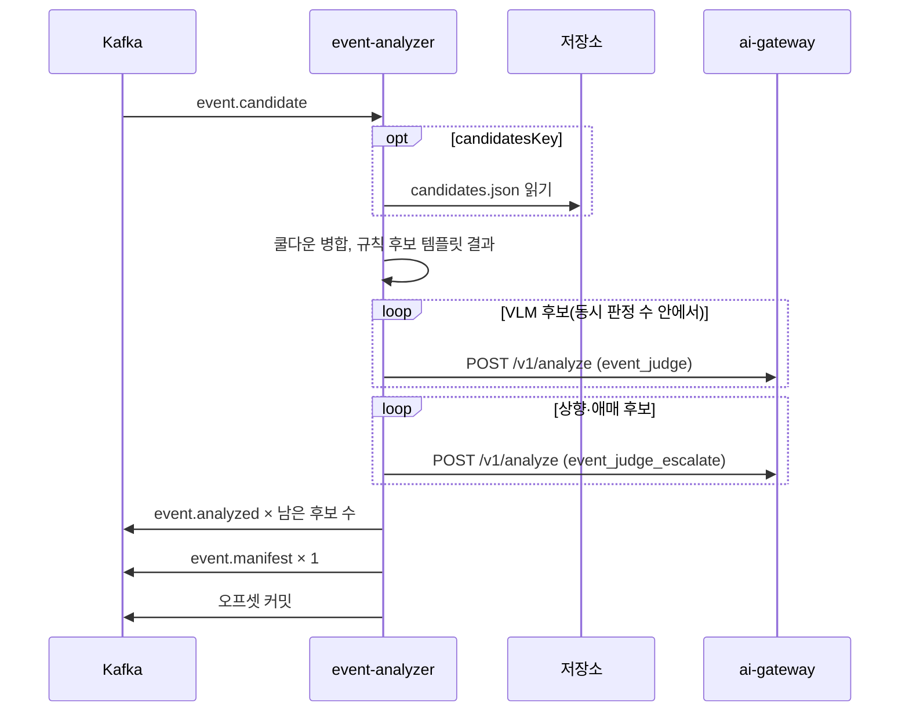

# Plan: SPEC-023 event-analyzer 탐지기·규칙 후보 판정과 event.manifest — ai

- spec: docs 레포 `docs/specs/SPEC-023-event-analyzer-detector/spec.md`
- 계약: `events/event.candidate`·`event.manifest`·`event.analyzed`(판정 방식 `rule*`, `detectorCandidate`), `candidates/v1/candidate-file`, `stages/v1`(`analyzer.merge`), `asyncapi/event-analyzer.yaml` 1.1.0 (docs #118, 계약 묶음 3.3.0. 구현은 잠금 4.0.0으로 한다)
- 앞선 구현: SPEC-020(벡터 후보 경로, ai #38), SPEC-021(생성 클라이언트·재시도 규칙·`X-Request-Deadline`)

- v5.1(계약 묶음 4.0.0, 2026-11-07, ADR-0016): 상태형 유형의 메시지 안 구간 규칙 `rule+carry`(R-17), `STREAM`의 Redis 재판정 키(R-18), 실행당 호출 상한 `call_cap_reached`(R-19), `event.manifest` 계수(R-20), 실시간 긴급 후보 `alert.candidate` → `alert.raised`(R-21~R-23), 단계 `analyzer.alert`(R-24)를 더한다. 계약은 `events/alert.candidate`·`alert.raised`(신규), `event.manifest`·`event.analyzed`·`event.candidate`의 선택 필드, `taxonomy/v2`의 `alertImmediately`·`rejudgeIntervalS`, `asyncapi/event-analyzer.yaml` 1.2.0, `stages/v1`이다. 잠금은 첫 태스크에서 4.0.0으로 올린다.

## 1. 요약

SPEC-020에서 만든 `services/event-analyzer`에 `event.candidate` 경로를 더한다. 메시지(또는 `candidatesKey` 파일)의 후보를 같은 트랙·같은 유형끼리 쿨다운 병합하고, `judgment: rule` 후보는 프로필 템플릿으로 바로 확정한다. `judgment: vlm` 후보는 SPEC-020과 같은 판정 코드로 `event_judge`를 부르고, 상향 조건이나 애매 점수 구간이면 `event_judge_escalate`로 다시 판정한다. 남은 후보마다 `event.analyzed`를 발행한 뒤 실행마다 `event.manifest`를 한 건 발행한다.

event-analyzer에 처음으로 프로필 파일(TOML)과 저장소 읽기(`libs/storage`)가 생긴다. 둘 다 기존 워크스페이스 코드(`vlm_common.profile`, `vlm_storage`)를 쓰므로 새 외부 패키지는 없다. ai-gateway는 바꾸지 않는다. `event_judge` 입력의 `evidence`가 자유 객체라 탐지기 근거를 그대로 싣는다.

## 2. 담당 요구사항

경로의 `ea/`는 `services/event-analyzer/src/event_analyzer/`, `t/`는 `services/event-analyzer/tests/`, `lc/`는 `libs/contracts/`다.

| 요구사항 | 담당 모듈 / 컴포넌트 | 검증 테스트 |
| --- | --- | --- |
| R-1 | `ea/candidates.py` `load_candidates`, `vlm_contracts.events.EventCandidate` | `t/test_analyzer_candidates.py`, `t/test_analyzer_detector_service.py` |
| R-2 | `ea/candidates.py`(→ `NonRetryableError`) | `t/test_analyzer_candidates.py`, `t/test_analyzer_worker_e2e.py` |
| R-3 | `ea/merge.py` `merge_candidates` | `t/test_analyzer_merge.py` |
| R-4 | `ea/rules.py` `rule_analysis` | `t/test_analyzer_rules.py`, `t/test_analyzer_detector_service.py` |
| R-5 | `ea/service.py` `_detector_request` | `t/test_analyzer_detector_service.py` |
| R-6 | `ea/judgment.py` `needs_escalation`(애매 구간 인자) | `t/test_judgment.py`, `t/test_analyzer_detector_service.py` |
| R-7 | `ea/judgment.py` `decide`(판정 경로 인자), `ea/service.py` 실패 처리 공용 | `t/test_judgment.py`, `t/test_analyzer_detector_service.py` |
| R-8 | `ea/service.py` `handle_detector`, `ea/ids.py` `analyzed_event_id` | `t/test_analyzer_detector_service.py`(계약 스키마 통과) |
| R-9 | `vlm_contracts.events.EventAnalyzed`·`DetectorEvidence` | `lc/tests/test_event_contracts.py`, `lc/tests/test_analysis_contracts.py`, `t/test_analyzer_detector_service.py` |
| R-10 | `ea/service.py` `_manifest`, `ea/ids.py` `manifest_event_id`, `vlm_contracts.events.EventManifest` | `t/test_analyzer_detector_service.py`, `lc/tests/test_event_contracts.py` |
| R-11 | `ea/service.py`(후보 0개 경로) | `t/test_analyzer_detector_service.py` |
| R-12 | `ea/service.py`(SPEC-020과 같은 `asyncio.Semaphore`) | `t/test_analyzer_detector_service.py` |
| R-13 | `ea/service.py` 단계 블록, `vlm_contracts.stages.StageId` | `t/test_analyzer_detector_service.py`, `lc/tests/test_stage_contracts.py` |
| R-14 | `EventCandidate` 검증 → 워커가 DLQ | `t/test_analyzer_worker_e2e.py` |
| R-15 | 워커 재시도(SPEC-013 공통). 발행 오류를 그대로 던짐 | `t/test_analyzer_detector_service.py` |
| R-16 | `ea/profile.py` `EventAnalyzerProfile`, `ea/__main__.py` | `t/test_analyzer_profile.py`, `t/test_analyzer_main.py` |
| R-17 | `ea/carry.py` `plan_carry`(상태형 유형의 구간 규칙, 순수 함수), `ea/service.py` `handle_detector` | `t/test_analyzer_carry.py`, `t/test_analyzer_detector_service.py::test_spec023_r17_*` |
| R-18 | `ea/rejudge_state.py`(`RejudgeState` Protocol, `RedisRejudgeState`, `NoRejudgeState`), `ea/settings.py`(`EVENT_ANALYZER_REDIS_URL` 선택) | `t/test_analyzer_rejudge_state.py`(integration, Redis), `t/test_analyzer_detector_service.py::test_spec023_r18_*` |
| R-19 | `ea/cap.py` `call_cap`, `ea/profile.py`(`[cap] floor` 3, `per_minute` 3), `ea/service.py` | `t/test_analyzer_cap.py`, `t/test_analyzer_detector_service.py::test_spec023_r19_*` |
| R-20 | `ea/service.py` `_manifest`, `vlm_contracts.events.EventManifest` | `t/test_analyzer_detector_service.py::test_spec023_r20_*`, `lc/tests/test_event_contracts.py` |
| R-21, R-23 | `ea/alerts.py` `handle_alert`, `ea/ids.py` `alert_event_id`, `vlm_contracts.events.AlertCandidate`·`AlertRaised` | `t/test_analyzer_alert_service.py`(pending → confirmed·dismissed, `unverified`·`unknown`은 dismissed), `lc/tests/test_event_contracts.py` |
| R-22 | `ea/alerts.py`가 `ea/service.py` `_detector_request`를 그대로 씀 | `t/test_analyzer_alert_service.py::test_spec023_r22_*`(같은 candidateId의 두 경로 요청 본문이 같음) |
| R-24 | `ea/alerts.py` 단계 블록, `vlm_contracts.stages.StageId`(`analyzer.alert`) | `t/test_analyzer_alert_service.py::test_spec023_r24_*`, `lc/tests/test_stage_contracts.py` |
| NFR-1 | 동시 판정, mock 프로필 | 로컬 compose 측정(tasks.md 측정 기록) |
| NFR-2 | `KafkaWorker`(하나씩 처리, 발행 뒤 커밋, 긴 핸들러 중 poll 유지) | `t/test_analyzer_worker_e2e.py`(`event.candidate` 경로) |

## 3. 원칙 점검

| 원칙 | 준수 | 비고 |
| --- | --- | --- |
| I 스펙 우선 | ☑ | SPEC-023 Approved (docs #118) |
| II 계약 우선 | ☑ | docs #118 머지. 잠금은 첫 태스크에서 3.14.0으로 올린다 |
| III 테스트 우선 | ☑ | R-1~R-16, NFR-2 테스트 매핑. NFR-1은 로컬 측정. 태스크마다 요구사항 하나의 Red→Green |
| IV 서비스 자율성 | ☑ | DB 없음. 후보 파일은 chunk-processor가 실행 폴더에 쓴 것을 읽기만 한다. chunk-processor·pipeline·analysis-api 코드는 건드리지 않는다 |
| V 단순성 | ☑ | 새 외부 패키지 없음. 프로필은 frame-encoder와 같은 TOML + `vlm_common.profile.load_profile`. 판정·실패 처리 코드는 벡터 경로와 공유한다 |
| VI 관측 가능성 | ☑ | 단계 `analyzer.merge`·`analyzer.judge`·`analyzer.escalate`, 결과에 `detectorProfile`·호출 ID·모델·프롬프트 버전 |
| VII 보안 | ☑ | 근거 프레임 경로만 넘기고 이미지·판정 문장을 로그에 남기지 않음. 후보 파일은 메시지가 가리키는 실행 폴더의 고정 이름만 읽는다(계약 패턴) |
| VIII 문서·주석 | ☑ | 계약 모델 테스트, README의 환경변수·프로필 표 갱신 |
| IX GitOps | ☑ | 운영 배포는 사용자 지시 시 infra·gitops에서 |

## 4. 기술 설계

### 앞선 작업과 의존

- **SPEC-021 구현이 먼저 끝난다.** 이 plan은 다음을 전제로 한다.
  - `libs/ai-client`의 요청·응답 모델이 계약에서 생성된 코드다. 아래의 `AnalyzeRequest`·`ImageRef` 같은 이름은 SPEC-021 plan이 정한 생성 모델 이름을 따른다.
  - analyze는 연결 실패만 재시도하고 502·503·504·시간 초과는 바로 `AiGatewayError`로 끝난다(SPEC-021 R-9). event-analyzer는 504를 호출 실패로 기록한다(SPEC-021 R-14).
  - 모든 호출에 `X-Request-Deadline`이 실린다(SPEC-021 R-8).
- 계약 잠금은 지금 3.0.0이다. 첫 태스크에서 `scripts/fetch-service-contracts.sh --update 4.0.0`으로 올린다. 이미 4.0.0이면 건너뛴다.
  - 4.0.0으로 올리면 지금 코드의 계약 테스트 4개가 깨진다(작업 공간 계약으로 확인함): `StageId` 목록, `EventAnalyzed`의 필드·enum·예시 왕복. 잠금 태스크에서 이 둘을 같이 맞춘다. `EventAnalyzed` 확장은 이 spec의 R-9이고, SPEC-024 plan의 잠금 태스크(T001)와 같은 태스크다. 먼저 구현하는 쪽이 한다.

### 패키지

| 경로 | 내용 |
| --- | --- |
| `lc/.../events.py` | `DetectorCandidate`(후보 항목), `DetectorInfo`, `EventCandidate`, `EventManifest`, `DetectorEvidence`. `EventAnalyzed`의 `judgment_method` 5종, `detector_candidate`, `judgments` 개수 규칙. `EVENT_MODELS`에 `event.candidate`·`event.manifest` |
| `lc/.../candidates.py` | `CandidateFile`(후보 파일 v1). 벡터 파일 모델(`vectors.py`)과 같은 자리 |
| `lc/.../stages.py` | 4.0.0 단계 ID 전체(이 spec은 `analyzer.merge`) |
| `ea/profile.py` | `EventAnalyzerProfile`: 병합 쿨다운, 유형별 규칙 템플릿·기본 severity, 유형별 애매 점수 구간 |
| `ea/candidates.py` | 메시지 또는 후보 파일에서 후보 목록 읽기와 검증 |
| `ea/merge.py` | 쿨다운 병합(I/O 없음) |
| `ea/rules.py` | 규칙 후보의 템플릿 `VLMAnalysis`(I/O 없음) |
| `ea/judgment.py` | 판정 방식에 경로(`vector`·`rule`)를 받도록 넓히고, 재판정 조건에 애매 구간을 더함 |
| `ea/service.py` | `handle_vector`(지금의 `handle`), `handle_detector`. 판정·재판정·실패 처리는 두 경로가 함께 쓴다 |
| `ea/ids.py` | `manifest_event_id(execution_id)` = uuid5(`vlm:event.manifest:<executionId>`) |
| `ea/settings.py` | `EVENT_ANALYZER_PROFILE_PATH`, 저장소 설정(`S3_*`, `vlm_storage.s3.StorageSettings`) |
| `ea/__main__.py` | 프로필 로드(실패하면 기동 실패), 저장소, 두 route 조립 |
| `services/event-analyzer/profiles/local.toml` | 동작 확인용 자리값. 실제 값은 AI 담당자 몫 |

`services/event-analyzer/pyproject.toml`에 워크스페이스 멤버 `vlm-storage`를 더한다(boto3는 이미 lock에 있다).

### 프로필

```toml
[merge]
cooldown_s = 10            # R-3. 0 이하면 기동 실패(R-16)

[rule_text]
missing_zone_name = "이름 없는 구역"   # 구역이 null일 때 넣는 자리값(확인 필요 2)

[rules.hazard_zone_access] # R-4. 탐지 가능 유형 8종 모두 필요(아래)
template = "{zoneName} 구역에 사람이 들어왔다."   # 자리값. 문안은 AI 담당자 몫
severity = "medium"

[escalation.ppe_missing]   # R-6. 선택. 없으면 그 유형은 애매 구간 상향이 없다
ambiguous_score = [0.4, 0.6]
```

- `[rules.<유형>]`은 분류 체계 v2의 탐지 가능 유형 8종이 모두 있어야 한다. 어떤 유형을 `rule`로 보낼지는 chunk-processor의 이벤트 정의 목록이 정하고, event-analyzer는 그 목록을 모른다. 기동할 때 모든 유형을 요구해야 R-16("규칙 판정이 가능한 유형")이 판정 중에 빠진 템플릿을 만나지 않는다(사용자 확인 필요 1).
- 템플릿의 자리 표시는 `{zoneName}` 하나다. `str.replace`로 바꾸므로 다른 중괄호는 글자 그대로 남는다. 구역이 null이면 `[rule_text] missing_zone_name` 값을 넣는다(사용자 확인 필요 2).
- 템플릿 길이는 900자 이하다. 구역 이름(100자)을 넣어도 `description` 상한(1000자) 안이다.
- 애매 구간은 양 끝을 포함한다. 0~1 밖이거나 시작이 끝보다 크면 기동 실패(R-16).
- 프로필 검증 실패는 `ProfileError`로 기동을 멈춘다(frame-encoder와 같다).

### 처리 순서 (`handle_detector`)

1. 워커가 `EventCandidate`로 검증한다. 맞지 않으면 DLQ(R-14).
2. 후보 읽기(R-1, R-2): `candidates`가 있으면 그것을, 없으면 `candidatesKey` 파일을 `asyncio.to_thread`로 읽어 `CandidateFile`로 검증한다.
   - 파일이 없음(`ObjectNotFoundError`), JSON·계약 불일치, 후보 수 ≠ `candidateCount`, 파일의 sourceId·jobId·chunkId·executionId가 메시지와 다름 → `NonRetryableError`로 DLQ. 식별자 비교는 spec에 따로 적히지 않았지만 다른 실행의 후보를 섞지 않으려는 것으로 "계약에 맞지 않음"에 넣는다.
   - 메시지에 실린 후보도 개수가 `candidateCount`와 다르면 같은 처리를 한다(R-2는 파일만 적었다. 보고에 적음).
   - 그 밖의 저장소 오류(일시 장애)는 그대로 던져 재시도 토픽으로 간다.
3. `analyzer.merge`(count = 받은 후보 수): 병합(R-3), 남은 규칙 후보의 템플릿 결과(R-4). 후보 0개여도 블록을 남긴다.
4. `analyzer.judge`(count = 남은 VLM 후보 수): SPEC-020과 같은 판정 함수로 `event_judge`. VLM 후보가 없으면 블록을 남기지 않는다.
5. `analyzer.escalate`(count = 재판정 수): `needs_escalation(first, ambiguous)`가 참인 후보만. 대상이 없으면 블록을 남기지 않는다.
6. 남은 후보마다(입력 순서) `event.analyzed` 발행(R-8, R-9), 이어서 `event.manifest` 발행(R-10, R-11). 키는 sourceId다.

- 병합(R-3)
  - `trackLocalId`가 null인 후보는 병합하지 않는다.
  - 같은 (`trackLocalId`, `eventType`) 묶음을 (`startMs`, `candidateId`)로 정렬하고, 바로 앞 후보의 `endMs`와 다음 후보의 `startMs` 간격이 `cooldown_s` 이하면 같은 묶음에 넣는다. spec 문구대로 "바로 앞 후보"를 쓴다. 겹친 구간이 길게 이어지면 묶음 최대 끝과 다를 수 있다(보고에 적음).
  - 묶음의 대표는 점수 최고 → 이른 `startMs` → 작은 `candidateId`(문자열) 순이다. 대표의 시각·근거 프레임은 바꾸지 않는다.
  - `judgment`는 묶음 기준에 넣지 않는다. 대표의 `judgment`가 판정 경로를 정한다.
  - `mergedCandidateIds`는 정렬 순서(시작 시각순)다. `mergedCount` = 받은 수 − 남은 수.
- 규칙 결과(R-4): `eventType` 후보 유형, `eventDetected` true, `verificationStatus` `confirmed`, `description` 템플릿, `severity` 프로필 값, `evidenceStart`·`evidenceEnd` = `startMs`·`endMs` / 1000, 나머지 null. 판정 방식 `rule`, `judgments` 빈 배열, `reviewRequired` false.
- VLM 요청(R-5): 이미지는 `evidenceFrameKeys` 순서 그대로, 변수는 `eventType`, `startSec`, `endSec`, `zoneName`(후보 값), `evidence` = {`path`: `detector`, `triggerClass`, `score`, `observationCount`, `detectorProfile`}. 재판정도 같은 입력이다.
- 재판정 조건(R-6): SPEC-020 R-3·R-4 조건(`needs_escalation`) 또는 `ambiguous`(그 유형에 애매 구간이 있고 점수가 구간 안). 1차가 실패이거나 `unverified`면 애매해도 부르지 않는다.
- 최종 판정(R-7): `decide(first, escalated, path)`가 `rule+vlm`·`rule+vlm+escalate`를 고른다. 최종 분석·검토 표시·실패 기록은 SPEC-020과 같은 코드다. `AI_IMAGE_NOT_FOUND`·재시도 소진·504·시간 초과·`AI_INVALID_RESPONSE`는 그 호출 실패로 기록하고, 그 밖의 4xx는 `NonRetryableError`로 메시지 전체를 DLQ로 보낸다. 발행 전에 모든 판정을 끝내므로 DLQ로 갈 때 발행된 것이 없다(`event.manifest`도 없다).
- 결과(R-9): `detectorCandidate` = 메시지의 chunkId·executionId, 후보의 triggerClass·score·observationCount·trackLocalId·zoneId·zoneName, 메시지의 `detector.detectorProfile`, `mergedCandidateIds`. `vectorCandidate`는 싣지 않는다.
- manifest(R-10): `candidateCount`(받은 수), `mergedCount`, `analyzedCount`, `analyzedEventIds`(발행 순서), 메시지의 `unsupportedEvents`, `detectorProfile`. eventId는 `manifest_event_id(executionId)`.
- 발행 오류(R-15)는 그대로 던져 재시도 토픽으로 간다. 다시 처리하면 병합·판정이 결정적이므로 같은 eventId로 같은 `event.analyzed`·`event.manifest`를 낸다. 판정 결과는 ai-gateway 결과 캐시(SPEC-016)에 맞으면 같은 값이고, 아니면 다시 판정한 값이다. 소비자는 eventId로 흡수한다.

### 계약 모델

- `EventAnalyzed`
  - `judgment_method`: `rule`·`rule+vlm`·`rule+vlm+escalate`·`vector+vlm`·`vector+vlm+escalate`
  - `detector_candidate: DetectorEvidence | None`(없으면 직렬화하지 않음)
  - `judgments`: 0~2개. `rule`이면 0개, 그 밖이면 1개 이상(계약의 if/then)
  - 검증: `vector*`면 `vector_candidate` 필수, `rule*`면 `detector_candidate` 필수
- `EventCandidate`: `candidates`와 `candidatesKey` 중 정확히 하나(계약 `oneOf`), `candidates` 256개 이하, `candidatesKey`는 메시지 식별자로 만든 실행 폴더의 `candidates.json`과 같아야 한다(계약 패턴은 형식만 본다. SPEC-019 `SegmentReady` 선례).
- 근거 프레임 경로가 메시지 실행 폴더(`execution_prefix()` + `blurred/`) 안인지 모델에서 확인할지는 사용자 확인 필요 3이다. 기본안은 확인한다(SPEC-019 R-16·SPEC-024 R-6과 같은 이유: 규칙 후보는 ai-gateway를 거치지 않아 다른 영상 경로가 그대로 발행된다).

### 상호작용



## 5. 대안과 선택 이유

| 대안 | 장점 | 단점 | 선택 |
| --- | --- | --- | --- |
| 한 서비스 클래스에 두 핸들러, 판정 코드 공유 | 실패 처리·재판정 규칙이 한 곳 | 클래스가 커짐 | ☑ |
| 탐지기 경로 서비스를 따로 만듦 | 파일이 나뉨 | 판정·실패 처리 코드가 두 벌 | |
| 규칙 템플릿을 8종 모두 요구 | 판정 중 템플릿 없음이 생기지 않음 | 쓰지 않는 유형도 자리값이 필요 | ☑ (확인 필요 1) |
| 규칙 템플릿을 프로필에 적은 유형만 요구 | 프로필이 짧음 | 적지 않은 유형의 `rule` 후보 처리가 spec에 없음 | |
| 프로필 TOML(frame-encoder 방식) | 템플릿 문장·구간을 Git으로 관리, 기동 검증 | 이미지에 파일을 넣어야 함 | ☑ |
| 환경변수만 | 지금 설정과 같음 | 유형별 문장·구간을 담기 어렵고 AGENTS.md "기준값은 프로필" 원칙에 맞지 않음 | |
| 저장소 오류 중 없음만 DLQ, 나머지는 재시도 | 일시 장애에 후보를 잃지 않음 | 없는 파일이 늦게 생기는 경우도 DLQ | ☑ |

## 6. 테스트 전략

- 단위: 병합(묶음 경계 = 쿨다운, 초과, 트랙 없음, 동점 규칙, 다른 유형), 규칙 결과(구역 있음·없음), 재판정 조건(애매 구간 안·밖·경계, 1차 실패·`unverified` 제외), 판정 방식 경로, 프로필 검증(빠진 유형, 쿨다운 0, 구간 밖·역전), ID
- 후보 읽기: `InMemoryStorage`로 파일 있음·없음·잘못된 JSON·계약 불일치·개수 불일치·식별자 불일치
- 서비스: 가짜 클라이언트·기록 발행기·메모리 저장소로 핸들러 전체. 발행한 `event.analyzed`·`event.manifest`를 docs 계약 JSON Schema로 검증
- 계약: `EVENT_MODELS` 자동 계약 테스트(필드·필수·enum·예시 왕복), 후보 파일 계약 테스트, 단계 ID 목록
- 워커 e2e: Kafka testcontainer, `MockTransport` 클라이언트, 메모리 저장소로 정상 발행(분석 + manifest), 잘못된 메시지 DLQ, 없는 후보 파일 DLQ, 긴 판정 중 커밋. 구현 뒤에 쓰는 통합 테스트라 Red 없음으로 PR에 적는다
- 로컬 compose: mock 프로필 ai-gateway와 VLM 후보 50개 메시지로 처리 시간(NFR-1), 성공 지표의 묶음(VLM 3, 규칙 1, 병합될 후보 2)으로 결과 수 확인
- 테스트 파일 이름은 `test_analyzer_*`(서비스), `test_candidate_file_contract.py`(계약)로 레포 전체에서 겹치지 않게 짓는다

## 7. 리스크와 롤백

- 실제 `event.candidate`를 내는 생산자(chunk-processor, 다른 담당자)가 아직 없다. 로컬은 직접 넣은 메시지로만 확인한다. 생산자가 계약을 바꾸면 소비 쪽을 맞춘다(handoff 2.1).
- 후보 파일 최대 20,000개면 `event.manifest`의 `analyzedEventIds`가 약 0.8MB가 되어 Kafka 기본 메시지 상한(1MB)에 가깝다. 로컬은 상한 안이다. 운영 토픽 설정(`max.message.bytes`)은 배포 때 확인한다(보고에 적음).
- 후보 20,000개를 한 메시지에서 판정하면 처리 시간이 길다. 하트비트는 `KafkaWorker`가 유지한다(NFR-2).
- 잠금 4.0.0으로 올리면서 다른 spec의 계약도 함께 들어온다. 이 태스크는 깨지는 테스트만 맞추고 다른 spec의 모델은 만들지 않는다.
- 롤백: `event.candidate` route를 빼면 벡터 경로는 그대로다. 계약 모델 확장은 벡터 경로 테스트로 확인한다.

## 8. 배포 고려사항

- 환경변수 추가: `EVENT_ANALYZER_PROFILE_PATH`(이미지 기본 `/app/profiles/local.toml`), `S3_BUCKET`·`S3_ENDPOINT_URL`·`S3_REGION`·`S3_PATH_STYLE`, 로컬 자격 증명 `AWS_ACCESS_KEY_ID` 등. 레포 `.env.example`과 README 표를 갱신한다.
- Dockerfile: `services/event-analyzer/profiles`를 `/app/profiles`로 복사(frame-encoder와 같은 방식).
- 로컬 compose(docs 레포, 별도 PR): event-analyzer에 저장소 환경변수·프로필 경로, `kafka-init`에 `event.candidate`·`event.manifest`·`event.candidate.event-analyzer.retry`, `local/README.md` 표.
- 운영 배포·토픽·ConfigMap(프로필 경로, 저장소 버킷)은 사용자 지시 시 infra·gitops에서 한다.
- 배포 순서: 소비자(pipeline-service·analysis-api의 `event.manifest` 소비)는 다른 담당자 몫이고, 발행만 먼저 해도 다른 서비스를 깨지 않는다.

## 9. v5.1 추가 설계(계약 묶음 4.0.0, 2026-11-07)

### 상태형 유형과 간격(R-17 전제)

상태형 여부와 간격은 분류 체계 `taxonomy/v2`의 이벤트 정의(`rejudgeIntervalS`)가 원본이다. 워커 이미지에 분류 체계 파일을 넣는 대신 프로필 `[rejudge]`에 `<eventType> = <초>`를 두고, 계약 테스트(`lc/tests/test_taxonomy_contracts.py`)가 분류 체계와 같은지 대조한다(SPEC-013 `StageId`와 같은 방식). `alertImmediately`는 stream-ingestor(SPEC-037)가 읽고 event-analyzer는 읽지 않는다.

### R-17 메시지 안 구간 규칙(`rule+carry`)

1. R-3 병합 뒤 남은 후보 중 상태형 유형을 `(trackLocalId, eventType)`로 묶고 `startMs` 순으로 놓는다.
2. 묶음의 첫 후보는 판정 대상이다. 그 뒤 후보는 직전 판정 대상의 `startMs` + 간격 이하이면 carry, 넘으면 새 판정 대상이다.
3. carry 후보는 자기 candidateId로 eventId를 만들고(R-8), `analysis`는 판정 대상의 결과를 복사하며 판정 방식 `rule+carry`, 호출 기록 `[]`로 발행한다. 판정 대상이 `unverified`·`unknown`이면 같은 상태를 복사한다(검토 표시 포함).
4. 판정 대상만 R-5~R-7(호출·재판정)을 거친다. `plan_carry`는 입력 후보 목록과 간격 표만 받는 순수 함수라 같은 메시지면 같은 결과다.

### R-18 `STREAM`의 창 넘김

- 메시지의 `jobType`이 `STREAM`이면 "직전 판정"을 Redis 키 `rejudge:<sourceId>:<trackId>:<eventType>`(값: 마지막 `confirmed` 판정의 `startMs`와 분석 JSON, TTL 간격 × 2)에서 찾는다. 창의 첫 후보도 키가 있고 간격 안이면 carry다. 판정해서 `confirmed`가 나오면 키를 갱신한다.
- Redis 미설정이거나 연결이 끊기면 판정한다(경고 로그 1회, 처리는 계속). 키 읽기·쓰기는 판정 대상마다 각 1회라 창당 호출 수가 작다.
- `redis` 패키지는 ai-gateway가 이미 쓰는 workspace 의존성이라 새 외부 패키지가 아니다. `EVENT_ANALYZER_REDIS_URL`은 선택이고 `.env.example`·로컬 compose에 둔다.

### R-19 실행당 호출 상한

- `cap = max(floor, ceil(per_minute × (ownedRange.endMs − ownedRange.startMs) / 60000))`. 기본 `floor` 3, `per_minute` 3(2분 청크 6회, 20초 창 3회).
- 판정 대상을 `startMs` 순으로 처리하면서 1차 판정·재판정 호출을 모두 센다. 남은 횟수가 0이면 그 후보와 뒤 후보는 호출 없이 `verificationStatus: unverified`, `unverifiedReason: call_cap_reached`, 검토 표시로 발행한다. 재판정은 남은 횟수가 있을 때만 하고, 없으면 1차 결과를 쓰고 검토 표시를 한다.
- 동시 판정(R-12)은 상한 안에서 고른 대상에만 적용한다. 대상 선정이 순서 기반이라 공유 상태 없이 결정적이다. `alert.candidate`(후보 1개)에는 상한을 적용하지 않는다.

### R-20 `event.manifest` 계수

`carriedCount`(`rule+carry` 발행 수), `capReachedCount`(`call_cap_reached` 수), `budgetExceededCount`(응답 `unverifiedReason: budget_exceeded` 수), `jobType`을 싣는다. 0이어도 싣는다(계약에서 선택이지만 소비자가 합산한다).

### R-21~R-24 긴급 후보

- 새 경로 `alert.candidate`(같은 소비 그룹). 검증 실패는 DLQ.
- 받자마자 단계 `analyzer.alert` 안에서 `alert.raised(status: pending)`를 낸다. 본문은 후보의 유형·트랙·구역·근거 프레임·사유다. eventId는 `uuid5(vlm:alert.raised:<candidateId>:pending)`.
- 그 뒤 같은 후보를 `_detector_request`로 만든 요청(이미지 순서·변수 동일)으로 `event_judge`에 보낸다. 같은 candidateId의 창 후보가 나중에 같은 요청을 보내므로 ai-gateway 결과 캐시(SPEC-016 R-2)가 적중한다(R-22). 재판정(R-6)은 하지 않는다(알림은 1차 결과로 닫는다).
- `confirmed`면 `alert.raised(status: confirmed, analysis)`, `eventDetected: false`면 `dismissed(dismissReason: not_detected)`, `unverified`·`unknown`이면 `dismissed(dismissReason: unverified 또는 unknown)`(R-23). eventId는 상태별로 `uuid5(...:<status>)`. `event.analyzed`는 내지 않는다.
- 핸들러가 pending 발행 뒤 실패하면 재시도에서 pending을 같은 eventId로 다시 내므로 소비자는 중복을 버릴 수 있다. 단계 `analyzer.alert`의 count는 1, 측정 구간은 받은 시각부터 pending 발행까지다.

### plan에서 정한 것(보고 대상)

| 항목 | plan의 선택 |
| --- | --- |
| carry 판정 대상이 `unknown`일 때 | 같은 상태를 복사한다. 다음 간격에서 다시 판정한다 |
| 재판정이 상한에 걸릴 때 | 1차 결과를 쓰고 검토 표시. `unverifiedReason`은 싣지 않는다(판정은 했다) |
| 긴급 후보의 재판정 | 하지 않는다. 지연이 목적이라 1차 결과로 닫는다 |
