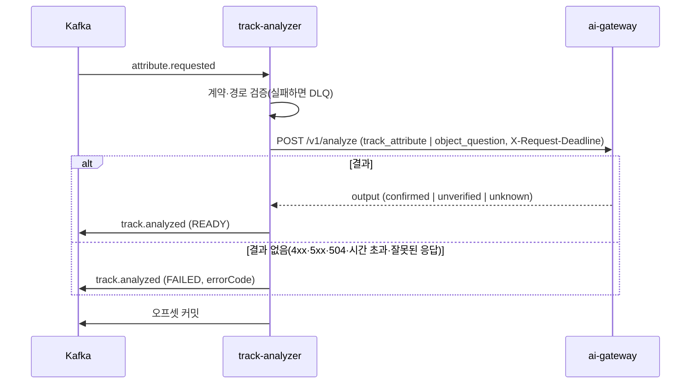

# Plan: SPEC-024 track-analyzer 트랙 속성 분석과 객체 자유 질문 — ai

- spec: docs 레포 `docs/specs/SPEC-024-track-analyzer/spec.md`
- 계약: `events/attribute.requested`·`track.analyzed`·`_track-attribute`·`_object-answer`, `taxonomy/v2`(`ppeState`·`workerRole`), `tracks/v1/chunk-tracks`(`representativeCrops`), `openapi/ai-gateway.yaml`(`TaskType` `track_attribute`·`object_question`), `asyncapi/track-analyzer.yaml` 1.0.0, `stages/v1` (docs #119, 계약 묶음 3.4.0. 구현은 잠금 4.0.0으로 한다)
- 앞선 구현: SPEC-020(event-analyzer 워커 구조, ai #38), SPEC-021(생성 클라이언트·재시도 규칙·`X-Request-Deadline`)

- v5.1(계약 묶음 4.0.0, 2026-11-07): 이 spec의 호출·응답 형식은 바뀌지 않는다. `ppe_missing` 확정 이벤트를 보호구 상태로 우선 표시하는 것은 화면(SPEC-032 R-15)의 몫이다. 잠금 태스크(T001)는 4.0.0으로 한다.

## 1. 요약

새 Kafka 워커 `services/track-analyzer`를 만든다. `attribute.requested`를 받아 reason `event`·`click`이면 `track_attribute`, `question`이면 `object_question`으로 ai-gateway `/v1/analyze`를 한 번 부르고, 요청마다 `track.analyzed`를 한 건 발행한다. 호출이 결과 없이 끝나면 화면이 기다리지 않도록 `outcome: FAILED`로 발행한다. DB·저장소는 없다. 구조는 event-analyzer(SPEC-020)와 같다.

ai-gateway에는 두 taskType의 Registry 폴더(입력·출력 스키마, 자리 표시 프롬프트, `fallback.json`)와 두 로컬 프로필 항목만 더한다. taskType별 코드는 쓰지 않는다(SPEC-009 R-24). 출력 스키마는 계약 `events/_track-attribute`·`_object-answer`를 참조한다. 프롬프트 문안·모델 선택은 AI 담당자 몫이다.

## 2. 담당 요구사항

경로의 `ta/`는 `services/track-analyzer/src/track_analyzer/`, `t/`는 `services/track-analyzer/tests/`, `gw/`는 `services/ai-gateway/`, `lc/`는 `libs/contracts/`다.

| 요구사항 | 담당 모듈 / 컴포넌트 | 검증 테스트 |
| --- | --- | --- |
| R-1 | `ta/service.py` `_request`(track_attribute) | `t/test_track_service.py` |
| R-2 | `ta/service.py` `_request`(object_question) | `t/test_track_service.py` |
| R-3 | `ta/service.py` `_ready`, `vlm_contracts.events.TrackAnalyzed`·`TrackAttribute`·`ObjectAnswer` | `t/test_track_service.py`(계약 스키마 통과), `lc/tests/test_event_contracts.py`, `lc/tests/test_track_attribute_contracts.py` |
| R-4 | `ta/service.py` `_failed`(`AiGatewayError` → FAILED) | `t/test_track_service.py` |
| R-5 | `ta/ids.py` `analyzed_event_id` | `t/test_track_service.py` |
| R-6 | `vlm_contracts.events.AttributeRequested` 경로 검증 → 워커가 DLQ | `lc/tests/test_track_attribute_contracts.py`, `t/test_track_worker_e2e.py` |
| R-7 | `AttributeRequested` 검증 → 워커가 DLQ | `t/test_track_worker_e2e.py` |
| R-8 | 워커 재시도(SPEC-013 공통). 발행 오류를 그대로 던짐 | `t/test_track_service.py` |
| R-9 | `ta/__main__.py` `build_client`(제한 시간 → SPEC-021 마감 헤더) | `t/test_track_main.py` |
| R-10 | `ta/service.py` 단계 블록, `vlm_contracts.stages.StageId` | `t/test_track_service.py`, `lc/tests/test_stage_contracts.py` |
| R-11 | `gw/registry/prompts/track_attribute/`, 프로필 `[tasks.track_attribute]` | `gw/tests/test_prompts.py`, `gw/tests/test_analyze_api.py` |
| R-12 | `gw/registry/prompts/object_question/`, 프로필 `[tasks.object_question]` | `gw/tests/test_prompts.py`, `gw/tests/test_analyze_api.py` |
| R-13 | 두 폴더의 `fallback.json`(기존 대체 결과 경로) | `gw/tests/test_analyze_api.py` |
| NFR-1 | 호출 하나·발행 하나, mock 프로필 | 로컬 compose 측정(tasks.md 측정 기록) |
| NFR-2 | `KafkaWorker`(하나씩 처리, 발행 뒤 커밋, 긴 핸들러 중 poll 유지) | `t/test_track_worker_e2e.py` |
| NFR-3 | `ta/service.py` 로그 항목(requestId·reason·오류 코드만) | `t/test_track_service.py`(`caplog`에 질문·답 없음) |

## 3. 원칙 점검

| 원칙 | 준수 | 비고 |
| --- | --- | --- |
| I 스펙 우선 | ☑ | SPEC-024 Approved (docs #119) |
| II 계약 우선 | ☑ | docs #119 머지. 잠금은 첫 태스크에서 3.14.0으로 올린다 |
| III 테스트 우선 | ☑ | R-1~R-13, NFR-2·NFR-3 테스트 매핑. NFR-1은 로컬 측정 |
| IV 서비스 자율성 | ☑ | 저장소·DB 없음. 이미지는 ai-gateway가 읽는다. analysis-api·notification 코드는 건드리지 않는다 |
| V 단순성 | ☑ | 새 외부 패키지 없음. event-analyzer와 같은 워커 구조, 설정은 환경변수만(유형별 기준값이 없어 프로필 파일 없음) |
| VI 관측 가능성 | ☑ | 단계 `attribute.call`, 결과에 호출 ID·모델·프롬프트 버전·분류 체계 버전 |
| VII 보안 | ☑ | 이미지 경로를 메시지 sourceId 폴더로 제한(R-6), 질문·답을 로그에 남기지 않음(NFR-3) |
| VIII 문서·주석 | ☑ | 계약 모델 테스트, README, 서비스 카탈로그는 docs 몫 |
| IX GitOps | ☑ | 운영 배포는 사용자 지시 시 |

## 4. 기술 설계

### 앞선 작업과 의존

- **SPEC-021 구현이 먼저 끝난다.** 이 plan은 다음을 전제로 한다.
  - `libs/ai-client` 요청·응답 모델이 계약에서 생성된 코드다. 아래의 `AnalyzeRequest`·`ImageRef`(`storageKey`·`ptsSec`) 같은 이름은 SPEC-021 plan이 정한 생성 모델 이름을 따른다.
  - analyze는 연결 실패만 재시도하고 502·503·504·시간 초과는 바로 `AiGatewayError`다(SPEC-021 R-9). 오류 코드 규칙은 SPEC-021 R-12다.
  - 클라이언트가 모든 호출에 `X-Request-Deadline`(첫 시도 시각 + 설정 제한 시간)을 싣는다(SPEC-021 R-8). track-analyzer는 제한 시간만 설정으로 넘긴다(R-9).
- 계약 잠금은 지금 3.0.0이다. 첫 태스크에서 `scripts/fetch-service-contracts.sh --update 4.0.0`으로 올린다. 이미 4.0.0이면 건너뛴다.
  - 4.0.0으로 올리면 지금 코드의 계약 테스트 4개가 깨진다(작업 공간 계약으로 확인함): `StageId` 목록, `EventAnalyzed`의 필드·enum·예시 왕복(SPEC-023이 바꾼 `event.analyzed`). 잠금 태스크에서 같이 맞춘다. 이 태스크는 SPEC-023 plan의 T001과 같은 태스크이고, 먼저 구현하는 쪽이 한다(handoff 6절 순서상 이 spec이 먼저다).

### 패키지

| 경로 | 내용 |
| --- | --- |
| `lc/.../events.py` | `PpeState`·`WorkerRole`, `TrackAttribute`, `ObjectAnswer`, `AttributeCrop`, `AttributeRequested`, `TrackAnalyzed`. `EVENT_MODELS`에 `attribute.requested`·`track.analyzed` |
| `lc/.../stages.py` | 4.0.0 단계 ID 전체(이 spec은 `track-analyzer.queue_wait`·`track-analyzer.handle`·`attribute.call`) |
| `lc/.../tracks.py` | 트랙 요약 파일 모델의 `representativeCrops`. 모델은 SPEC-022(track-stitcher)가 만든다. 그 모델이 아직 없으면 이 태스크는 건너뛰고 SPEC-022가 4.0.0 계약대로 필드를 넣는다. ai 레포에서 이 필드를 읽는 서비스는 없다 |
| `ta/settings.py` | 환경변수 `TRACK_ANALYZER_`: 소비 그룹, ai-gateway 주소, 호출 제한 시간, 연결 실패 재시도 횟수·대기 |
| `ta/service.py` | 핸들러 |
| `ta/ids.py` | eventId = uuid5(`vlm:track.analyzed:<requestId>`) |
| `ta/__main__.py` | 조립·기동 |
| `gw/registry/prompts/track_attribute/` | `prompt.md`(자리 표시), `input.schema.json`, `output.schema.json`, `fallback.json` |
| `gw/registry/prompts/object_question/` | 같은 구성 |
| `gw/profiles/local.toml`, `local-mock.toml` | `[tasks.track_attribute]`·`[tasks.object_question]` |

새 멤버 `services/track-analyzer`는 루트 `pyproject.toml`의 `members`, `[tool.mypy] files`·`mypy_path`, `[tool.pytest.ini_options] pythonpath`에 모두 더한다(handoff 4.3).

### 처리 순서

1. 워커가 `AttributeRequested`로 검증한다(R-7). 모델 검증에 경로 검사(R-6)가 들어 있어 sourceId 폴더 밖 경로도 여기서 DLQ로 간다. ai-gateway를 부르지 않는다.
2. 요청을 만든다.
   - `event`·`click`(R-1): taskType `track_attribute`, 이미지 = `crops`(순서 유지, `ptsSec` = `ptsMs` / 1000), 변수 `{"className": ...}`
   - `question`(R-2): taskType `object_question`, 이미지 = `crops` 다음에 `evidenceFrameKeys`(장면 프레임은 `ptsSec` 없음), 변수 `{"className": ..., "question": ...}`
3. `attribute.call`(unit `images`, count = 보낸 이미지 수, R-10): 호출 한 번. 연결 실패 재시도는 클라이언트 안이라 블록 시간에 들어간다.
4. 결과(R-3): reason에 맞게 `output`을 `TrackAttribute` 또는 `ObjectAnswer`로 검증하고 `outcome: READY`, `callId`·`modelId`·`promptVersion`·`taxonomyVersion`(응답 값)을 담는다. `unverified`·`unknown`도 READY다.
5. 실패(R-4): `AiGatewayError`면 `outcome: FAILED`, `errorCode` = 오류 코드, `attributes`·`answer`·`callId`·`modelId`·`promptVersion`·`taxonomyVersion` = null(계약 예시와 같음). 응답 `output`이 결과 형식과 맞지 않으면 `AI_INVALID_RESPONSE`로 FAILED다.
   - SPEC-020과 달리 4xx(403 포함)도 DLQ가 아니라 FAILED다. 화면이 기다리는 요청이라 결과 없이 끝내지 않는다는 spec 목적이고, R-4가 4xx를 명시했다.
6. 발행: `track.analyzed`, 키 sourceId, eventId는 `analyzed_event_id(requestId)`(R-5). 블로킹 발행은 `asyncio.to_thread`로 넘기고 오류는 그대로 던져 재시도 토픽으로 간다(R-8).

- 로그(NFR-3): 실패 경고에 `requestId`, `reason`, `taskType`, `code`만 싣는다. 질문·답·설명 문장, 요청 변수를 싣지 않는다. 계약 모델의 `repr`이 로그에 찍히지 않도록 예외 메시지에도 넣지 않는다.
- 다시 처리할 때 ai-gateway를 다시 부른다. 같은 이미지·변수면 결과 캐시(SPEC-016)가 받는다.

### 계약 모델

- `AttributeRequested`
  - 계약의 if/then: `question`이면 `question` 필수(문자열), 아니면 `question` null·`evidenceFrameKeys` 빈 배열
  - 경로 검증(R-6): 모든 `crops[].key`·`evidenceFrameKeys`가 `sources/<메시지 sourceId>/`로 시작하고, `.`·`..`·빈 경로 조각이 없어야 한다. 계약 패턴(`^sources/[0-9a-f-]{36}/.+/blurred/...`)은 sourceId와 `..`를 보지 않아 모델에서 확인한다(SPEC-019 `SegmentReady` 선례).
- `TrackAnalyzed`: `READY`+`event`·`click`이면 `attributes` 있음·`answer` null, `READY`+`question`이면 `answer` 있음·`attributes` null, `FAILED`면 `errorCode` 있음·둘 다 null. `taxonomyVersion`은 `"v2"` 또는 null.
- `TrackAttribute`: `verificationStatus`(`confirmed`·`unverified`·`unknown`), `helmet`·`vest`(`PpeState | None`), `role`(`WorkerRole | None`), `equipment`(클래스 이름 10개 이하, 중복 없음), `description`(300자 이하)
- `ObjectAnswer`: `verificationStatus`, `answerable`(bool | None), `answer`(1000자 이하)

### ai-gateway

- `track_attribute/input.schema.json`: `className`(분류 체계 `className` 참조) 필수, 추가 속성 없음. 예시 하나.
- `object_question/input.schema.json`: `className`, `question`(1~500자) 필수. 질문 길이는 입력 스키마 검증(SPEC-009 R-2)으로 400이 된다.
- `output.schema.json`: `$ref: ../../events/_track-attribute.schema.json`(또는 `_object-answer`)과 출력 예시만. 예시는 mock Adapter 응답이 된다.
- `fallback.json`: `verificationStatus`는 `$status`, 판정 필드는 null, `equipment`는 빈 배열(R-13). 입력 변수를 쓰지 않는다. 모델 미설정·예산 초과(`unverified`), 출력 검증 실패(`unknown`)는 기존 대체 결과 경로가 처리한다.
- `prompt.md`: 동작 확인용 자리 표시 문장. 문안은 AI 담당자 몫이다.
- 프로필: `max_images`는 `track_attribute` 3, `object_question` 11(크롭 3 + 장면 8). `local.toml`은 로컬 Ollama의 같은 모델(`qwen3-vl:4b-instruct`), `local-mock.toml`은 mock. 출력 토큰·제한 시간은 `event_judge`와 같은 자리값이다.
- 계약 파일 배치: 테스트 `conftest.py`의 registry 배치와 Dockerfile COPY에 `events/_track-attribute.schema.json`·`_object-answer.schema.json`을 더한다. `registry_bundle._REGISTRY_FOLDERS`는 이미 `events`를 담는다. 테스트 도우미 `gateway_support.profile()`의 tasks에도 두 taskType을 더한다(프로필·Registry 목록이 다르면 `check_tasks`가 기동을 막는다).
- 이미지 하한(R-11 "1~3장", R-12 "1~11장"): ai-gateway는 지금 상한(`max_images`)만 검사한다. 하한 검사를 더하려면 프로필 스키마에 `min_images`를 더해야 한다(사용자 확인 필요 1). 기본안은 `TaskProfile`에 `min_images`(기본 0, 기존 taskType 동작 유지)를 더하고 두 taskType은 1로 둔다. 모자라면 400 `AI_INVALID_REQUEST`다. 확인 전까지 해당 태스크(T009)는 보류한다.

### 상호작용

## 5. 대안과 선택 이유

| 대안 | 장점 | 단점 | 선택 |
| --- | --- | --- | --- |
| 경로 검사를 계약 모델 검증에 둠 | 워커의 계약 불일치 DLQ 경로를 그대로 씀, SPEC-019 선례 | 모델에 메시지 간 규칙이 들어감 | ☑ |
| 경로 검사를 서비스에서 `NonRetryableError`로 | 서비스 코드에서 보임 | 같은 결과를 두 곳에서 처리 | |
| 4xx도 FAILED로 발행 | 화면이 기다리지 않음(spec 목적, R-4) | 설정 오류가 DLQ에 쌓이지 않고 결과로 보임 | ☑ |
| SPEC-020처럼 4xx는 DLQ | 설정 오류가 눈에 띔 | 화면이 무한정 기다림. R-4와 다름 | |
| 출력 형식 파일을 Registry에 하나씩 복사 | 프롬프트와 관계없는 이벤트 스키마가 섞이지 않음(SPEC-020 선택 유지) | 복사 목록이 세 곳에서 늘어남 | ☑ |
| 프로필에 `min_images` 추가 | 하한을 ai-gateway가 지킴 | 프로필 스키마 변경 | 확인 필요 1 |
| 하한을 호출자 계약(`crops` 1개 이상)에 맡김 | 변경 없음 | ai-gateway가 R-11·R-12의 하한을 보장하지 않음 | |

## 6. 테스트 전략

- 계약: `EVENT_MODELS` 자동 계약 테스트(필드·필수·enum·예시 왕복), 결과 형식 2종과 `TrackAnalyzed` 조건 규칙, `AttributeRequested` 경로 검사(다른 sourceId, `..`, `question` 규칙), 단계 ID 목록
- 서비스: 가짜 클라이언트·기록 발행기로 reason별 요청(이미지 순서·`ptsSec`·변수), READY·FAILED 결과를 docs 계약 JSON Schema로 검증, 같은 요청 → 같은 eventId, 단계 블록 count, `caplog`에 질문·답 없음
- 클라이언트 경계: `MockTransport`로 503(한 번만 호출)·504·시간 초과·403·잘못된 출력 → FAILED와 코드
- 기동: `build_client`가 설정 제한 시간으로 `X-Request-Deadline`을 싣는지(`MockTransport`가 받은 헤더)
- ai-gateway: 두 taskType 로드·버전 ID, 이미지 상한 초과 400, `question` 길이 400, mock 출력이 계약 형식, 모델 미설정·예산 초과 `unverified`, 잘못된 모델 출력 `unknown`
- 워커 e2e: Kafka testcontainer와 `MockTransport` 클라이언트로 정상 발행, 잘못된 메시지 DLQ, sourceId 밖 경로 DLQ(ai-gateway 호출 0회), 긴 호출 중 커밋. 구현 뒤에 쓰는 통합 테스트라 Red 없음으로 PR에 적는다
- 테스트 파일 이름은 `test_track_*`(서비스), `test_track_attribute_contracts.py`(계약)로 짓고, 여러 파일이 쓰는 도우미는 `ta_support.py`로 둔다(루트 `pythonpath`에 `services/track-analyzer/tests` 추가)
- 로컬 compose: mock 프로필 ai-gateway로 click·question 요청의 발행부터 결과까지 p95(NFR-1)

## 7. 리스크와 롤백

- 생산자(analysis-api, 다른 담당자)가 아직 없다. 로컬은 직접 넣은 메시지로만 확인한다. 생산자가 계약을 바꾸면 소비 쪽을 맞춘다(handoff 2.1).
- 실제 크롭 이미지는 chunk-processor(다른 담당자)가 `representativeCrops`를 쓰기 전까지 없다. 로컬은 실행 폴더 `blurred/`에 올린 단색 JPEG로 확인한다(SPEC-020 측정과 같음).
- ai-gateway의 대체 결과·출력 검증 코드가 `VLMAnalysis` 모양을 가정한 곳이 있으면 새 taskType에서 드러난다. T007·T008·T010 테스트가 이를 잡는다. 코드 수정이 필요하면 taskType별 분기 없이 일반화한다.
- 클릭 응답 p95 2초(NFR-1)는 mock 기준이다. 실제 모델 응답 시간은 AI 담당자의 모델 선택에 달렸다.
- 롤백: 새 서비스라 끄면 된다. ai-gateway 변경은 폴더·프로필 항목 추가라 지우면 이전과 같다.

## 8. 배포 고려사항

- 환경변수(레포 `.env.example`, README): `TRACK_ANALYZER_AI_GATEWAY_URL`(필수), `TRACK_ANALYZER_CALL_TIMEOUT_S`(기본 60. 화면이 기다리는 요청이라 event-analyzer 180초보다 짧다. 마감 헤더로 ai-gateway도 같은 시각에 멈춘다), `TRACK_ANALYZER_MAX_RETRIES`·`_RETRY_BASE_DELAY_S`(2, 1.0, 연결 실패만), `TRACK_ANALYZER_GROUP_ID`(`track-analyzer`), 공통 `KAFKA_BOOTSTRAP`·`STAGE_TIMING_PUBLISH`·`HEALTH_PORT`·`LOG_LEVEL`
- Dockerfile(멀티스테이지, non-root)과 CI `service-images` job에 runtime 빌드 단계를 더한다. ai-gateway Dockerfile에 계약 파일 2개 COPY.
- 로컬 compose(docs 레포, 별도 PR): track-analyzer 서비스(메모리 256M), `kafka-init`에 `attribute.requested`·`track.analyzed`·`attribute.requested.track-analyzer.retry`·`track-analyzer.dlq`, `local/README.md` 표.
- ai-gateway 프로필의 `[callers] allowed`에는 이미 `track-analyzer`가 있다.
- 운영 배포·토픽·ConfigMap은 사용자 지시 시 infra·gitops에서 한다.

## 9. v5.1 추가 설계(계약 묶음 4.0.0, 2026-11-07)

바뀐 요구사항이 없다. 잠금을 4.0.0으로 올리면 깨지는 계약 테스트(`StageId` 목록, `EventAnalyzed`)는 T001에서 SPEC-023 T001과 같은 방식으로 맞춘다.
