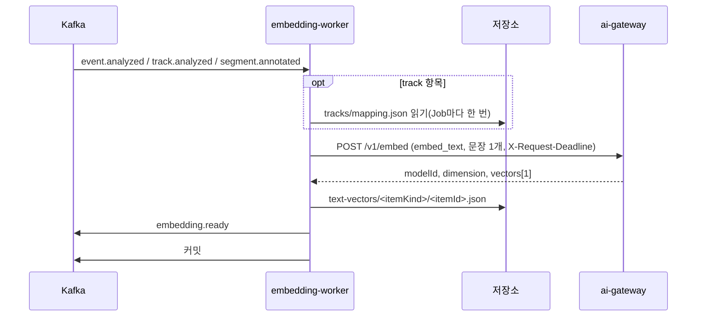

# Plan: SPEC-025 embedding-worker 이벤트·트랙·구간 주석 텍스트 벡터 — ai

- spec: docs 레포 `docs/specs/SPEC-025-embedding-worker/spec.md`
- 계약: `events/event.analyzed`·`track.analyzed`·`segment.annotated`·`embedding.ready`, `vectors/v1/text-vector-file`, `tracks/v1/track-mapping`(트랙 항목 시각·클래스, 4절), `stages/v1`, `asyncapi/embedding-worker.yaml`, `openapi/ai-gateway.yaml`(`/v1/embed`, `X-Request-Deadline`). 잠금 계약 묶음 4.1.0

## 1. 요약

새 Kafka 워커 `services/embedding-worker`를 만든다. 소비 그룹 하나(`embedding-worker`)로 `event.analyzed`·`track.analyzed`·`segment.annotated`를 받는다. 메시지 하나에서 항목(itemKind·itemId) 하나와 문장 하나를 만든다. 문장이 있으면 ai-gateway `/v1/embed`(`embed_text`, 문장 1개)를 부르고, 응답 벡터를 텍스트 벡터 파일로 저장한 뒤 `embedding.ready`를 발행한다. 문장이 없거나 조건에 맞지 않는 항목은 호출 없이 건너뛴다.

ai-gateway 호출은 SPEC-021이 `libs/ai-client`에 더하는 `embed`(생성 모델, `X-Request-Deadline`, 503·연결 실패 2회 재시도)를 그대로 쓴다. 이 plan은 SPEC-021 구현이 먼저 머지된다고 본다. 새 Python 패키지는 없다. DB는 없고 저장소는 텍스트 벡터 파일 쓰기와 트랙 번역표 읽기만 한다.

## 2. 담당 요구사항

경로의 `ew/`는 `services/embedding-worker/src/embedding_worker/`, `t/`는 `services/embedding-worker/tests/`다.

| 요구사항 | 담당 모듈 / 컴포넌트 | 검증 테스트 |
| --- | --- | --- |
| R-1 | `ew/texts.py` `event_item` | `t/test_embedding_texts.py` |
| R-2 | `ew/texts.py` `track_item` | `t/test_embedding_texts.py` |
| R-3 | `ew/texts.py` `annotation_item` | `t/test_embedding_texts.py` |
| R-4 | `ew/texts.py`(`Skip` 결과), `ew/service.py`(호출·발행 없이 로그) | `t/test_embedding_texts.py`, `t/test_embedding_service.py` |
| R-5 | `ew/texts.py` `_clip`(설정 `max_chars`) | `t/test_embedding_texts.py` |
| R-6 | `ew/service.py`, `ew/files.py`(경로·파일 모델) | `t/test_embedding_service.py`(파일·이벤트 계약 스키마 통과) |
| R-7 | `ew/texts.py`(항목별 `metadata`), `ew/tracks.py`(번역표 조회) | `t/test_embedding_texts.py`, `t/test_embedding_service.py` |
| R-8 | `ew/ids.py`, `ew/service.py`(응답 `modelId`·`dimension` 기록) | `t/test_embedding_ids.py`, `t/test_embedding_service.py` |
| R-9 | `ew/service.py` `_embed`(`AiGatewayError` 분류) | `t/test_embedding_service.py` |
| R-10 | `ew/service.py` `_embed`(4xx·벡터 수·길이 검사 → `NonRetryableError`) | `t/test_embedding_service.py` |
| R-11 | `vlm_contracts` 모델 검증 → 워커가 DLQ | `t/test_embedding_worker_e2e.py` |
| R-12 | 워커 재시도(SPEC-013 공통). 저장·발행 오류를 그대로 던짐 | `t/test_embedding_service.py` |
| R-13 | `ew/service.py` 단계 블록 | `t/test_embedding_service.py` |
| NFR-1 | 핸들러 전체 | 로컬 compose 측정(tasks "측정 기록") |
| NFR-2 | `ew/service.py` 로그 필드(항목 ID·이유·코드만) | `t/test_embedding_service.py`(로그에 문장·벡터가 없음) |
| NFR-3 | `KafkaWorker`(하나씩 처리, 발행 뒤 커밋) | `t/test_embedding_worker_e2e.py` |

## 3. 원칙 점검

| 원칙 | 준수 | 비고 |
| --- | --- | --- |
| I 스펙 우선 | ☑ | SPEC-025 Approved (docs #120) |
| II 계약 우선 | ☑ | docs #120 머지. 잠금 4.1.0에 계약과 단계 ID가 이미 있다(T001). 트랙 항목 시각·클래스는 번역표에서 읽는다(D-12) |
| III 테스트 우선 | ☑ | R-1~R-13, NFR-2·NFR-3 테스트 매핑, NFR-1은 로컬 측정 |
| IV 서비스 자율성 | ☑ | DB 없음. search-service 코드·DB에 의존하지 않고 계약 파일만 쓴다. 트랙 번역표는 계약 `tracks/v1/track-mapping` 형식의 저장소 파일로만 읽는다 |
| V 단순성 | ☑ | 새 패키지 없음. 묶음 임베딩 없이 메시지 하나에 문장 하나(spec 제외 범위). 설정은 환경변수만, 프로필 파일 없음 |
| VI 관측 가능성 | ☑ | 단계 `embedding.call`·`embedding.store`, health, `traceparent` 전파, 건너뜀 로그(이유 코드) |
| VII 보안 | ☑ | 문장 원문·벡터를 로그에 남기지 않음(NFR-2). 입력은 계약 모델로 경계에서 검증 |
| VIII 문서·주석 | ☑ | 계약 모델 테스트, README, 문장 규칙에 R-ID 주석 |
| IX GitOps | ☑ | 운영 배포·토픽은 사용자 지시 시 infra·gitops |

## 4. 기술 설계

### 패키지

| 경로 | 내용 |
| --- | --- |
| `libs/contracts/.../events.py` | `SegmentAnnotated`, `EmbeddingReady`, `ItemKind`. `TrackAnalyzed`·`TrackAttribute`는 SPEC-024 구현이 이미 더했다 |
| `libs/contracts/.../vectors.py` | `TextVectorFile`, `TextVectorMetadata`(필드는 모두 선택, `startMs`·`endMs`만 필수). 벡터 길이 = `dimension` 검사 |
| `libs/contracts/.../track_mapping.py` | `TrackMappingSummary`·`MappedTrackSummary`(번역표 읽기 전용. 최종 trackId·className·startMs·endMs만 두고 나머지 필드는 무시). SPEC-022의 전체 모델 `tracks.py`가 아직 main에 없어 파일을 분리해 충돌을 피했다(D-12) |
| `libs/contracts/.../stages.py` | 단계 ID 4개(`embedding-worker.queue_wait`·`.handle`, `embedding.call`·`embedding.store`) |
| `ew/settings.py` | 환경변수 `EMBEDDING_WORKER_`: 소비 그룹, ai-gateway 주소, 호출 제한 시간(기본 30초), 재시도 횟수·첫 대기, 최대 글자 수(기본 2000, 최대 2000), 번역표 메모리 개수(기본 8) |
| `ew/texts.py` | 입력 이벤트 → `TextItem`(itemKind, itemId, jobId, text, textFormat, metadata) 또는 `Skip(reason)`. track은 `track_skip`으로 조건을 먼저 보고, 통과한 메시지만 번역표를 읽는다 |
| `ew/tracks.py` | `TrackLookup`: jobId별 번역표를 읽어 trackId → (className, startMs, endMs) |
| `ew/files.py` | 벡터 파일 경로 `sources/<sourceId>/jobs/<jobId>/text-vectors/<itemKind>/<itemId>.json` |
| `ew/ids.py` | eventId = uuid5(`vlm:embedding.ready:<itemKind>:<itemId>:<modelId>`) |
| `ew/service.py` | 세 핸들러(`handle_event`, `handle_track`, `handle_annotation`)와 공통 처리 `_process` |
| `ew/__main__.py` | 조립·기동(`route` 세 개, health, 측정 발행) |

### 문장 규칙

| itemKind | textFormat | 문장 | metadata |
| --- | --- | --- | --- |
| `event` | `event-v1` | `analysis`의 `description`·`riskReason`·`solution` 중 null이 아니고 공백뿐이 아닌 값을 이 순서로 `"\n"`으로 잇는다(R-1) | `startMs`·`endMs`(이벤트의 ms 값), `eventType`(`analysis.eventType`), `severity`(null이면 생략), `verificationStatus`(`analysis`) |
| `track` | `track-v1` | `attributes.description`(R-2) | `startMs`·`endMs`·`className`(번역표), `trackId`, `helmet`·`vest`·`role`(null이면 생략) |
| `segment_annotation` | `segment_annotation-v1` | `text`(R-3) | `startMs`·`endMs`, `segmentId` |

- 문장 결과가 빈 문자열이거나 공백뿐이면 `Skip`이다(R-4). 공백뿐인 문자열도 임베딩할 값이 없다고 본다. event의 세 값 중 공백뿐인 값도 같은 이유로 잇지 않는다(빈 줄이 생기지 않게 한다).
- 이벤트 시각은 계약의 `startMs`·`endMs`(ms)다(D-13). `analysis.evidenceStart`·`evidenceEnd`(초)는 판정하지 못하면 null이라 쓰지 않는다.
- track은 reason `event`·`click`, `outcome` `READY`, `attributes.verificationStatus` `confirmed`, `description`이 있을 때만 항목을 만든다. 하나라도 어기면 `Skip`이고 이유 코드(`track_question`, `track_failed`, `track_not_confirmed`, `track_no_description`)를 남긴다(R-4).
- 최대 글자 수는 파이썬 문자열 길이(코드 포인트) 기준으로 앞에서 자른다(R-5). 계약 `text.maxLength`가 2000이라 설정 상한도 2000이다.
- 텍스트 벡터 파일 metadata는 계약상 null을 받지 않는다. 값이 null인 필터 필드는 키를 빼고 쓴다.
- textFormat 값은 코드 상수다. 문장 규칙을 바꾸면 버전을 올리고 재임베딩 대상이 된다(계약 설명).

### 트랙 항목의 시각·클래스

`track.analyzed`에는 R-7이 요구하는 트랙 시각과 클래스가 없다. 계약에서 구할 수 있는 곳은 track-stitcher의 번역표(`tracks/v1/track-mapping`, 경로 `sources/<sourceId>/jobs/<jobId>/tracks/mapping.json`)다. 이 파일을 읽어 trackId로 `className`·`startMs`·`endMs`를 찾는다(D-12 결정). 계약 변경 없이 R-7을 채울 수 있다.

- 번역표는 Job마다 한 번 읽고 워커 메모리에 jobId 키로 작게(설정 개수) 보관한다. 같은 Job의 트랙 메시지가 이어서 오기 때문이다.
- 번역표가 없으면 저장소 일시 오류처럼 다시 던져 재시도 토픽으로 보낸다(R-12). `track.analyzed`는 `track.manifest` 뒤에 나오므로 정상 흐름에서는 있다.
- 메모리의 번역표에 trackId가 없으면 저장소에서 한 번 다시 읽는다. 그래도 없으면 다시 처리해도 같으므로 `NonRetryableError`로 DLQ에 보낸다. 번역표가 계약과 맞지 않거나 다른 Job의 것이어도 DLQ다.

### 처리 순서

1. 워커가 토픽별 계약 모델로 검증한다. 맞지 않으면 DLQ(R-11).
2. `texts.py`로 항목을 만든다. `Skip`이면 이유와 입력 eventId만 로그에 남기고 끝낸다(R-4, NFR-2).
3. `embedding.call`(count 1, unit `texts`): `embed(EmbedRequest(taskType=embed_text, texts=[text]))`. 헤더 `X-Caller: embedding-worker`, `traceparent`, `X-Request-Deadline`(SPEC-021 R-8).
4. 응답 검사: 벡터 수 1, 벡터 길이 = `dimension`. 어기면 `NonRetryableError`(R-10). 모델 ID·차원이 계약 범위(200자, 4096)를 넘어 파일·이벤트 모델 검증에 실패해도 같다.
5. `embedding.store`(count 1, unit `files`): 텍스트 벡터 파일을 `put_bytes`로 같은 경로에 덮어쓴다(R-6, R-12). 경로에 모델 단계가 없어 같은 항목·다른 모델이면 마지막 모델 결과로 덮어쓴다(C-5).
6. `embedding.ready` 발행. 키는 sourceId, eventId는 `ids.py`(R-8). 발행 오류는 그대로 던진다(R-12).

- 저장소·발행은 블로킹이라 `asyncio.to_thread`로 넘긴다.
- 파일을 먼저 저장하고 이벤트를 낸다. 소비자가 이벤트를 받았을 때 파일이 있어야 하기 때문이다.

### ai-gateway 오류 분류

ai-client가 SPEC-021 R-10 재시도를 마친 뒤 던진 `AiGatewayError`를 아래처럼 나눈다.

| 결과 | 처리 | 근거 |
| --- | --- | --- |
| `AI_MODEL_NOT_CONFIGURED`(503), `AI_BUDGET_EXCEEDED`(429) | `NonRetryableError` → DLQ | R-9 단서. 503인 `AI_MODEL_NOT_CONFIGURED`는 클라이언트가 2회 재시도한 뒤 DLQ로 간다(C-6, 그대로 둔다) |
| 그 밖의 503, 429 `AI_RATE_LIMITED`, `AI_CONNECTION_FAILED`, `AI_TIMEOUT` | 그대로 던짐 → 재시도 토픽, 소진하면 DLQ | R-9 |
| 그 밖의 4xx, `AI_INVALID_RESPONSE` | `NonRetryableError` → DLQ | R-10. 계약과 맞지 않는 응답은 다시 불러도 같다고 본다 |
| 502 `AI_PROVIDER_FAILED`, 504 `AI_DEADLINE_EXCEEDED`, 그 밖의 5xx | 그대로 던짐 → 재시도 토픽 | spec에 없음. D-14 결정 |

### embedding-worker 범위 밖

- 텍스트 인덱스 적재와 하이브리드 검색은 search-service(다른 담당자)다. 이 레포에서 그 코드를 만들지 않는다.
- 로컬에서 `segment.annotated`는 생산자가 없으므로 e2e·측정은 테스트가 직접 넣는다.

### 상호작용

## 5. 대안과 선택 이유

| 대안 | 장점 | 단점 | 선택 |
| --- | --- | --- | --- |
| 트랙 시각·클래스를 번역표 파일에서 읽음 | 계약 변경 없음. 최종 trackId 기준 값이 이미 있다 | 저장소 읽기가 하나 늘고 track-stitcher 출력에 의존 | ☑(D-12) |
| `track.analyzed`에 `className`·`startMs`·`endMs` 추가(계약 변경, track-analyzer는 내 담당) | 메시지 하나로 끝남 | 계약·SPEC-024 변경이 필요하고 attribute.requested에도 시각이 없어 analysis-api(다른 담당자) 계약까지 바뀜 | |
| 트랙 항목 metadata를 비워 둠 | 단순 | 계약 `metadata.startMs`·`endMs`가 필수라 파일이 계약을 어김 | |
| 세 토픽을 소비 그룹 하나로 받음 | Pod·설정 하나, 같은 DLQ | 토픽마다 재시도 토픽이 따로 생김 | ☑ |
| 토픽마다 워커를 나눔 | 토픽별 확장 | 배포 단위가 셋이 되어 catalog와 다름 | |
| 오류 분류를 embedding-worker에 둠 | 워커별 정책(DLQ 코드)이 보임 | — | ☑ |
| 오류 분류를 ai-client에 둠 | 재사용 | DLQ 결정은 워커 정책이라 클라이언트가 알 일이 아님 | |

## 6. 테스트 전략

- 단위: 문장 규칙(세 종류, null 조합, 공백, 잘라내기), metadata(null 필드 생략), ID 결정성, 경로
- 서비스: 가짜 ai-client(`embed`만 있는 Protocol 구현)·`InMemoryStorage`·기록 발행기로 핸들러 전체. 결과 파일과 이벤트를 docs 계약 스키마(jsonschema)로 검증한다. 오류 분류는 `AiGatewayError`를 직접 던지는 가짜로 확인한다. 로그 캡처로 문장·벡터가 없는지 확인한다.
- 계약: 새 모델을 docs 원본과 비교(필드·필수·enum·예시 왕복), 단계 ID
- 워커 e2e: Kafka testcontainer와 `MockTransport`로 만든 ai-client로 세 토픽 정상 발행, 잘못된 메시지 DLQ, `AI_MODEL_NOT_CONFIGURED` DLQ, 503 재시도 토픽, 발행 뒤 커밋
- 테스트 파일 이름은 `test_embedding_*`, 공용 도우미는 `ew_support.py`(루트 `pythonpath`에 등록)
- 로컬 compose: mock 프로필 ai-gateway로 메시지 처리 시간 p95(NFR-1)

## 7. 리스크와 롤백

- 리스크
  - SPEC-022의 번역표 전체 모델(`vlm_contracts.tracks`)이 머지돼도 읽기 모델(`track_mapping.py`)과 함께 둘 수 있다. 읽기 모델은 필요한 필드만 본다.
  - 벡터 파일 경로에 모델 ID가 없다(계약 `vectorKey` 패턴). 임베딩 모델이 바뀌면 같은 경로를 마지막 결과로 덮어쓰고 eventId만 달라진다(C-5). spec 제외 범위 문장("다른 모델이면 다른 파일")과 달라 spec 문구 수정이 필요하다.
  - `AI_MODEL_NOT_CONFIGURED`는 503이라 ai-client가 2회 재시도한 뒤에 DLQ로 간다(SPEC-021 R-10). 호출 2번이 더 들지만 결과는 같아 그대로 둔다(C-6).
- 결정된 확인 항목(2026-11-07)
  - D-12 트랙 항목 시각·클래스: 번역표를 읽는다
  - D-13 이벤트 항목 시각: 계약의 `startMs`·`endMs`
  - D-14 502·504·그 밖의 5xx: 재시도 토픽
- 롤백: 새 서비스라 끄면 된다. libs 계약 모델 추가는 기존 테스트로 확인한다.

## 8. 배포 고려사항

- 환경변수: `EMBEDDING_WORKER_AI_GATEWAY_URL`, `EMBEDDING_WORKER_CALL_TIMEOUT_S`, `EMBEDDING_WORKER_MAX_RETRIES`, `EMBEDDING_WORKER_RETRY_BASE_DELAY_S`, `EMBEDDING_WORKER_MAX_CHARS`, `EMBEDDING_WORKER_TRACK_MAPPING_CACHE`와 공통 `KAFKA_BOOTSTRAP`·`STORAGE_*`·`HEALTH_PORT`. README 환경변수 표에 적는다. 레포 `.env.example`은 권한 설정으로 이 작업에서 읽고 쓸 수 없어 PR에 보고한다. 비밀값은 없다.
- 로컬 compose(docs `local/`): embedding-worker(256M), 토픽 `segment.annotated`, `embedding.ready`, `event.analyzed.embedding-worker.retry`, `track.analyzed.embedding-worker.retry`, `segment.annotated.embedding-worker.retry`, `embedding-worker.dlq`를 `kafka-init`과 `local/README.md`에 더한다. `track.analyzed`는 SPEC-024 compose 작업에서 생긴다고 본다(없으면 함께 더함).
- 운영 배포·토픽은 사용자 지시 시 infra·gitops에서 한다.
- 배포 순서: ai-gateway에 `embed_text` 프로필이 있어야 한다. 없으면 모든 메시지가 `AI_MODEL_NOT_CONFIGURED`로 DLQ에 간다.
