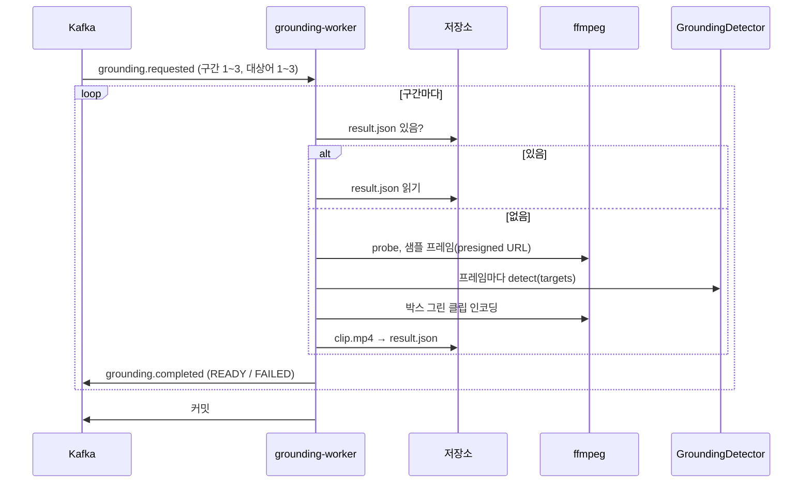

# Plan: SPEC-026 grounding-worker 검색 상위 구간 bbox 주석 클립 — ai

- spec: docs 레포 `docs/specs/SPEC-026-grounding-worker/spec.md`
- 계약: `events/grounding.requested`·`grounding.completed`, `groundings/v1/grounding-result`, `models/manifest`(탐지기 가중치), `stages/v1`, `asyncapi/grounding-worker.yaml`. 잠금 계약 묶음 3.14.0

## 1. 요약

새 Kafka 워커 `services/grounding-worker`를 만든다. `grounding.requested`의 구간(최대 3개)을 순서대로 처리한다. 구간마다 정규화 영상에서 샘플 프레임(기본 1초 간격, 최대 12장)을 뽑고, 대상어를 텍스트 클래스로 개방 어휘 탐지를 한다. 그다음 원본 fps의 H.264 주석 클립(박스와 대상어 라벨, 오디오 유지)을 만들어 클립과 결과 파일을 저장하고 `grounding.completed`를 발행한다. 결과 파일이 이미 있으면 탐지·인코딩 없이 그 내용으로 다시 발행한다. 실패는 `outcome: FAILED`로 발행한다.

영상 디코딩·인코딩은 normalize처럼 시스템 ffmpeg·ffprobe 프로세스로 한다(새 Python 패키지 없음, 사용자 확인 필요 항목). **탐지기 실행 라이브러리는 정하지 않았다.** 서비스 코드는 `GroundingDetector` 인터페이스만 쓰고, 이번 단계에서는 결정적 mock 구현으로 전체 흐름과 테스트를 완성한다. 실제 구현은 사용자 확인(5절) 뒤 태스크로 더한다.

## 2. 담당 요구사항

경로의 `gw/`는 `services/grounding-worker/src/grounding_worker/`, `t/`는 `services/grounding-worker/tests/`다.

| 요구사항 | 담당 모듈 / 컴포넌트 | 검증 테스트 |
| --- | --- | --- |
| R-1 | `gw/service.py` `handle`(구간 순서대로, 구간마다 한 건) | `t/test_grounding_service.py` |
| R-2 | `gw/sampling.py` `sample_times`, `gw/media.py` `extract_frames` | `t/test_grounding_sampling.py`, `t/test_grounding_media.py`(ffmpeg) |
| R-3 | `gw/detector.py` `GroundingDetector`, `gw/service.py`(기준 신뢰도 필터) | `t/test_grounding_service.py`, `t/test_grounding_detector.py` |
| R-4 | `gw/render.py` `box_windows`·`filter_script`, `gw/media.py` `render_clip` | `t/test_grounding_render.py`, `t/test_grounding_media.py`(ffmpeg) |
| R-5 | `gw/render.py` `target_color` | `t/test_grounding_render.py` |
| R-6 | `gw/service.py`, `gw/keys.py`(클립·결과 경로) | `t/test_grounding_service.py`(저장 순서, 결과 파일·이벤트 계약 스키마 통과) |
| R-7 | `gw/service.py` `_counts` | `t/test_grounding_service.py` |
| R-8 | `gw/service.py` `_reuse` | `t/test_grounding_service.py` |
| R-9 | `gw/ids.py` | `t/test_grounding_ids.py` |
| R-10 | `gw/service.py`(probe 길이·구간 검사) | `t/test_grounding_service.py` |
| R-11 | `gw/service.py`(`exists`·`MediaReadError`·`DecodeError` → FAILED) | `t/test_grounding_service.py`, `t/test_grounding_media.py`(ffmpeg, 깨진 파일) |
| R-12 | `gw/service.py`(`DetectorError` → FAILED) | `t/test_grounding_service.py` |
| R-13 | `gw/service.py`(`asyncio.timeout`), `gw/media.py`(취소 시 프로세스 종료) | `t/test_grounding_service.py`, `t/test_grounding_media.py`(ffmpeg) |
| R-14 | 워커 재시도(SPEC-013 공통). 저장·발행 오류를 그대로 던짐, 다시 처리하면 R-8 | `t/test_grounding_service.py` |
| R-15 | `vlm_contracts.events.GroundingRequested` 검증(`normalizedKey` 폴더 검사 포함) → DLQ | `libs/contracts/tests/test_grounding_contracts.py`, `t/test_grounding_worker_e2e.py` |
| R-16 | `KafkaWorker._wait`(처리 중 pause, poll 유지, 끝나면 resume, `libs/messaging` 기존 동작) | `t/test_grounding_worker_e2e.py`(처리가 `max.poll.interval.ms`보다 길어도 커밋) |
| R-17 | `gw/service.py`(결과 파일 `groundingModel`·`scoreThreshold`, 이벤트 `groundingModel`) | `t/test_grounding_service.py` |
| R-18 | `gw/service.py` 단계 블록 | `t/test_grounding_service.py` |
| NFR-1 | 전체 | 로컬 compose 측정(실제 탐지기 결정 뒤, tasks "측정 기록") |
| NFR-2 | 컨테이너 메모리 상한 1.5GB | 로컬 compose 측정 |
| NFR-3 | `KafkaWorker`(하나씩 처리), 모든 구간 발행 뒤 핸들러 종료 → 커밋 | `t/test_grounding_worker_e2e.py` |

## 3. 원칙 점검

| 원칙 | 준수 | 비고 |
| --- | --- | --- |
| I 스펙 우선 | ☑ | SPEC-026 Approved (docs #121) |
| II 계약 우선 | ☑ | docs #121 머지. 잠금을 3.14.0으로 올린 뒤 구현한다(T001) |
| III 테스트 우선 | ☑ | R-1~R-18, NFR-3 테스트 매핑. NFR-1·NFR-2는 로컬 측정. 탐지기는 인터페이스를 가짜로 바꿔 끼워 검증한다 |
| IV 서비스 자율성 | ☑ | DB 없음. search-service·notification-service 코드에 의존하지 않고 계약만 따른다 |
| V 단순성 | △ | 새 Python 패키지는 탐지기 라이브러리 결정 전까지 없다. ffmpeg `drawtext`용 글꼴 시스템 패키지를 이미지에 더한다. 탐지기 라이브러리는 사용자 확인 필요(5절) |
| VI 관측 가능성 | ☑ | 단계 `grounding.sample`·`detect`·`render`·`store`, health, `traceparent` 전파, 결과에 탐지기 버전·기준 신뢰도 |
| VII 보안 | ☑ | ffmpeg 인자는 목록으로 넘기고 셸을 쓰지 않는다. 대상어는 계약 패턴으로 검증한 값만 필터 스크립트에 넣고 이스케이프한다. `normalizedKey` 폴더 검사(R-15). 클립은 외부 모델로 보내지 않아 블러 대상이 아니다(spec 제외) |
| VIII 문서·주석 | ☑ | 계약 모델 테스트, README, 색·샘플 규칙에 R-ID 주석 |
| IX GitOps | ☑ | 운영 배포·토픽은 사용자 지시 시 infra·gitops |

## 4. 기술 설계

### 패키지

| 경로 | 내용 |
| --- | --- |
| `libs/contracts/.../events.py` | `GroundingRequested`(`GroundingSegment`, `normalizedKey`가 sourceId·normalizationId 폴더인지 검사, `endMs > startMs`는 검사하지 않음: R-10이 FAILED로 처리), `GroundingCompleted`(READY·FAILED 필드 조합 검사), `GroundingErrorCode` |
| `libs/contracts/.../groundings.py` | `GroundingResultFile`(`clip`, `frames[].detections[]`, `colors`) |
| `libs/contracts/.../stages.py` | 단계 ID 6개 |
| `libs/storage/.../storage.py` 외 | `ObjectStorage.presigned_get_url(key, expires_s)` 추가. S3는 boto3 `generate_presigned_url`, 메모리 구현은 테스트용 가짜 주소 |
| `gw/settings.py` | 환경변수 `GROUNDING_WORKER_`: 소비 그룹, 프로필 경로, mock 허용, 모델 캐시 폴더, 구간 제한 시간(기본 120초), 샘플 간격(기본 1000ms, 200ms 이상), 최대 샘플 수(12, 상한 12), 작업 폴더 |
| `gw/profile.py` | 프로필(TOML) `[detector]`: `kind`, `manifest`, `manifest_sha256`, `score_threshold`, mock은 `version`. `[render]`: x264 preset·crf, 선 두께, 글꼴 경로 |
| `gw/detector.py` | `GroundingDetector` Protocol, `Detection`, `RgbFrame`, `DetectorError`, `MockDetector`, `load_detector`(프로필 → 구현) |
| `gw/sampling.py` | 샘플 시각 계산 |
| `gw/render.py` | 대상어 색, 샘플별 표시 구간, ffmpeg 필터 스크립트 생성 |
| `gw/media.py` | `MediaTool` Protocol과 `FfmpegTool`(probe, 샘플 프레임 추출, 클립 렌더링) |
| `gw/keys.py` | `sources/<sourceId>/groundings/<groundingId>/<groundingModel>/{clip.mp4,result.json}` |
| `gw/ids.py` | eventId = uuid5(`vlm:grounding.completed:<groundingId>:<groundingModel>`) |
| `gw/service.py` | 핸들러 |
| `gw/__main__.py` | 조립·기동(프로필 검증과 탐지기 로드는 기동 때 한 번) |
| `services/grounding-worker/profiles/` | `local.toml`(실제 탐지기 자리, 라이브러리 결정 뒤), `local-mock.toml` |

### 탐지기 인터페이스

```python
class GroundingDetector(Protocol):
    @property
    def version(self) -> str: ...  # groundingModel(가중치 manifest의 version)
    def detect(self, frame: RgbFrame, targets: Sequence[str]) -> list[Detection]: ...
```

- `RgbFrame`은 ffmpeg가 내보낸 rgb24 바이트와 너비·높이·`pts_ms`다. 이미지 라이브러리 타입에 묶이지 않게 한다.
- `Detection`은 대상어, 0~1 좌표 박스(x, y, w, h), 신뢰도다. 기준 신뢰도 필터는 서비스가 한다(R-3). 구현마다 따로 걸러 기준이 어긋나는 것을 막는다.
- 블로킹이고 CPU를 쓴다. 서비스는 프레임 하나씩 `asyncio.to_thread`로 부른다. 그래야 R-13 제한 시간이 프레임 사이에서 끊긴다.
- 구현은 자기 라이브러리 오류를 `DetectorError`로 바꿔 던진다. 서비스는 그것만 받아 `GROUNDING_DETECTOR_FAILED`로 처리한다(R-12).
- `MockDetector`: 대상어와 프레임 시각으로 박스를 결정적으로 만든다. `local-mock` 프로필과 테스트 전용이고, `GROUNDING_WORKER_ALLOW_MOCK=true`가 아니면 기동에 실패한다(AGENTS "mock은 CI·단위 테스트 전용").
- 인터페이스는 지금 grounding-worker만 쓰므로 서비스 안에 둔다. 두 번째 사용처(평가 스크립트 등)가 생기면 `libs/`로 옮긴다. chunk-processor(다른 담당자)의 탐지기와는 공유하지 않는다.
- 탐지기 가중치·기준 신뢰도·모델 선택은 AI 담당자 몫이다. 프로필에는 동작 확인용 자리값만 둔다.

### 영상 처리 (ffmpeg 프로세스)

- 입력: 저장소 presigned GET 주소를 ffmpeg·ffprobe에 직접 넘긴다. 정규화 사본은 `+faststart`라 HTTP 범위 요청으로 구간만 읽는다. 10초 구간 때문에 영상 전체를 내려받지 않는다(5절 대안).
- probe: `ffprobe`로 길이·fps·너비·높이·오디오 유무. normalize의 `probe.py`와 같은 해석을 쓰되 서비스 사이 import는 하지 않는다(필요한 필드만 다시 구현).
- 샘플: 시각 `startMs + k × 간격`(`< endMs`, k < 최대 수)마다 `-ss <t> -i <url> -frames:v 1 -f rawvideo -pix_fmt rgb24 -`. 프레임마다 프로세스 하나라 메모리는 1080p 한 장(약 6MB) 단위다. 결과의 `ptsMs`는 요청 시각이다.
- 렌더링: 프로세스 하나로 `-ss <start> -t <길이> -i <url>`, 필터 스크립트(`-filter_script:v`)의 `drawbox`·`drawtext`를 `enable='between(t,a,b)'`로 켠다. 샘플 i의 표시 구간은 이웃 샘플과의 중간점 사이다. 그래서 모든 원본 프레임이 표시 시각이 가장 가까운 샘플의 박스를 받는다(R-4). 출력은 `libx264 -pix_fmt yuv420p`, 원본 fps 유지(`-fps_mode passthrough`), 오디오가 있으면 `-map 0:a:0? -c:a aac`, `+faststart`.
- 출력 클립을 다시 probe해 결과 파일 `clip`(fps, 너비, 높이, `durationMs`, `audio`)을 채운다.
- 프로세스는 `asyncio.create_subprocess_exec`로 띄운다. 제한 시간으로 취소되면 `finally`에서 kill하고 기다린다(R-13). normalize의 `subprocess.run`과 다른 이유다.
- 글꼴: `drawtext`는 글꼴 파일이 필요하다. runtime 이미지에 `fonts-dejavu-core`(Debian 패키지)를 설치하고 프로필 `[render] font_path`로 가리킨다.

### 처리 순서 (구간마다)

1. 경로·eventId 계산. 결과 파일이 있으면 읽어 계약 모델로 검증하고 그 내용(탐지 → 대상어별 수)으로 READY를 발행한다(R-8). 이후 단계를 건너뛴다.
2. 원본 확인: `exists(normalizedKey)`가 False면 `GROUNDING_SOURCE_UNREADABLE`(R-11). 저장소 연결 오류는 그대로 던진다(R-14).
3. probe. 실패면 `SOURCE_UNREADABLE`. `endMs <= startMs`이거나 `endMs`가 영상 길이(ms)를 넘으면 `GROUNDING_SEGMENT_OUT_OF_RANGE`(R-10).
4. `grounding.sample`(count 프레임 수): 샘플 프레임 추출. 디코딩 실패는 `SOURCE_UNREADABLE`.
5. `grounding.detect`(count 프레임 수): 프레임마다 탐지 후 기준 신뢰도 이상만 남김(R-3).
6. `grounding.render`(count 클립 프레임 수): 클립 인코딩(R-4, R-5).
7. `grounding.store`(count 2): `clip.mp4` 저장 → `result.json` 저장(R-6). 결과 파일이 마지막이라, 결과 파일이 있으면 클립도 있다.
8. READY `grounding.completed` 발행. `frames`는 샘플마다 모든 대상어 키를 담고 탐지가 없으면 0이다(R-7).

- 2~6을 `asyncio.timeout(구간 제한 시간)`으로 감싼다. 넘으면 `GROUNDING_TIMEOUT`으로 FAILED다(R-13).
- FAILED도 같은 eventId 규칙(R-9)으로 발행하고 `clipKey`·`resultKey`·`frames`는 null이다.
- 저장소·발행 오류는 그대로 던져 메시지 전체가 재시도 토픽으로 간다. 다시 처리하면 끝난 구간은 1단계에서 재사용된다(R-14).
- 구간 작업 폴더는 처리마다 임시 폴더로 만들고 끝나면 지운다(클립 파일만 잠깐 디스크에 둔다).

### 상호작용



## 5. 대안과 선택 이유

### 탐지기 실행 라이브러리 (사용자 확인 필요)

| 대안 | 장점 | 단점 | 선택 |
| --- | --- | --- | --- |
| A. `ultralytics`(YOLOE 공식 구현) | 실행 시점에 대상어를 텍스트 클래스로 바로 지정(`set_classes`). 구현이 가장 짧다 | AGPL-3.0이라 배포 형태에 따라 소스 공개 의무. opencv 등 의존성이 커 이미지가 커진다 | 확인 필요 |
| B. `onnxruntime` + ONNX로 내보낸 YOLOE | 런타임은 MIT. 이미지가 작고 CPU 추론이 빠르다 | 보통 내보내기는 클래스를 고정하므로 텍스트 임베딩을 입력으로 받는 그래프로 따로 내보내야 한다(AI 담당자 작업). 대상어 텍스트 임베딩은 lock에 있는 open_clip(MobileCLIP)로 만들 수 있다. 가중치 자체의 라이선스도 AI 담당자 확인이 필요하다 | 확인 필요 |
| C. `transformers`의 OWLv2·Grounding DINO 계열 | Apache-2.0, 임의 문장 클래스 지원 | 새 의존성이 크고 CPU에서 프레임당 수 초라 NFR-1(30초)이 빠듯하다 | |

- 어느 쪽이든 서비스 코드는 `GroundingDetector`만 쓴다. 결정 전에는 mock으로 R-1~R-18을 모두 구현·검증하고, 결정 뒤 구현 태스크(T026~T028)만 더한다.
- 모델 manifest 계약은 `kind: detector`면 `classes`(1개 이상)가 필수다. 개방 어휘 탐지기는 고정 클래스가 없어 manifest 작성 방식(AI 담당자)을 확인해야 한다(7절).

### 그 밖의 선택

| 대안 | 장점 | 단점 | 선택 |
| --- | --- | --- | --- |
| ffmpeg·ffprobe 프로세스(normalize와 같은 방식) | 새 Python 패키지 없음, 코덱·오디오 처리를 ffmpeg가 맡음 | 시스템 패키지·글꼴이 이미지에 필요 | ☑(사용자 확인 필요) |
| PyAV 등 바인딩 | 프레임 단위 제어 | 새 패키지 | |
| 박스를 ffmpeg 필터(`drawbox`·`drawtext`)로 그림 | 프레임 데이터가 Python을 거치지 않아 메모리·CPU가 적다. 프로세스 하나 | 필터 문자열 이스케이프를 테스트로 지켜야 함 | ☑ |
| 원본 프레임을 파이프로 받아 Pillow로 그린 뒤 다시 인코딩 | 그리기가 자유롭다 | 1080p 300장을 Python으로 옮겨 느리고 프로세스가 둘. Pillow를 직접 의존성으로 더함 | |
| presigned 주소로 ffmpeg가 직접 읽음 | 구간만 읽는다. 디스크 사용이 적다 | `ObjectStorage`에 메서드가 하나 늘어남 | ☑ |
| 정규화 영상 전체를 내려받음 | 저장소 인터페이스 그대로 | 긴 영상이면 10초 구간에 수 GB를 받는다 | |
| 탐지기 인터페이스를 서비스 안에 둠 | 사용처가 하나라 단순 | 두 번째 사용처가 생기면 옮겨야 함 | ☑ |

## 6. 테스트 전략

- 단위: 샘플 시각(경계, 12장 상한, 간격 설정), 색(sha256 앞 3바이트), 표시 구간(중간점, 첫·마지막 샘플), 필터 스크립트 이스케이프(`'`·`:`가 든 대상어), 경로, ID
- 서비스: 가짜 `MediaTool`(probe 값·프레임·클립 파일을 돌려줌, 오류 주입)·가짜 `GroundingDetector`·`InMemoryStorage`·기록 발행기로 핸들러 전체. 결과 파일과 이벤트를 docs 계약 스키마로 검증한다. 제한 시간은 느린 가짜와 짧은 설정으로 확인한다.
- 탐지기: `MockDetector` 결정성, mock 허용 설정 없이 기동 실패, `load_detector` 프로필 검증
- ffmpeg(`ffmpeg` 마커, 서비스 이미지 안): 테스트가 만든 짧은 합성 영상(오디오 있음·없음)으로 샘플 프레임 크기, 클립 코덱 h264·fps·길이·오디오, 박스 위치 픽셀 색, 깨진 파일의 `MediaReadError`, 취소 시 프로세스 종료
- 계약: 새 모델을 docs 원본과 비교(필드·필수·enum·패턴·예시 왕복), 단계 ID, `presigned_get_url`(S3 구현은 SeaweedFS testcontainer)
- 워커 e2e: Kafka·SeaweedFS testcontainer와 mock 탐지기·실제 ffmpeg(서비스 이미지)로 정상 발행, 재사용, 잘못된 메시지·`normalizedKey` 불일치 DLQ, 긴 처리 중 커밋
- 테스트 파일 이름은 `test_grounding_*`, 공용 도우미는 `gw_support.py`
- 실제 탐지기 구현은 `model` 마커로 가중치를 받아 확인한다(결정 뒤)

## 7. 리스크와 롤백

- 리스크
  - 탐지기 라이브러리 결정 전에는 mock만 있어 NFR-1·NFR-2를 실제 모델로 잴 수 없다. 측정 태스크는 결정 뒤에 한다.
  - `drawtext` 이스케이프 실수는 ffmpeg 오류나 필터 주입으로 이어진다. 대상어는 계약 패턴(`[a-z0-9 '-]`)으로 먼저 걸러지고, 이스케이프는 단위 테스트로 지킨다.
  - presigned 주소의 만료 시간은 구간 제한 시간보다 길게 잡는다.
- spec·계약과 맞춰 볼 점(계약대로 구현하고 보고한다)
  - R-17은 `grounding.completed`에도 기준 신뢰도를 기록하라고 하지만 계약에 그 필드가 없다. 결과 파일 `scoreThreshold`에만 기록한다.
  - R-9 eventId는 groundingId·탐지기 버전만 쓴다. FAILED 뒤 다시 요청해 READY가 나와도, 다른 requestId의 요청이어도 같은 eventId라 소비자가 중복으로 버릴 수 있다.
  - R-10 영상 길이 비교에 허용 오차가 없다. 마지막 구간 `endMs`가 ffprobe 길이보다 몇 ms 길면 FAILED가 된다.
  - 결과 파일 `sampleFps`는 이름은 fps인데 설명은 "샘플 간격"이다. 1000 ÷ 간격(ms)으로 기록한다.
  - 모델 manifest 계약은 `kind: detector`에 `classes`가 필수라 개방 어휘 탐지기 manifest 작성 방식이 정해지지 않았다.
- 사용자 확인이 필요한 항목
  - 탐지기 실행 라이브러리(A/B/C)와 가중치 라이선스
  - 영상 처리를 ffmpeg·ffprobe 프로세스로 하는 것과 runtime 이미지에 `ffmpeg`·`fonts-dejavu-core` 시스템 패키지를 넣는 것
- 롤백: 새 서비스라 끄면 된다. `ObjectStorage` 메서드 추가는 기존 구현의 테스트로 확인한다.

## 8. 배포 고려사항

- 환경변수: `GROUNDING_WORKER_PROFILE_PATH`, `GROUNDING_WORKER_ALLOW_MOCK`, `GROUNDING_WORKER_MODEL_CACHE_DIR`, `GROUNDING_WORKER_ITEM_TIMEOUT_S`, `GROUNDING_WORKER_SAMPLE_INTERVAL_MS`, `GROUNDING_WORKER_MAX_SAMPLES`, `GROUNDING_WORKER_WORK_DIR`와 공통 `KAFKA_BOOTSTRAP`·`STORAGE_*`·`MODEL_STORAGE_*`·`HEALTH_PORT`. 레포 `.env.example`과 README에 적는다. 비밀값은 없다.
- 이미지: normalize처럼 runtime 단계에 ffmpeg, 그리고 글꼴 패키지. 가중치는 이미지에 넣지 않고 기동 때 받는다(모델 캐시 폴더에 emptyDir).
- 로컬 compose(docs `local/`): grounding-worker(1.5G, overview "로컬 개발 환경" 표), 토픽 `grounding.requested`, `grounding.completed`, `grounding.requested.grounding-worker.retry`, `grounding-worker.dlq`를 `kafka-init`과 `local/README.md`에 더한다. 로컬은 생산자(search-service)가 없으므로 측정은 테스트가 직접 넣는다.
- 운영 배포·토픽은 사용자 지시 시 infra·gitops에서 한다.
