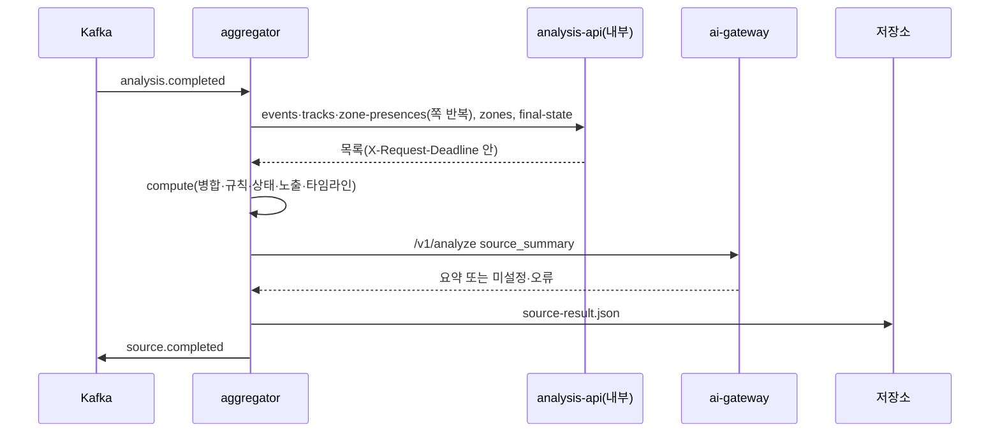

# Plan: SPEC-027 aggregator 영상 단위 병합·시간 규칙·위험 상태·노출 지표·요약 — ai

- spec: docs 레포 `docs/specs/SPEC-027-aggregator/spec.md`
- 계약(계약 묶음 3.14.0): `events/analysis.completed`·`source.completed`·`_source-summary`·`_vlm-analysis`, `aggregates/v1/source-result`, `openapi/analysis-service.yaml` 0.4.0(내부 `/internal/v1` 경로 5개), `openapi/ai-gateway.yaml` 1.4.0(taskType `source_summary`), `asyncapi/aggregator.yaml` 1.1.0, `stages/v1`
- 선행: SPEC-021(ai-client 생성 모델·`X-Request-Deadline`·호출 종류별 재시도)이 먼저 구현된다고 본다.

- v5.1(계약 묶음 4.0.0, 2026-11-07, ADR-0015·ADR-0016): 상태 전이를 `fold` 한 함수로 두고 업로드 완료·실시간 창·늦은 벡터 이벤트가 같은 함수를 지난다. R-4 개정(`rule*`만 대조, `partial`·`missingCounts`), R-25~R-28(늦은 벡터 이벤트 대기 집합·`revision` 재발행), R-29~R-32(`STREAM` 창 증분 fold·`state.updated`·세션 마무리), R-33(stream-service 내부 구역 API), R-34(단계 `aggregate.fold`)를 더한다. 계약은 `events/analysis.completed`(`jobType: STREAM`, `scope`, `chunkId`, `partial`, `session.role: ROTATION`), `source.completed`(`revision`·`partial`·`missingCounts`), `state.updated`(신규), `event.analyzed`·`track.detected` 소비, `asyncapi/aggregator.yaml` 1.2.0, `openapi/stream-service.yaml` 1.0.0, `stages/v1`(`aggregate.fold`)이다. 잠금은 T001에서 4.0.0으로 올린다.

## 1. 요약

빈 자리인 `services/aggregator`에 Kafka 워커를 만든다. `analysis.completed`를 받으면 analysis-api 내부 읽기 API로 job의 이벤트·트랙·구역 머문 구간을 마지막 쪽까지 읽고 영상의 구역과 (세션이면) 직전 영상의 `final-state`를 읽는다. 그 입력으로 병합·시간 규칙·상태 스냅샷·위험·노출 지표·타임라인을 **순수 함수**로 계산하고, ai-gateway `source_summary`로 요약을 붙여 결과 파일을 저장한 뒤 `source.completed`를 발행한다.

analysis-api 읽기 클라이언트는 새 lib `libs/analysis-client`에 두고 요청·응답 모델은 `openapi/analysis-service.yaml`에서 datamodel-code-generator로 생성한다(SPEC-021 R-6과 같은 방식, 손으로 쓴 모델 없음). 재시도·마감 계산은 SPEC-021이 ai-client에 만드는 것을 `libs/common`으로 옮겨 두 클라이언트가 같이 쓴다.

ai-gateway에는 `source_summary` Registry 폴더(입력·출력 스키마, 자리 표시 프롬프트, `fallback.json`)와 두 로컬 프로필의 `[tasks.source_summary]`만 더한다. 프롬프트 문안과 시간 규칙 기준값은 AI 담당자 몫이고 여기서는 자리값만 둔다.

## 2. 담당 요구사항

경로의 `agg/`는 `services/aggregator/src/aggregator/`, `t/`는 `services/aggregator/tests/`, `ac/`는 `libs/analysis-client/`다, `sc/`는 `libs/stream-client/`다

| 요구사항 | 담당 모듈 / 컴포넌트 | 검증 테스트 |
| --- | --- | --- |
| R-1 | `agg/service.py` `AggregatorService.handle` | `t/test_aggregator_service.py`(결과 파일·`source.completed`가 계약 스키마 통과) |
| R-2 | `agg/service.py`(REEMBED 건너뛰기 로그) | `t/test_aggregator_service.py` |
| R-3 | `agg/reader.py`, `ac/src/vlm_analysis_client/client.py` | `ac/tests/test_analysis_client.py`, `t/test_aggregator_reader.py` |
| R-4 | `agg/reader.py`(`CountMismatchError`, 재시도 가능) | `t/test_aggregator_reader.py`, `t/test_aggregator_service.py` |
| R-5 | `agg/reader.py`(`final-state` 404 처리) | `t/test_aggregator_reader.py` |
| R-6, R-7 | `agg/merge.py` `merge_events` | `t/test_aggregator_merge.py` |
| R-8, R-9 | `agg/rules.py` `dwell_events`·`loiter_events` | `t/test_aggregator_rules.py` |
| R-10 | `agg/rules.py` `finish_rule_events`(severity) | `t/test_aggregator_rules.py` |
| R-11~R-15 | `agg/state.py` `run_state` | `t/test_aggregator_state.py` |
| R-16 | `agg/exposure.py` `exposure_of` | `t/test_aggregator_exposure.py` |
| R-17 | `agg/timeline.py` `build_timeline` | `t/test_aggregator_timeline.py` |
| R-18, R-19 | `agg/summary.py` `summarize`, ai-gateway `registry/prompts/source_summary/` | `t/test_aggregator_summary.py`, `services/ai-gateway/tests/test_prompts.py`, `test_analyze_api.py` |
| R-20 | `agg/ids.py`, `agg/result.py`, `agg/service.py`(저장 뒤 발행) | `t/test_aggregator_ids.py`, `t/test_aggregator_service.py` |
| R-21 | `agg/compute.py` `compute`, `agg/result.py` `encode_result`(고정 직렬화), `agg/profile.py`(프로필 버전) | `t/test_aggregator_compute.py`, `t/test_aggregator_profile.py` |
| R-22 | `agg/service.py`(재시도 가능 오류는 그대로 던짐) | `t/test_aggregator_service.py`, `t/test_aggregator_worker_e2e.py` |
| R-23 | `agg/service.py`(`NonRetryableError`), `vlm_contracts.events.AnalysisCompleted` 검증 → 워커 DLQ | `t/test_aggregator_service.py`, `t/test_aggregator_worker_e2e.py` |
| R-24 | `agg/service.py` 단계 블록, `vlm_contracts.stages` | `t/test_aggregator_service.py`, `libs/contracts/tests/test_stage_contracts.py` |
| R-4(v5.1: `rule*`만 대조, `partial`) | `agg/reader.py`(판정 방식 `rule*` 수·트랙 수 대조, 재시도 상한 뒤 `partial`·`missingCounts`) | `t/test_aggregator_reader.py::test_spec027_r4_*`, `t/test_aggregator_service.py::test_spec027_r4_partial` |
| R-25, R-26 | `agg/pending.py` `PendingVectors`(Redis `pending-vector:<jobId>`, TTL 7일), `agg/service.py` `on_event_analyzed`, `agg/reader.py`(읽은 이벤트와 합치기, eventId 중복 제거) | `t/test_aggregator_pending.py`(integration, Redis), `t/test_aggregator_service.py::test_spec027_r25_*`·`r26_*` |
| R-27, R-28 | `agg/revision.py` `recompute_with_late_event`, `agg/result.py`(`inputEventIds`·`revision`), `agg/ids.py`(`source.completed` eventId = `uuid5(jobId, revision)`) | `t/test_aggregator_revision.py`, `t/test_aggregator_service.py::test_spec027_r27_*` |
| R-29 | `agg/pending.py` `PendingWindow`(Redis `pending:<sourceId>:<chunkId>`, TTL 1시간), `agg/service.py` `on_track_detected`·`on_event_analyzed`(`STREAM` 분기) | `t/test_aggregator_pending.py`, `t/test_aggregator_stream_service.py::test_spec027_r29_*` |
| R-30 | `agg/fold.py` `fold`(R-11~R-17을 상태 입력·출력으로 감쌈), `agg/stream.py` `WindowFolder`, `agg/session_state.py`(Redis·S3 스냅샷·직전 세션·빈 상태) | `t/test_aggregator_fold.py`(업로드 한 번 fold = 창 단위 fold 누적), `t/test_aggregator_stream_service.py::test_spec027_r30_*`, `t/test_aggregator_session_state.py`(integration) |
| R-31 | `agg/stream.py`(`hazard_zone_access` 재판정), `agg/judge_budget.py`(Redis 계수 `agg:judge-calls:<jobId>`, SPEC-028 `judge_call_limit` 공유) | `t/test_aggregator_stream_service.py::test_spec027_r31_*`, `t/test_aggregator_judge_budget.py`(integration) |
| R-32 | `agg/stream.py` `finish_session`, `agg/result.py` | `t/test_aggregator_stream_service.py::test_spec027_r32_*`(결과 파일·`source.completed` 계약 통과) |
| R-33 | `sc/`(`openapi/stream-service.yaml` 생성 모델, `StreamApiClient.get_session_zones`), `agg/stream.py`(세션당 1회, Redis 캐시) | `sc/tests/test_stream_client.py`, `t/test_aggregator_stream_service.py::test_spec027_r33_*` |
| R-34 | `agg/stream.py` 단계 블록, `vlm_contracts.stages.StageId`(`aggregate.fold`) | `t/test_aggregator_stream_service.py::test_spec027_r34_*`, `libs/contracts/tests/test_stage_contracts.py` |
| NFR-1 | `agg/compute.py` | `t/test_aggregator_performance.py`(생성 입력 2,000·5,000·20,000건, p95 5초) |
| NFR-2 | 전체 | 로컬 compose 측정(256M 컨테이너, tasks.md 측정 기록) |
| NFR-3 | `agg/service.py`·`agg/summary.py` 로그 필드 | `t/test_aggregator_service.py`(caplog에 요약·설명 원문 없음) |
| NFR-4 | `KafkaWorker`(하나씩 처리, 발행 뒤 커밋) | `t/test_aggregator_worker_e2e.py` |

## 3. 원칙 점검

| 원칙 | 준수 | 비고 |
| --- | --- | --- |
| I 스펙 우선 | ☑ | SPEC-027 Approved(머지됨), 미결 사항 없음 |
| II 계약 우선 | ☑ | 계약 묶음 3.14.0에 모두 있음. 첫 태스크에서 잠금을 올린다 |
| III 테스트 우선 | ☑ | R-1~R-24, NFR-1·NFR-3·NFR-4 테스트 매핑, NFR-2는 로컬 측정. 계산은 순수 함수라 단위 테스트로 검증 |
| IV 서비스 자율성 | ☑ | analysis-api DB를 읽지 않고 내부 읽기 API만 쓴다. 저장소는 자기 경로(`.../aggregate/`)에만 쓴다. 다른 담당자 서비스 코드는 바꾸지 않는다 |
| V 단순성 | ☑ | 새 외부 패키지 없음(httpx·jsonschema·pydantic은 lock에 있음, datamodel-code-generator는 SPEC-021이 들인다). analysis-api 자리 표시 서버 도구는 사용자 확인 필요(5절) |
| VI 관측 가능성 | ☑ | 단계 `aggregate.read`·`compute`·`summary`·`store`, health, `traceparent` 전파(Kafka 헤더 → HTTP 호출) |
| VII 보안 | ☑ | 메시지·응답을 계약 모델로 검증한다. 요약 문장·이벤트 설명 원문을 로그에 남기지 않는다(NFR-3) |
| VIII 문서·주석 | ☑ | 계약 모델 테스트, 생성 코드 비교 CI, README |
| IX GitOps | ☑ | 운영 배포·토픽은 사용자 지시 시 infra·gitops에서 한다 |

## 4. 기술 설계

### 변경 대상

| 경로 | 변경 |
| --- | --- |
| `service-contracts.lock` | 4.0.0 |
| `libs/contracts/.../events.py` | `AnalysisCompleted`, `SourceCompleted`, `SessionRef`, 개수 모델 |
| `libs/contracts/.../aggregates.py` (새 파일) | 결과 파일 `SourceResult`와 하위 모델(`MergeGroup`, `RuleEvent`, `Snapshot`, `Risk`, `Exposure`, `TimelineItem`, `Summary`, `InitialState`) |
| `libs/contracts/.../stages.py` | 단계 ID 6개(`aggregator.queue_wait`·`aggregator.handle`·`aggregate.read`·`compute`·`summary`·`store`) |
| `libs/common/.../http_call.py` (새 파일) | SPEC-021의 `CallRetry`·마감 계산·호출 종류별 재시도 판정을 ai-client에서 옮김(동작 변경 없음) |
| `libs/analysis-client/` (새 멤버, `vlm-analysis-client`) | 생성 모델 `vlm_analysis_client/models.py`, 얇은 호출부 `client.py` `AnalysisApiClient`, `AnalysisApiError` |
| `services/aggregator/` (새 멤버) | 워커, 프로필 `profiles/aggregate-v1.toml`, Dockerfile, README |
| `services/ai-gateway/registry/prompts/source_summary/` | `prompt.md`(자리 표시), `input.schema.json`, `output.schema.json`(`$ref ../../events/_source-summary.schema.json`), `fallback.json` |
| `services/ai-gateway/profiles/local.toml`, `local-mock.toml`, `tests/gateway_support.py` | `[tasks.source_summary]` |
| `services/ai-gateway` 테스트 배치·`registry_bundle.py`·Dockerfile | 계약 `events/_source-summary.schema.json`을 Registry에 함께 넣음(`_vlm-analysis` 선례의 세 곳) |
| 루트 `pyproject.toml` | 새 멤버 2개를 `members`·mypy `files`·`mypy_path`·pytest `pythonpath`(`services/aggregator/tests`)에 추가 |
| `.github/workflows/checks.yml` | aggregator runtime 이미지 빌드, 생성 코드 비교에 `analysis-service.yaml` 추가 |

### 패키지(aggregator)

| 경로 | 내용 |
| --- | --- |
| `agg/settings.py` | 환경변수 `AGGREGATOR_`: 소비 그룹, ai-gateway 주소, analysis-api 주소, 저장소 버킷, 프로필 파일, 읽기 제한 시간(기본 300초), 쪽 크기(기본 1000), 재시도 횟수·대기 |
| `agg/profile.py` | `AggregateProfile`(TOML, `vlm_common.profile.Profile`): `name`, `merge_gap_ms`(10000), `dwell_ms`(60000), `loiter_window_ms`(300000), `loiter_count`(3), `person_classes`(`["person"]`), 규칙 이벤트 설명 템플릿. 버전 `aggregateProfile` = `<name>@<파일 내용 sha256 앞 12자리>` |
| `agg/model.py` | 계산 입력·출력의 내부 값 객체(`@dataclass(frozen=True, slots=True)`): `InputEvent`, `TrackSpan`, `Presence`, `ZoneInfo`, `InitialState`, `Computed` |
| `agg/reader.py` | 쪽 읽기와 개수 검사, 생성 모델 → 내부 값 객체 변환. 이벤트의 `analysis`는 `vlm_contracts.events.VLMAnalysis`로 검증 |
| `agg/merge.py` | R-6·R-7 |
| `agg/rules.py` | R-8~R-10 |
| `agg/state.py` | R-11~R-15 |
| `agg/exposure.py` | R-16 |
| `agg/timeline.py` | R-17 |
| `agg/ids.py` | R-20의 결정적 ID |
| `agg/compute.py` | 순수 계산 전체를 묶는 `compute(inputs, profile) -> Computed` |
| `agg/summary.py` | `source_summary` 호출과 요약 상태 결정 |
| `agg/result.py` | `SourceResult` 조립, 고정 직렬화(`encode_result`), `source.completed` 조립 |
| `agg/service.py` | 핸들러 |
| `agg/__main__.py` | 조립·기동 |

### 계산 규칙(순수 함수)

입력은 읽기 결과를 바꾼 값 객체이고, 출력은 결과 파일의 요약을 뺀 부분이다. 함수는 입력 목록 순서에 의존하지 않도록 처음에 정해진 키로 정렬한다(R-21).

1. 병합(R-6·R-7): `(eventType, trackId 또는 zoneId)`로 나눈 뒤 `startMs`, `eventId` 순으로 훑는다. chunkId가 다르고 `뒤.startMs − 앞.endMs ≤ merge_gap_ms`인 두 이벤트를 Union-Find로 잇는다. 겹치면 간격이 음수라 이어진다. 묶음 크기가 2 이상인 것만 `mergeGroups`에 낸다. 대표는 `(score 내림차순, null은 가장 낮음) → startMs → eventId` 순 첫 번째다. 묶음의 `startMs`·`endMs`는 구성원의 최소·최대다.
2. 상태(R-11~R-15): 대표 중 `analysis.verificationStatus == confirmed`인 이벤트를 이벤트 시각(`evidenceEnd × 1000`을 반올림한 정수, 없으면 `endMs`), eventId 순으로 처리한다. 구역이 없으면 `global`. 초기 상태의 구역 상태로 시작하고, 초기 활성 위험은 원래 riskId·`firstSeenMs: 0`·`lastSeenMs: 0`·`carriedOver: true`로 시작한다.
   - `afterState`가 있으면 스냅샷(이전 = 구역의 현재 상태, 없으면 null)을 만들고 구역 상태를 바꾼다.
   - `riskDetected=true`이고 `riskType`·`riskReason`이 있으면 같은 `(zoneId, riskType)` 활성 위험의 `lastSeenMs`·`relatedEventIds`를 갱신하거나 새 활성 위험을 만든다(`reason`은 그 이벤트의 `riskReason`).
   - `riskDetected=false`이고 `riskType`이 있으면 같은 키의 활성 위험을 그 시각으로 `resolved`로 바꾸고 해소 이벤트를 `relatedEventIds`에 더한다. 없으면 무시한다. 해소된 키에 다시 위험이 나오면 새 riskId다(overview 상태 표 "재활성은 새 riskId").
3. 시간 규칙(R-8~R-10): `kind == hazard` 구역과 `person_classes` 트랙의 구역 머문 구간만 본다.
   - 체류: 머문 구간 하나가 `exitMs − enterMs ≥ dwell_ms`이면 그 구간으로 `rule: dwell`.
   - 배회: `(trackId, zoneId)`의 진입 시각을 정렬해 창 시작 i부터 `loiter_count`번째 진입이 `loiter_window_ms` 안이면 `rule: loiter` 하나(시작 = 첫 진입, 끝 = 마지막으로 센 진입의 이탈 시각). 다음 창은 마지막으로 센 진입 뒤부터 센다.
   - severity: 규칙 이벤트 구간이 같은 구역 위험의 활성 구간 `[firstSeenMs, resolvedAtMs 또는 durationMs]`과 겹치면 high, 아니면 medium. 그래서 상태 계산 뒤에 정한다. 규칙 이벤트는 상태 계산에 넣지 않는다.
4. 노출(R-16): 활성 구간 `[firstSeenMs, resolvedAtMs 또는 durationMs]`. 구역 위험은 그 구역 머문 구간 중 사람 트랙, `global`은 사람 트랙의 `[startMs, endMs]`를 겹친 길이로 본다. `exposureCount`는 겹친 트랙 수, `exposureSeconds`는 겹친 길이 합, `activeSeconds`는 활성 길이다. 초는 ms/1000이고 소수 셋째 자리에서 반올림한다(직렬화가 같게).
5. 타임라인(R-17): 대표 이벤트(`event`, `atMs = startMs`), 규칙 이벤트(`rule_event`, `startMs`), 위험 활성(`risk_activated`, `firstSeenMs`, 이어 온 위험은 이 영상에서 활성된 것이 아니라 넣지 않음), 해소(`risk_resolved`, `resolvedAtMs`)를 `(atMs, refId)` 순으로 놓는다.
6. ID(R-20): `uuid5(NAMESPACE_URL, <이름>)`. 이름은 아래와 같다.

| 대상 | 이름 |
| --- | --- |
| `source.completed` eventId | `vlm:source.completed:<jobId>:<aggregateProfile>` |
| 병합 묶음 | `vlm:aggregate:merge:<jobId>:<keptEventId>` |
| 규칙 이벤트 | `vlm:aggregate:rule:<jobId>:<rule>:<trackId>:<zoneId>:<startMs>`(계약 설명과 같음) |
| 스냅샷 | `vlm:aggregate:snapshot:<jobId>:<relatedEventId>:<zoneId>` |
| 위험 | `vlm:aggregate:risk:<jobId>:<zoneId>:<riskType>:<활성으로 만든 첫 eventId>` |

### 처리 순서(핸들러)

1. 워커가 `AnalysisCompleted`로 검증한다. 맞지 않으면 DLQ(R-23).
2. `jobType == REEMBED`이면 jobId·이유를 로그에 남기고 끝낸다(R-2).
3. 마감 = 핸들러 시작 시각 + 읽기 제한 시간. 이 job의 모든 analysis-api 호출이 같은 마감을 쓴다(R-3).
4. `aggregate.read`: 이벤트·트랙·구역 머문 구간을 `nextCursor`가 null일 때까지 읽고, 구역 목록과 (세션이고 `previousSourceId`가 있으면) `final-state`를 읽는다. 이벤트·트랙 수가 `counts.events`·`counts.tracks`와 다르면 `CountMismatchError`(재시도 가능)를 던진다(R-4). count는 읽은 항목 수다.
5. `aggregate.compute`: `asyncio.to_thread(compute, ...)`. 계산 중에도 워커의 poll이 이어지게 이벤트 루프를 막지 않는다.
6. `aggregate.summary`: R-18·R-19.
7. `aggregate.store`: 결과 파일을 `sources/<sourceId>/jobs/<jobId>/aggregate/source-result.json`에 쓴다. 같은 job을 다시 처리하면 덮어쓴다(요약을 뺀 내용이 같다).
8. `source.completed` 발행(키 sourceId, Kafka 헤더 `traceparent`). 발행이 끝나야 워커가 커밋한다(NFR-4).

### 오류 처리

| 상황 | 처리 | 요구사항 |
| --- | --- | --- |
| 읽기 503·연결 실패 | 클라이언트가 2회 지수 대기 재시도. 다음 대기가 마감을 넘기면 멈춤 | R-3, R-22 |
| 재시도 소진, 시간 초과, 504 `ANALYSIS_DEADLINE_EXCEEDED`, 404 `ANALYSIS_JOB_NOT_FOUND` | 그대로 던져 재시도 토픽 | R-22 |
| `final-state` 404 `ANALYSIS_NO_ACTIVE_VERSION` | 빈 초기 상태, `fromSourceId: null` | R-5 |
| 400, 응답이 생성 모델·`VLMAnalysis` 검증 실패 | `NonRetryableError` → DLQ | R-23 |
| 저장소·Kafka 일시 오류 | 그대로 던져 재시도 토픽 | R-22 |
| 요약 호출 실패 | 요약만 `failed`, 나머지 발행 | R-19 |

### analysis-api 클라이언트(`libs/analysis-client`)

- 생성: SPEC-021이 ai-client에 만드는 생성 스크립트와 CI 비교 단계에 `openapi/analysis-service.yaml`을 더한다. 계약 파일이 공개 API까지 한 파일이라 모든 스키마가 생성되지만 호출부는 내부 operation 5개(`listJobEvents`·`listJobTracks`·`listJobZonePresences`·`listSourceZones`·`getSourceFinalState`)만 둔다.
- `JobEvent.analysis`는 계약에서 `type: object`(직접 참조하지 않음)라 생성 모델이 dict다. aggregator가 `VLMAnalysis`로 다시 검증하고, 실패하면 계약과 맞지 않는 응답으로 본다(R-23).
- 헤더: `X-Caller: aggregator`, `X-Request-Deadline`(epoch ms 문자열), `traceparent`.
- 오류: `AnalysisApiError(code, status)`. `code`는 ProblemDetail `code`, 없으면 `ANALYSIS_HTTP_<상태>`, 시간 초과 `ANALYSIS_TIMEOUT`, 연결 실패 `ANALYSIS_CONNECTION_FAILED`, 계약과 맞지 않는 응답 `ANALYSIS_INVALID_RESPONSE`. `retryable`은 503·연결 실패만이다(읽기 전용 규칙).
- 테스트는 httpx `MockTransport`로 한다.

### ai-gateway `source_summary`

- 입력 변수(`input.schema.json`): `durationSec`, `zones`(`zoneId`·`name`·`kind`), `timeline`(결과 파일 타임라인 항목 그대로), `risks`(`riskId`·`zoneId`·`riskType`·`status`·`reason`·`firstSeenMs`·`resolvedAtMs`·`carriedOver`·`exposure`). 이벤트 설명 원문은 넣지 않는다(spec R-18 변수 목록).
- 출력: `$ref ../../events/_source-summary.schema.json`, 예시는 mock 응답. `fallback.json`은 `{"summary": null, "highlights": []}`.
- 이미지가 없어도 프로필 `max_images`는 0보다 커야 하므로 1로 둔다.
- 프로필: `local.toml`은 로컬 Ollama의 같은 모델(자리값, 모델 선택은 AI 담당자), `local-mock.toml`은 mock.

### 요약 상태(R-18·R-19)

| 조건 | 호출 | 상태 |
| --- | --- | --- |
| `counts.confirmedEvents == 0`이고 위험(이어 온 위험 포함)이 없음 | 부르지 않음 | `empty` |
| 응답 `modelId == null`(미설정·예산 초과) | 부름 | `not_configured` |
| `AiGatewayError`(SPEC-021 R-9 재시도 뒤) | 부름 | `failed` |
| `modelId`가 있고 `output.summary == null`(출력 검증 실패 대체 결과) | 부름 | `failed` |
| 그 밖 | 부름 | `generated` |

`text`·`highlights`·`callId`·`modelId`·`promptVersion`은 응답 값, 부르지 않았거나 실패면 null·빈 배열이다.

### `source.completed` 개수

`inputEvents` 읽은 이벤트 수, `confirmedEvents` 확정 대표 수(규칙 이벤트 제외), `mergeGroups`, `ruleEvents`, `snapshots`, `risks`(이어 온 위험 포함), `activeRisksAtEnd`.

### spec이 정하지 않아 plan에서 정한 것(보고 대상)

| 항목 | plan의 선택 | 근거 |
| --- | --- | --- |
| chunkId가 null인 이벤트(R-6) | 병합 대상에서 뺀다 | "청크 경계를 넘는" 병합이 목적이라 청크가 없는 이벤트는 경계가 없다 |
| 대표가 확정이 아니고 다른 구성원이 확정인 묶음(R-7·R-11) | spec대로 대표만 본다. 그 묶음은 상태 계산에 들어가지 않는다 | spec 문장 그대로. 의도와 다르면 spec을 고친다 |
| 타임라인의 `event` 항목(R-17) | 판정 상태와 상관없이 대표 전부, `atMs = startMs` | R-17이 "병합 대표 이벤트"만 말한다 |
| 배회 이벤트 구간(R-9) | 첫 진입 ~ 마지막으로 센 진입의 이탈 | spec에 구간 정의가 없다 |
| 해소 이벤트의 `relatedEventIds` 포함(R-14) | 포함 | 해소 근거를 위험에서 찾게 한다 |
| 출력 검증 실패 대체 결과(`modelId` 있음, `summary` null)(R-19) | `failed` | `generated`인데 문장이 없는 상태를 피한다 |
| `final-state` 404 `ANALYSIS_SOURCE_NOT_FOUND`(직전 영상이 지워짐) | **사용자 확인 필요**. 확인 전 기본안: `ANALYSIS_NO_ACTIVE_VERSION`과 같이 빈 초기 상태 | R-5·R-22가 이 코드를 정하지 않는다. 재시도해도 풀리지 않는다 |
| `zones` 404 `ANALYSIS_SOURCE_NOT_FOUND` | R-22의 `ANALYSIS_JOB_NOT_FOUND`와 같이 재시도 토픽 | 영상이 없으면 job도 없다 |

### 상호작용

### 데이터 모델

해당 없음(DB 없음). 저장소 경로는 계약 `aggregates/v1/source-result`대로다.

### API / 이벤트

- 소비: `analysis.completed`(`asyncapi/aggregator.yaml` `consumeAnalysisCompleted`)
- 발행: `source.completed`(`publishSourceCompleted`)
- 호출: analysis-api `listJobEvents`·`listJobTracks`·`listJobZonePresences`·`listSourceZones`·`getSourceFinalState`, ai-gateway `analyze`(taskType `source_summary`)

## 5. 대안과 선택 이유

| 대안 | 장점 | 단점 | 선택 |
| --- | --- | --- | --- |
| 계산을 순수 함수 모듈로 나누고 핸들러는 I/O만 | 같은 입력이면 같은 결과를 단위 테스트로 바로 확인(R-21), 다중 Pod 재실행에 안전 | 값 객체 변환 코드가 늘어남 | ☑ |
| 핸들러 안에서 읽으며 바로 계산 | 코드가 짧음 | 결정성·경계 조건 테스트에 Kafka·HTTP 가짜가 필요 | |
| analysis-api 클라이언트를 새 lib `libs/analysis-client`에 둠 | spec 영향 범위(libs)와 같음, 다른 워커도 쓸 수 있음 | 멤버가 하나 늘어남 | ☑ |
| aggregator 안에 둠 | 멤버가 늘지 않음 | 생성 코드 비교 CI가 서비스 폴더를 봐야 함 | |
| 재시도·마감 도우미를 `libs/common`으로 옮김 | ai-gateway·analysis-api 클라이언트가 같은 규칙을 씀 | SPEC-021 구현 뒤 옮기는 리팩터링 한 번 | ☑ |
| analysis-client가 ai-client를 의존 | 옮기지 않아도 됨 | 관계없는 lib 의존 | |
| 결과 파일을 Pydantic 모델로 직렬화(필드 순서 고정, 목록은 계산에서 정렬) | 계약 모델 테스트와 같은 모델 | float 표현을 맞춰야 함(반올림) | ☑ |

analysis-api 자리 표시 서버(로컬 compose, spec 성공 지표)는 **사용자 확인 필요**다. 단위·e2e 테스트는 httpx `MockTransport`로 하므로 이 도구가 없어도 구현과 CI는 진행된다.

| 선택지 | 장점 | 단점 |
| --- | --- | --- |
| A. 계약 기반 mock 서버 도구(예: Stoplight Prism 컨테이너)로 `analysis-service.yaml` 예시를 응답 | 코드 없음, 계약이 바뀌면 바로 따라감 | 새 도구(외부 이미지). 예시가 고정이라 `analysis.completed`의 `counts`를 예시 개수(이벤트 1·트랙 1)에 맞춰 보내야 함(R-4) |
| B. ai 레포 `libs/testing`에 작은 FastAPI 앱(이미 lock에 있는 fastapi·uvicorn)을 두고 계약 예시나 시나리오 JSON을 응답 | 새 패키지 없음, 시나리오(세션·여러 쪽)를 바꿔 가며 확인 가능 | 코드를 유지해야 함, compose용 이미지 하나가 더 필요 |
| C. 자리 표시 서버 없이 aggregator 통합 테스트(`MockTransport`)로만 확인 | 추가 구성 없음 | spec 7절 성공 지표(로컬 compose)를 그대로 확인하지 못함 |

## 6. 테스트 전략

- 단위(순수 함수): 병합(경계·연쇄·같은 청크·trackId 없음), 대표 순서, 체류·배회 경계값(정확히 기준값, 창 다시 세기), severity 겹침, 스냅샷·위험 전이·해소·재활성, 이어 온 위험, 노출(global·구역), 타임라인 순서, ID, 입력 순서를 섞어도 같은 결과
- 클라이언트: `MockTransport`로 쪽 반복, 헤더, 503·연결 실패 재시도, 마감 초과 시 중단, ProblemDetail 코드, 계약과 맞지 않는 응답
- 서비스: 가짜 클라이언트·메모리 저장소(`vlm_storage.memory`)·기록 발행기로 핸들러 전체. 결과 파일과 `source.completed`를 계약 JSON Schema로 검증
- 계약: 새 모델을 docs 원본과 비교(필드·필수·enum·예시 왕복), 단계 ID, 생성 코드 비교
- ai-gateway: `source_summary` 로드, mock 응답의 모델·프롬프트 버전, 미설정이면 `modelId: null`
- 워커 e2e: Kafka testcontainer와 `MockTransport` 클라이언트로 정상 발행, 잘못된 메시지 DLQ, 400 DLQ, 503 재시도 토픽, 발행 뒤 커밋
- 성능: 생성 입력으로 `compute` p95(NFR-1, `-m "not integration"`에 포함하되 크기는 spec 그대로)
- 테스트 파일 이름은 `test_aggregator_*`, `test_analysis_client.py`로 짓고 도우미는 `agg_support.py`에 둔다.

## 7. 리스크와 롤백

- analysis-api와 pipeline-service는 다른 담당자 서비스라 아직 없다. 계약은 소비 쪽이 먼저 정했으므로(생산자 확인 필요) 생산자가 바꾸면 소비 쪽을 맞춘다.
- `source_summary` 입력에 타임라인 전체를 넣으므로 이벤트가 많은 영상은 입력 토큰이 커진다. 상한은 spec에 없어 두지 않고, 로컬 측정에서 크기를 기록한다.
- datamodel-code-generator가 `analysis-service.yaml`의 상대 `$ref`(`../aggregates/...`, `../taxonomy/...`)를 푸는 방식은 SPEC-021 생성 스크립트에서 함께 확인한다.
- 롤백: 새 서비스라 끄면 된다. ai-gateway 변경은 Registry 폴더 추가뿐이라 기존 테스트로 확인한다.

## 8. 배포 고려사항

- 환경변수: aggregator 레포 `.env.example`(새 서비스 README 표), 루트 `local/.env.example`은 비밀값이 없어 바꿀 것이 없다. 운영은 gitops ConfigMap(사용자 지시 시).
- 로컬 compose(docs 레포 PR): aggregator(256M), 토픽 `analysis.completed`, `source.completed`, `analysis.completed.aggregator.retry`, `aggregator.dlq`, `local/README.md` 표. analysis-api 자리 표시 서버는 5절 선택 뒤.
- 순서: 계약 잠금 → SPEC-021 구현 → 이 plan. ai-gateway `source_summary` 폴더는 aggregator보다 먼저 머지해도 된다.

## 9. v5.1 추가 설계(계약 묶음 4.0.0, 2026-11-07)

### fold 정의(R-30, ADR-0016)

- `fold(state: SessionState, events: Sequence[ConfirmedEvent], zones: ZoneList, window: Range) -> tuple[SessionState, FoldDelta]`. 순수 함수이고 `asyncio.to_thread`로 돌린다.
- `SessionState`: 활성 위험(구역·유형·시작 시각), 마지막 스냅샷, 노출 누적(트랙·구역별), 처리한 창 수(`lastSequence`)와 마지막 창 끝 시각, 재고(SPEC-028), 세션 동안의 규칙 이벤트 수. 이벤트 본문은 두지 않는다.
- `FoldDelta`: 바뀐 스냅샷, 위험 전이, 노출 증분, 이 창의 규칙 이벤트. `state.updated` 본문이 된다.
- 기존 R-11~R-17 순수 함수(`run_state`, `dwell_events`·`loiter_events`, `exposure_of`, `build_timeline`)를 fold가 호출하도록 옮긴다. 업로드 경로(R-1)는 `fold(직전 세션 상태 또는 빈 상태, 이벤트 전체)` 한 번이고 결과는 지금과 같다(기존 테스트 유지). 창 단위 fold를 누적한 결과가 한 번 fold와 같음을 테스트로 고정한다.

### R-4 개정과 늦은 벡터 이벤트(R-25~R-28)

- 대조는 판정 방식이 `rule`로 시작하는 이벤트 수와 트랙 수만 한다(벡터 이벤트는 완료 뒤에도 올 수 있다). 재시도 상한(기본 5회)을 넘으면 `partial: true`, `missingCounts: {events, tracks}`를 실어 발행한다.
- 워커가 `event.analyzed`(소비 그룹 aggregator)를 받으면 `jobType != STREAM`이고 판정 방식이 `vector`로 시작할 때 Redis 해시 `pending-vector:<jobId>`에 `eventId → 요약(JSON)`을 넣는다(HSET, TTL 7일). 그 밖의 업로드 이벤트는 무시한다.
- `analysis.completed(job)` 처리는 R-3 읽기 결과와 이 해시를 eventId로 중복 제거해 합친다(R-26). 결과 파일에 `inputEventIds`(정렬)와 `revision`(처음 1)을 기록하고 `source.completed.revision`을 싣는다(R-28). `source.completed`의 eventId는 `uuid5(vlm:source.completed:<jobId>:<revision>)`이라 재발행도 결정적이다.
- 이미 발행한 job(Redis `agg:published:<jobId>` = `{revision, resultKey}`, TTL 7일. 없으면 S3 결과 파일로 판단)에 `vector*`·`confirmed` 이벤트가 오고 그 eventId가 결과 파일의 `inputEventIds`에 없으면(R-27): R-3 읽기 + 대기 집합 + 이 이벤트로 전체를 다시 계산해 같은 경로에 저장하고 `revision + 1`로 `source.completed`를 낸다. `confirmed`가 아닌 늦은 이벤트는 대기 집합에만 둔다.

### `STREAM` 창 처리(R-29~R-32)

1. `track.detected`·`event.analyzed`에 `jobType: STREAM`이면 Redis 해시 `pending:<sourceId>:<chunkId>`에 모은다(TTL 1시간). `chunk.manifest`(SPEC-028 경로)의 `ownedRange`·`last`·`gapMs`도 같은 키에 둔다.
2. `analysis.completed(scope: chunk)`를 받으면 대기 집합의 `rule*` 이벤트 수를 `counts`와 대조한다(R-4와 같은 재시도·`partial`). `partial`이면 `state.updated.partial: true`.
3. 이전 상태는 Redis `agg:state:<sourceId>`(TTL 48시간) → 없으면 S3 `sources/<sourceId>/state/` 최신 스냅샷 → 없으면 `session.previousSourceId`의 Redis·S3 상태 → 없으면 빈 상태 순으로 찾는다. 구역은 R-33으로 받는다.
4. `fold`를 돌리고 `state.updated`를 1건 낸다. `sequence`는 이전 상태의 `lastSequence + 1`, `windowStartMs`·`windowEndMs`는 `chunk.manifest.ownedRange`, `gapMs`는 manifest 값, `activeRiskZoneIds`는 fold 뒤 활성 위험의 구역이다. 새 상태를 Redis에 쓰고 30창마다 S3 `sources/<sourceId>/state/<sequence>.json`에 저장한다. 창의 `FoldDelta`는 `sources/<sourceId>/jobs/<jobId>/aggregate/windows/<sequence>.json`에 남긴다(R-32의 입력).
5. 같은 창이 다시 오면(`chunkId`가 이미 처리한 창이면) 다시 계산하지 않고 저장된 `state.updated`를 다시 낸다(최소 한 번 전달).
6. R-31: fold 입력의 `hazard_zone_access` 규칙 이벤트 구간이 같은 구역의 활성 위험 구간과 겹치면 그 트랙의 대표 프레임(대기 집합의 `track.detected` 트랙 파일 `representativeCrops`)으로 `event_judge`를 부르고 결과를 `analysis`, 판정 방식 `rule+vlm`으로 기록한다. 호출 수는 Redis 계수 `agg:judge-calls:<jobId>`로 세고 SPEC-028 `judge_call_limit`(기본 20, 세션당)을 넘으면 부르지 않는다. 창이 직렬이라 계수는 결정적이다.
7. `analysis.completed(scope: job)`를 받으면(R-32) 세션 상태와 창 `FoldDelta` 전체로 R-16~R-18(노출 합계, 타임라인, 요약)을 계산해 결과 파일을 저장하고 `source.completed(revision 1)`를 낸다. 재고 비교·요약·예측은 창마다 하지 않는다(SPEC-028 R-19).

### R-33 구역 읽기

- 새 lib `libs/stream-client`(`vlm-stream-client`): `openapi/stream-service.yaml`에서 datamodel-code-generator로 생성한 모델과 얇은 호출부 `StreamApiClient.get_session_zones(session_id)`. `libs/analysis-client`와 같은 방식이고 CI의 생성 코드 비교에 `stream-service.yaml`을 더한다. `sessionId`는 `sourceId`와 같다(계약 설명).
- 세션당 한 번 읽어 Redis `agg:zones:<sourceId>`(TTL 48시간)에 둔다. 호출 실패는 재시도 가능 오류다(구역 없이 fold하지 않는다).

### 설정·워커

- `AGGREGATOR_REDIS_URL`은 운영 필수다. 없으면 업로드 기본 경로만 동작하고 `event.analyzed`·`track.detected`·`STREAM` 창은 재시도 가능 오류로 둔다(로컬 compose에는 Redis가 있다). `redis` 패키지는 workspace에 이미 있다.
- 워커 경로에 `event.analyzed`·`track.detected`를 더한다(같은 소비 그룹 aggregator). 대기 집합 쓰기는 eventId 키라 멱등이다.
- 단계: `aggregate.fold`(count = 입력 이벤트 수), 기존 `aggregate.read`·`compute`·`summary`·`store`는 그대로다.

### plan에서 정한 것(보고 대상)

| 항목 | plan의 선택 |
| --- | --- |
| 창 순번(`sequence`) | 이전 상태의 `lastSequence + 1`. 창은 stream-service가 순서대로 완료 판정한다(SPEC-036 R-8). `ownedRange.startMs`가 마지막 창 끝보다 앞이면 이미 처리한 창으로 보고 다시 낸다 |
| 늦은 벡터 이벤트 재계산 범위 | 전체 재계산(R-3 다시 읽기). 증분 fold는 순서가 바뀐 이벤트를 넣을 수 없다 |
| `STREAM`의 R-5 직전 영상 상태 | `session.previousSourceId`(회전)의 Redis·S3 마지막 상태. analysis-api `final-state`는 부르지 않는다 |
| 창 `FoldDelta` 저장 | 세션 마무리(R-32) 입력으로 S3에 창마다 남긴다. 대기 집합(TTL 1시간)만으로는 24시간 세션을 마무리할 수 없다 |
