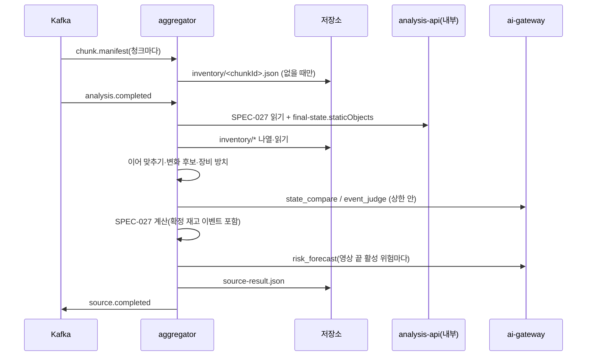

# Plan: SPEC-028 aggregator 정적 객체 재고 비교·장비 방치·위험 노출 예측 — ai

- spec: docs 레포 `docs/specs/SPEC-028-aggregator-inventory/spec.md`
- 계약(계약 묶음 3.14.0): `events/chunk.manifest`·`_state-compare`·`_risk-forecast`·`_vlm-analysis`, `aggregates/v1/chunk-inventory`·`source-result`(`inventory`·`inventoryChanges`·`inventoryEvents`·`forecasts`), `events/source.completed`(`counts.inventoryEvents`·`forecasts`), `openapi/analysis-service.yaml` `FinalState.staticObjects`, `openapi/ai-gateway.yaml` 1.4.0(taskType `state_compare`·`risk_forecast`), `asyncapi/aggregator.yaml` 1.1.0, `stages/v1`
- 선행: SPEC-021, SPEC-027(이 plan은 SPEC-027의 aggregator 위에 더한다)

- v5.1(계약 묶음 4.0.0, 2026-11-07, ADR-0015): `chunk.manifest`에 선택 필드 `jobType`·`trackIdEpoch`·`last`·`gapMs`(생산자 stream-ingestor, SPEC-037)가 더해졌다. `STREAM` 세션은 창마다가 아니라 프로필 주기마다 재고·방치·예측을 계산한다(R-19). SPEC-027 v5.1 설계(창 처리·세션 상태·Redis 계수) 위에 더한다. 잠금은 4.0.0이다.

## 1. 요약

aggregator에 `chunk.manifest` 소비 경로를 더해 청크마다 처음 받은 재고를 청크 재고 파일로 저장한다. `analysis.completed` 처리에서는 SPEC-027 계산 앞에 재고 단계를 넣는다. 청크 재고(와 세션 직전 영상의 끝 재고)를 이어 맞춰 변화 후보를 만들고(순수 함수), 후보를 `state_compare`로, 통로·위험구역 장비 방치를 `event_judge`로 판정한다(호출 수 상한). 확정된 재고 이벤트는 SPEC-027 상태 계산·노출·타임라인에 들어간다. 노출 계산 뒤 영상 끝에 활성인 위험마다 `risk_forecast`를 부른다.

ai-gateway에는 `state_compare` Registry 폴더(VLM)와, VLM이 아닌 새 Adapter 종류 `predictor`와 1단계 규칙 점수 구현, `risk_forecast` Registry 폴더를 더한다. 재고 클래스·방호 클래스·장비 클래스·기준값·프롬프트 문안·예측 모델은 AI 담당자 몫이고 프로필 자리값만 둔다.

## 2. 담당 요구사항

경로 약칭은 SPEC-027 plan과 같다(`agg/`, `t/`). `gw/`는 `services/ai-gateway/src/ai_gateway/`, `gt/`는 `services/ai-gateway/tests/`다.

| 요구사항 | 담당 모듈 / 컴포넌트 | 검증 테스트 |
| --- | --- | --- |
| R-1 | `agg/inventory_store.py` `InventoryStore.handle`(`put_bytes_if_absent`) | `t/test_aggregator_inventory_store.py` |
| R-2 | `agg/reader.py`(재고 파일 수 검사) | `t/test_aggregator_reader.py` |
| R-3, R-4, R-5 | `agg/inventory.py` `stitch`·`change_candidates` | `t/test_aggregator_inventory.py` |
| R-6 | `agg/inventory.py`(직전 재고를 앞 청크로) | `t/test_aggregator_inventory.py` |
| R-7, R-8 | `agg/judge.py` `judge_changes`(호출 수 상한, 순서) | `t/test_aggregator_judge.py` |
| R-9, R-10 | `agg/judge.py`, `agg/compute.py`(재고 이벤트를 상태 입력으로) | `t/test_aggregator_judge.py`, `t/test_aggregator_compute.py` |
| R-11 | `agg/equipment.py` `abandoned_equipment` | `t/test_aggregator_equipment.py` |
| R-12 | `agg/judge.py` `judge_equipment` | `t/test_aggregator_judge.py` |
| R-13 | `agg/inventory.py` `end_inventory`, `agg/result.py` | `t/test_aggregator_inventory.py`, `t/test_aggregator_service.py` |
| R-14, R-15 | `agg/forecast.py` `forecast_risks`, `zone_entries_per_minute` | `t/test_aggregator_forecast.py` |
| R-16 | `gw/adapters/predictor.py` `RuleForecastPredictor`, `gw/analyze.py`(predictor 경로), `gw/profile.py` | `gt/test_predictor_adapter.py`, `gt/test_analyze_api.py`, `gt/test_profile.py` |
| R-17 | `agg/ids.py`, `agg/result.py` | `t/test_aggregator_ids.py`, `t/test_aggregator_compute.py` |
| R-18 | `agg/service.py`·`agg/inventory_store.py` 단계 블록 | `t/test_aggregator_service.py`, `libs/contracts/tests/test_stage_contracts.py` |
| R-19 | `agg/stream.py`(`inventory_due`, 주기 계산을 창 처리 끝에 붙임), `agg/profile.py`(`stream_inventory_interval_s`, 기본 600), `agg/judge_budget.py`(세션당 상한, SPEC-027 R-31과 같은 계수) | `t/test_aggregator_stream_inventory.py`, `t/test_aggregator_judge_budget.py`(integration) |
| NFR-1 | `agg/inventory.py` | `t/test_aggregator_performance.py`(청크 60 × 객체 100, p95 2초) |
| NFR-2 | `agg/inventory_store.py` | `t/test_aggregator_worker_e2e.py`(처리 확인), 로컬 compose 측정(p95 300ms) |
| NFR-3 | `gw/adapters/predictor.py` | `gt/test_overhead.py`에 `risk_forecast` 경우 추가(p95 20ms) |

## 3. 원칙 점검

| 원칙 | 준수 | 비고 |
| --- | --- | --- |
| I 스펙 우선 | ☑ | SPEC-028 Approved(머지됨) |
| II 계약 우선 | ☑ | 계약 묶음 3.14.0. 단 `_risk-forecast` 대체 결과와 직전 영상 프레임 경로는 계약으로 풀어야 한다(5절 확인 항목) |
| III 테스트 우선 | ☑ | R-1~R-18, NFR-1·NFR-3 테스트 매핑, NFR-2는 로컬 측정 |
| IV 서비스 자율성 | ☑ | 재고는 `chunk.manifest`와 `final-state`로만 받는다. chunk-processor·analysis-api 코드는 바꾸지 않는다 |
| V 단순성 | ☑ | 새 외부 패키지 없음. `predictor`는 규칙 점수만 두고 모델 파일 로딩(manifest)은 학습 모델이 생길 때 더한다 |
| VI 관측 가능성 | ☑ | 단계 `aggregate.inventory_store`·`inventory_compare`·`judge`·`forecast`, 결과에 callId |
| VII 보안 | ☑ | 프레임은 계약의 블러 사본 경로만 넘긴다. 판정 문장을 로그에 남기지 않는다 |
| VIII 문서·주석 | ☑ | 계약 모델 테스트, README |
| IX GitOps | ☑ | 운영 배포는 사용자 지시 시 |

## 4. 기술 설계

### 변경 대상

| 경로 | 변경 |
| --- | --- |
| `libs/contracts/.../events.py` | `ChunkManifest`, `StaticObject`, `ReferenceFrame`, `SourceCompleted.counts`의 선택 필드 |
| `libs/contracts/.../aggregates.py` | `ChunkInventory`, `SourceResult`의 `inventory`·`inventoryChanges`·`inventoryEvents`·`forecasts`, 타임라인 종류 `inventory_event` |
| `libs/contracts/.../stages.py` | 단계 ID 4개 |
| `libs/storage/.../storage.py`·`s3.py`·`memory.py` | `list_keys(prefix)` 추가(R-2 재고 파일 수). 저장소 인터페이스에 메서드 하나를 더한다 |
| `agg/` | `inventory_store.py`, `inventory.py`, `equipment.py`, `judge.py`, `forecast.py`, `profile.py`·`compute.py`·`service.py`·`result.py`·`ids.py` 확장 |
| `agg/__main__.py` | `chunk.manifest` 경로 추가(같은 소비 그룹) |
| `gw/adapters/predictor.py` (새 파일) | `Predictor` Protocol, `RuleForecastPredictor` |
| `gw/profile.py` | `AdapterKind`에 `predictor`, predictor 설정(`horizons_sec`, 규칙 계수) |
| `gw/analyze.py`, `gw/main.py` | Adapter 종류가 `predictor`인 taskType은 predictor로 처리 |
| `services/ai-gateway/registry/prompts/state_compare/`, `risk_forecast/` | 입력·출력 스키마, 프롬프트(자리 표시), `fallback.json` |
| ai-gateway 프로필 2개·`gateway_support.py`·Registry 배치·Dockerfile | `[tasks.state_compare]`·`[tasks.risk_forecast]`, 계약 `_state-compare`·`_risk-forecast` 파일 |

### aggregator 프로필 추가 값(자리값, AI 담당자 몫)

`inventory_iou`(0.5), `move_window_ms`(120000), `barrier_classes`, `equipment_classes`, `abandon_ms`(600000), `judge_call_limit`(20), 장비 방치 템플릿 설명. 클래스 목록은 탐지 프로필의 재고 클래스와 맞춰 AI 담당자가 채운다.

### `chunk.manifest` 처리(R-1)

1. 워커가 `ChunkManifest`로 검증한다. 맞지 않으면 DLQ.
2. `aggregate.inventory_store`: `ChunkInventory`(sourceId·jobId·chunkId·executionId·ownedRange·detectorProfile·staticObjects·referenceFrames)를 `sources/<sourceId>/jobs/<jobId>/aggregate/inventory/<chunkId>.json`에 `put_bytes_if_absent`로 쓴다. 이미 있으면 아무것도 하지 않는다(처음 쓴 실행이 이김). count는 객체 수다.
3. 발행은 없다.

### `analysis.completed` 처리에 더하는 단계

SPEC-027 순서의 읽기와 계산 사이에 넣는다.

1. `aggregate.read`(SPEC-027): `inventory/` 아래 키를 나열해 `counts.chunks`보다 적으면 재시도 가능 오류(R-2), 아니면 모두 읽는다. 직전 영상 `final-state.staticObjects`는 SPEC-027 R-5 호출 결과를 쓴다.
2. `aggregate.inventory_compare`(순수, `asyncio.to_thread`)
   - R-3 이어 맞추기: 청크를 `ownedRange.startMs`, chunkId 순으로 놓는다. 이웃한 두 청크에서 같은 클래스 쌍의 박스 IoU를 계산해 기준 이상인 쌍을 `(IoU 내림차순, 앞 objectLocalId, 뒤 objectLocalId)` 순으로 하나씩 짝짓는다. 짝은 같은 객체 사슬이다. objectId는 사슬을 처음 본 청크의 `chunkId[:8] + objectLocalId`(계약 설명), 직전 재고에서 시작한 사슬은 직전 objectId를 그대로 쓴다.
   - R-4: 짝이 없는 앞 객체 → `removed`(`beforeMs` = 그 객체 `lastSeenMs`), 짝이 없는 뒤 객체 → `appeared`(`afterMs` = `firstSeenMs`).
   - R-5: 같은 클래스 `removed`·`appeared` 쌍 중 `0 ≤ appeared.afterMs − removed.beforeMs ≤ move_window_ms`를 차이가 작은 쌍부터(같으면 objectId 순) 하나씩 `moved`로 합친다.
   - R-6: 직전 재고를 첫 청크 앞(시각 없음)에 놓고 위를 적용한다. 직전 재고에서 온 `removed` 중 `barrier_classes`이고 `moved`로 합쳐지지 않은 것을 `not_restored`로 바꾼다.
   - R-11 장비 방치: 사슬의 `lastSeenMs − firstSeenMs ≥ abandon_ms`이고 `equipment_classes`이며 구역이 있고, 그 구간에 같은 구역의 사람 트랙 머문 구간이 겹치지 않는 객체.
   - R-13: 마지막 청크 객체의 사슬을 끝 재고로 낸다.
3. `aggregate.judge`(I/O, count = 호출 수)
   - 판정 순서: `removed`·`moved`·`not_restored` 후보를 `(beforeMs, null은 앞, changeId)` 순, 그 뒤 통로·위험구역 장비 방치를 `(firstSeenMs, objectId)` 순. 상한에 이르면 남은 후보는 판정하지 않는다(R-8).
   - R-7 `state_compare`: 이미지 = 직전 객체 `frameKey` + 이후 시각에 가장 가까운 기준 프레임(`moved`는 이후 객체 `frameKey`). 변수 = `eventType`(`object_moved`·`object_removed`·`barrier_not_restored`), `changeKind`, `expectedClasses`(그 클래스 하나), `zoneName`, `beforeSec`·`afterSec`. `appeared`는 부르지 않고 `eventId`·`verificationStatus` null로 기록한다.
   - R-12 `event_judge`: 이미지 = 사슬 마지막 `frameKey`, 변수 = `eventType: equipment_abandoned`, `startSec`·`endSec`, `zoneName`, `evidence`(`className`, `stationarySeconds`, `rule: equipment_abandoned`). 일반 구역은 부르지 않고 템플릿 설명의 `rule`·`confirmed` 분석으로 만든다.
   - R-9: 판정한 후보마다 재고 이벤트(`judgmentMethod` `inventory+state_compare`·`rule+vlm`·`rule`, `analysis`는 응답의 VLMAnalysis, `evidenceFrameKeys`는 보낸 이미지)를 만든다.
   - R-10: `AiGatewayError`(SPEC-021 R-9 재시도 뒤)면 `verificationStatus: unknown`인 분석(유형만 채우고 나머지 null)으로 기록한다.
4. `aggregate.compute`(SPEC-027): 상태 입력 = 병합 대표 + `confirmed` 재고 이벤트. 이벤트 시각 규칙은 SPEC-027과 같다. 타임라인에 `inventory_event` 항목을 더한다.
5. `aggregate.forecast`(R-14·R-15, count = 위험 수): 영상 끝 활성 위험마다 `risk_forecast`. 변수 = `riskType`, `zoneKind`(`global`이면 null), `activeSeconds`, `exposureCount`, `exposureSeconds`, `zoneEntriesPerMinute`(그 구역 사람 트랙 진입 수 ÷ 영상 분, `global`은 사람 트랙 수 ÷ 영상 분). `modelId: null`이면 `not_configured`, 오류면 `failed`, 그 밖은 `generated`와 출력.
6. 요약·저장·발행(SPEC-027). `counts.inventoryEvents`·`forecasts`를 채운다.

### ID(R-17)

| 대상 | 이름(`uuid5(NAMESPACE_URL, …)`) |
| --- | --- |
| 변화 | `vlm:aggregate:change:<jobId>:<kind>:<beforeObjectId 또는 ->:<afterObjectId 또는 ->` |
| 재고 이벤트(변화) | `vlm:aggregate:inventory-event:<jobId>:<changeId>` |
| 재고 이벤트(장비 방치) | `vlm:aggregate:equipment:<jobId>:<objectId>` |

`forecasts` 항목은 계약에 ID 필드가 없고 riskId로 찾는다. 같은 입력이면 판정·예측 응답을 뺀 내용(후보, 순서, ID, 이미지 경로)이 같다.

### ai-gateway

- `state_compare`: 출력 `$ref ../../events/_state-compare.schema.json`, `fallback.json`은 `analysis`(유형 `$input.eventType`, 상태 `$status`, 나머지 null)와 빈 `changes`. 프로필 `local.toml`은 로컬 Ollama 같은 모델(자리값), `local-mock.toml`은 mock, `max_images = 2`.
- `predictor` Adapter(R-16)
  - Protocol `Predictor.predict(*, model, variables) -> JsonObject`. `VlmAdapter`와 따로 둔다(프롬프트·이미지가 없음).
  - `AnalyzeService`: taskType 설정의 Adapter 종류가 `predictor`면 결과 캐시·예산·분당 한도(`ModelGate`)를 거치지 않고(외부 비용이 없다) predictor를 부른 뒤 출력 스키마로 검증하고 호출 로그를 남긴다. 미설정이면 기존과 같이 `fallback.json`, `modelId: null`.
  - `RuleForecastPredictor`: 입력은 `activeSeconds`, `zoneEntriesPerMinute`만 쓴다. 기본안 λ = `zoneEntriesPerMinute` / 60 × min(1, `activeSeconds` / `saturation_s`), 구간마다 p = 1 − exp(−λ × `horizonSec`). `horizons_sec`(기본 600·1800)와 `saturation_s`는 프로필 값이고 출력 `method: rule`, `features`에 두 입력값. 공식 형태는 AI 담당자가 바꿀 수 있는 자리값이다.
  - 프롬프트 파일: Registry가 `prompt.md`를 요구하고 버전 해시에 넣으므로 "predictor가 처리하며 모델에 보내지 않는다"는 한 줄을 둔다.
  - `mock` 허용 검사는 그대로이고 `predictor`는 운영 프로필에서도 쓸 수 있다.
- `registry_bundle._REGISTRY_FOLDERS`는 이미 `events`를 넣는다. 테스트 배치(`tests/conftest.py`)와 Dockerfile COPY에 계약 파일 `_state-compare`·`_risk-forecast`를 더한다.

### spec이 정하지 않아 plan에서 정한 것(보고 대상)

| 항목 | plan의 선택 |
| --- | --- |
| `removed`의 "이후 시각"(R-7 기준 프레임) | 짝이 없던 뒤 청크의 `ownedRange.startMs`. `afterMs`에도 이 값을 기록한다. 마지막 청크 뒤에 사라진 경우는 없다(마지막 청크 객체는 끝 재고) |
| `not_restored`의 시각 | `beforeMs` null(직전 영상 시각이라 이 영상 기준이 아님), `afterMs` = 첫 청크 시작 |
| R-6의 `not_restored` 대상 | 직전 재고에서 온 `removed`만. 이 영상 안에서 사라진 방호벽은 `removed`로 둔다(US-2 기준) |
| `moved`의 시간 방향 | 등장이 제거보다 늦은 쌍만 |
| 장비 방치 구간 | 사슬의 `firstSeenMs` ~ `lastSeenMs` |
| 상한을 넘은 통로·위험구역 장비 방치(R-8·R-12) | **사용자 확인 필요**. 확인 전 기본안: `rule+vlm` 이벤트를 `verificationStatus: unverified` 분석으로 기록하고 상태 계산에 넣지 않음 |
| `event_judge` 호출 오류(R-12) | R-10과 같이 `unknown`으로 기록 |

### 상호작용

### 데이터 모델

해당 없음(DB 없음). 청크 재고 파일은 계약 `aggregates/v1/chunk-inventory`대로다.

### API / 이벤트

- 소비: `chunk.manifest`(`consumeChunkManifest`), `analysis.completed`
- 호출: ai-gateway `analyze`(`state_compare`, `event_judge`, `risk_forecast`), analysis-api `getSourceFinalState`

## 5. 대안과 선택 이유

| 대안 | 장점 | 단점 | 선택 |
| --- | --- | --- | --- |
| 재고 단계를 순수 함수(이어 맞추기·후보)와 I/O(판정)로 나눔 | 후보·ID 결정성을 단위 테스트로 확인(R-17) | 판정 결과를 계산 입력으로 다시 넘김 | ☑ |
| 재고 파일 수를 저장소 나열로 셈(`list_keys`) | 청크 목록 출처가 따로 필요 없음 | 저장소 인터페이스에 메서드 추가 | ☑ |
| `chunk.manifest` 받을 때 별도 표식 파일 갱신 | 나열 없음 | 동시 쓰기 처리가 필요 | |
| predictor를 `ModelGate` 밖에서 처리 | 비용·캐시가 없는 규칙 점수에 맞음, NFR-3(20ms) 여유 | 경로가 하나 늘어남 | ☑ |
| predictor도 `ModelGate`를 거침 | 경로 하나 | 의미 없는 캐시·예산 예약, DB·Redis 왕복 | |

### 사용자 확인 필요

1. 직전 영상 프레임 경로(R-6·R-7 `not_restored`). 직전 객체의 대표 프레임은 `sources/<previousSourceId>/...`인데, ai-gateway는 요청 `sourceId` 아래 경로만 받는다(SPEC-009 R-10, 계약 `AnalyzeRequest.sourceId` 설명). 그래서 `not_restored`는 지금 계약으로 판정할 수 없다.
   - A. aggregator가 직전 프레임을 이 영상 job 폴더(`sources/<sourceId>/jobs/<jobId>/aggregate/frames/blurred/…`)로 복사해 보낸다. 계약 변경 없음. 다른 영상의 블러 사본이 이 영상 폴더에 남고 이 영상과 함께 지워진다(보존 규칙 검토 필요).
   - B. ai-gateway 계약에 "같은 세션의 다른 영상 경로" 허용을 더한다. 계약 변경(minor)과 ai-gateway 이미지 정책 변경.
   - C. `not_restored`는 이후 프레임 한 장과 기대 객체 설명만으로 판정한다. 계약 변경 없음. R-7("두 장")과 달라 spec 수정이 필요.
2. `risk_forecast` 대체 결과. `_risk-forecast`는 `horizons` 최소 1개·`exposureProbability` 필수라, 모델 미설정일 때 쓸 `fallback.json`을 값을 지어내지 않고 만들 수 없다(Registry는 대체 결과가 출력 스키마를 통과해야 기동한다).
   - A. 계약 `_risk-forecast`의 `horizons` 최소 개수를 0으로(설명에 "미설정이면 빈 배열") 바꾼다. 계약 minor, docs PR 먼저. 기본안.
   - B. predictor 종류 taskType만 대체 결과 검사를 건너뛰게 ai-gateway 코드에 예외를 둔다. taskType별 코드 금지(SPEC-009 R-24)와 충돌.
3. 규칙 점수 공식 기본안(4절 predictor). spec은 "활성 시간과 구역 분당 진입 수만으로 정해지는 결정적 값"만 정했다. 공식 형태를 이대로 둘지.
4. 상한을 넘은 통로·위험구역 장비 방치 처리(4절 표).

## 6. 테스트 전략

- 단위(순수): IoU 짝짓기(동점·클래스 다름·기준 경계), 사슬 objectId, `removed`·`appeared`·`moved`(창 경계, 가까운 쌍 우선), 직전 재고와 `not_restored`, 끝 재고, 장비 방치(사람 겹침·구역 없음), 판정 순서·상한, 구역 분당 진입 수, ID, 입력 순서를 섞어도 같은 후보
- 서비스: 가짜 ai-gateway 클라이언트(호출 기록)·메모리 저장소로 `chunk.manifest` 저장 멱등, 재고 파일 부족 재시도, 판정 결과가 상태·타임라인에 들어감, 오류 `unknown`, 예측 상태 3종. 결과 파일을 계약 스키마로 검증
- ai-gateway: predictor 규칙 점수 결정성·범위 0~1, 프로필 검증(`predictor` 종류), `/v1/analyze` `risk_forecast` 응답(호출 로그, 캐시·예산 없음), `state_compare` 로드·mock 응답, NFR-3 지연
- 저장소: `list_keys`를 S3(SeaweedFS testcontainer)·메모리 구현에서 같은 결과로
- 성능: 청크 60 × 객체 100 이어 맞추기 p95(NFR-1)
- 워커 e2e: `chunk.manifest` 두 건과 `analysis.completed`로 `object_moved` 재고 이벤트가 든 `source.completed`(spec 성공 지표의 테스트판)

## 7. 리스크와 롤백

- chunk-processor는 다른 담당자 서비스라 `chunk.manifest`가 아직 없다. 계약은 소비 쪽이 먼저 정했다(생산자 확인 필요).
- 재고가 큰 영상은 판정 후보가 많다. 상한(기본 20)으로 비용을 막고, 판정하지 않은 후보는 결과에 남아 원인을 볼 수 있다.
- 5절 1·2가 정해지기 전에는 `not_restored` 판정(T018)과 `risk_forecast` 등록(T022)을 진행하지 않는다. 나머지 태스크는 진행할 수 있다.
- 롤백: aggregator 재고 단계는 재고 파일이 없으면(청크 0) 빈 결과다. ai-gateway 변경은 새 taskType·새 Adapter 종류 추가라 기존 taskType에 영향이 없다.

## 8. 배포 고려사항

- 로컬 compose(docs PR): 토픽 `chunk.manifest`, `chunk.manifest.aggregator.retry`. 생산자가 없으므로 측정은 메시지를 직접 넣는다.
- ai-gateway 프로필 변경은 Registry 묶음(`registry_bundle`)에 함께 들어간다. 운영 배포는 사용자 지시 시.
- 순서: SPEC-027 → ai-gateway `state_compare`·`predictor`·`risk_forecast` → aggregator 재고 단계.

## 9. v5.1 추가 설계(계약 묶음 4.0.0, 2026-11-07)

- `STREAM`의 `chunk.manifest`도 R-1과 같이 청크 재고 파일로 저장한다(경로는 창의 `chunkId`). 저장 경로·멱등 규칙은 같다.
- SPEC-027 창 처리(R-30)의 fold 뒤에 `inventory_due(state, window_end_ms)`를 본다. 세션 상태의 `lastInventoryAtMs`가 없거나 `window_end_ms − lastInventoryAtMs ≥ stream_inventory_interval_s × 1000`이면 그때까지의 재고 파일(`inventory/` 나열)과 세션 현재 상태로 R-3~R-7(이어 맞추기·변화 후보), R-11~R-12(장비 방치), R-14~R-15(예측)를 계산한다. 회전 세션이면 `previousSourceId` 세션 상태의 끝 재고를 첫 청크 앞에 놓는다(R-6와 같은 규칙).
- 확정된 재고 이벤트는 다음 창 fold의 입력에 넣어 다음 `state.updated`의 규칙 이벤트·위험 전이에 담긴다. 예측 결과는 세션 상태에 두고 세션 마무리(SPEC-027 R-32) 결과 파일의 `forecasts`에 싣는다. `state.updated`에는 예측 필드가 없다.
- 판정 호출(R-7·R-12)의 상한(R-8)은 세션당이다. SPEC-027 R-31과 같은 Redis 계수 `agg:judge-calls:<jobId>`를 쓴다. 업로드 job은 지금처럼 프로세스 안 계수다.
- 주기 계산은 창 처리와 같은 핸들러 안에서 순서대로 한다(별도 타이머 없음). 창이 멈추면 계산도 멈추고, 세션 마무리에서 마지막으로 한 번 더 계산한다.
