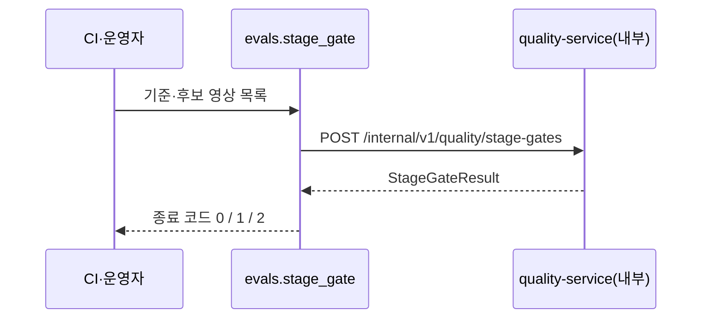

# Plan: SPEC-030 매칭 규칙·성능 Gate CI 명령 (evals) — ai

- spec: docs 레포 `docs/specs/SPEC-030-quality-datasets/spec.md`
- 계약(계약 묶음 5.0.0, ADR-0018): `quality/v1/golden-manifest`(`bboxLabel`·`intervalLabel`·`stateChangeLabel`), `openapi/quality-service.yaml` 3.0.0(`evaluateStageGate`), `aggregates/v1/source-result`(`inventoryChanges.kind`, 상태 변화 비교 대상)
- 범위: 이 레포가 맡는 R-11, R-12, R-19만 다룬다. quality-service·media-service(R-1~R-10, R-13~R-18, NFR-1~NFR-3)는 backend 레포 plan이다.
- 선행: SPEC-021(생성 스크립트·`vlm_common` 재시도 도우미, SPEC-027 T005에서 `libs/common`으로 옮김)

## 1. 요약

빈 자리인 `evals/`를 워크스페이스 멤버로 만든다. 평가 잡이 예측과 라벨을 같은 규칙으로 맞추도록 시간 구간·bbox·상태 변화 매칭을 **순수 함수**로 두고, 성능 Gate를 quality-service `POST /internal/v1/quality/stage-gates`로 계산해 `passed: false`면 0이 아닌 코드로 끝나는 CLI를 둔다. 요청·응답 모델은 `openapi/quality-service.yaml`에서 다른 내부 클라이언트와 같은 `scripts/generate-clients.sh`로 `libs/quality-client`에 생성한다.

평가 스위트 내용(어떤 Golden Set·지표를 쓰는지), 예측을 어디서 읽는지, 기준값 조정은 AI 담당자 몫이다. 매칭 함수는 값 객체를 받으므로 그 선택과 상관없이 쓸 수 있다.

## 2. 담당 요구사항

경로의 `ev/`는 `evals/src/evals/`, `et/`는 `evals/tests/`다.

| 요구사항 | 담당 모듈 / 컴포넌트 | 검증 테스트 |
| --- | --- | --- |
| R-11 | `ev/matching.py` `temporal_iou`, `match_intervals` | `et/test_evals_matching.py` |
| R-12 | `ev/matching.py` `match_boxes`, `match_state_changes`, `box_iou` | `et/test_evals_matching.py` |
| R-19 | `libs/quality-client` `QualityApiClient.evaluate_stage_gate`(호출), `ev/stage_gate.py`(CLI `python -m evals.stage_gate`) | `libs/quality-client/tests/test_quality_client*.py`, `et/test_evals_stage_gate.py` |

## 3. 원칙 점검

| 원칙 | 준수 | 비고 |
| --- | --- | --- |
| I 스펙 우선 | ☑ | SPEC-030 Approved(머지됨) |
| II 계약 우선 | ☑ | 계약 묶음 5.0.0. 상태 변화 종류 대응은 5절 1의 기본 대응표로 정했다 |
| III 테스트 우선 | ☑ | R-11·R-12·R-19 테스트 매핑, 매칭은 순수 함수 단위 테스트 |
| IV 서비스 자율성 | ☑ | quality-service DB를 읽지 않고 내부 API만 부른다 |
| V 단순성 | ☑ | 새 외부 패키지 없음(httpx·pydantic-settings는 lock에 있음). 헝가리안 같은 최적 할당 대신 spec이 정한 탐욕 일대일 |
| VI 관측 가능성 | ☑ | CLI는 단계별 결과를 JSON 로그로 남긴다(`print` 금지) |
| VII 보안 | ☑ | 응답을 생성 모델로 검증한다. 비밀값 없음 |
| VIII 문서·주석 | ☑ | 생성 코드 비교 CI, README |
| IX GitOps | ☑ | 해당 없음(배포 단위 아님) |

## 4. 기술 설계

### 변경 대상

| 경로 | 변경 |
| --- | --- |
| `evals/pyproject.toml`(새 멤버 `vlm-evals`, 패키지 `evals`) | AGENTS.md 명령 `python -m evals.<모듈>`과 맞춘다. 의존: `vlm-common`, `vlm-quality-client`, httpx, pydantic-settings |
| `ev/matching.py` | 매칭 규칙 |
| `libs/quality-client`(새 멤버 `vlm-quality-client`) | `models.py`(생성), `client.py` `QualityApiClient`. 생성 방식을 한 곳에 두려고 `evals` 안이 아니라 다른 클라이언트와 같은 자리에 둔다 |
| `ev/stage_gate.py` | CLI `main`(`python -m evals.stage_gate`)과 `EvalsSettings` |
| 루트 `pyproject.toml` | `members`, mypy `files`·`mypy_path`, pytest `testpaths`·`pythonpath`에 `evals`, `consider_namespace_packages` |
| `scripts/generate-clients.sh` | 표에 `quality-client` 한 줄. 생성 코드 비교는 다른 클라이언트처럼 pytest(`test_quality_client_generated.py`)가 CI에서 한다 |
| `services/*/Dockerfile` test 단계, `.dockerignore` | `uv sync --all-packages`가 새 멤버 `evals`의 정의를 찾도록 `COPY evals evals`, `.dockerignore`는 `evals`의 `pyproject.toml`·`src`만 넣는다 |

### 매칭 규칙(순수 함수)

공통 규칙: 후보 쌍마다 점수를 매기고, 기준을 통과한 쌍을 정렬해 앞에서부터 라벨·예측이 둘 다 아직 짝이 없으면 짝짓는다(일대일 탐욕). 결과는 `MatchResult(pairs, unmatched_labels, unmatched_predictions)`이고 짝이 없는 라벨은 놓침, 짝이 없는 예측은 오탐이다. 결과 순서는 입력 순서와 상관없이 정해진다.

| 종류 | 비교 대상 | 기준(기본값, 인자로 바꿈) | 정렬 |
| --- | --- | --- | --- |
| 시간 구간(R-11) | 같은 `eventType` | temporal IoU = 겹친 길이 / 합친 길이 ≥ 0.3 | IoU 내림차순 → 라벨 `startMs` → 라벨 ID → 예측 ID |
| bbox(R-12) | 같은 `className`, `abs(label.ptsMs − pred.ptsMs) ≤ frame_interval_ms / 2` | 박스 IoU ≥ 0.5 | IoU 내림차순 → 라벨 `ptsMs` → 라벨 ID → 예측 ID |
| 상태 변화(R-12) | 같은 `className`, 같은 변화 종류 | `abs(Δt) ≤ 5000ms` | `abs(Δt)` 오름차순 → 라벨 `atMs` → 라벨 ID → 예측 ID |

- 길이가 0인 구간 두 개가 같은 시각이면 합친 길이가 0이다. 이때 IoU는 0으로 본다(나눗셈을 피하고 기준을 넘지 않게).
- 입력 값 객체: `IntervalLabel`·`IntervalPrediction`(id, eventType, startMs, endMs), `BoxLabel`·`BoxPrediction`(id, ptsMs, className, box), `StateChangeLabel`·`StateChangePrediction`(id, atMs, className, kind). 라벨 쪽은 `golden-manifest` `datasetItems[].labels`에서 바로 만들 수 있다.
- `frame_interval_ms`는 호출자가 넘긴다. spec이 "프레임 간격"이 라벨 영상의 프레임 간격인지 검출 샘플링 간격인지 정하지 않아, 함수는 값을 받기만 한다.
- 상태 변화의 `Δt` 기준 예측 시각: 재고 변화 `afterMs`, 없으면 `beforeMs`(plan의 선택, 보고 대상). `state_change_time_ms`가 계산하고, 둘 다 없으면 None이라 호출자가 비교 대상에서 뺀다.
- ID가 겹치면 정렬 키가 정해지지 않으므로 `ValueError`로 받지 않는다.

### 성능 Gate CLI(R-19)

```bash
uv run --package vlm-evals python -m evals.stage_gate \
  --baseline-sources baseline.txt --candidate-sources candidate.txt \
  [--stage-id analyzer.judge ...] [--max-regression-ratio 0.2] [--min-samples 5]
```

- quality-service 주소와 호출자 이름(기본 `quality-eval`, 계약 예시)은 `EvalsSettings`(`EVALS_QUALITY_URL`, `EVALS_CALLER`, 시도 제한 `EVALS_TIMEOUT_S`, 전체 제한 `EVALS_DEADLINE_S`)로 읽는다.
- 목록 파일은 한 줄에 UUID 하나, 빈 줄과 `#` 줄은 건너뛴다. 중복은 계약(`uniqueItems`)과 맞지 않아 입력 오류(2)다.
- 비운 선택 인자는 보내지 않는다(계약이 null을 받지 않는다). 서버 기본값이 쓰인다.
- `X-Request-Deadline`은 보내지 않는다(5절 2). 마감은 재시도 대기가 넘지 않게 하는 데만 쓴다.
- 요청 본문은 생성 모델 `StageGateRequest`, 응답은 `StageGateResult`로 검증한다.
- 재시도: 이 호출은 저장하지 않는 계산(R-18)이라 읽기 전용 규칙(503·연결 실패 2회 지수 대기)을 쓴다. `vlm_common.http_call`의 도우미를 쓴다.
- 종료 코드: `passed: true` 0, `passed: false` 1, 호출 실패·응답이 계약과 맞지 않음·입력 파일 오류 2. 단계별 결과(`stageId`, p95 두 값, `ratio`, `status`)를 JSON 로그로 남긴다.
- CI에서 벤치마크 영상을 돌리고 이 명령을 부르는 workflow는 벤치마크 환경이 생길 때 더한다. 이 plan은 명령만 둔다.

### 데이터 모델

해당 없음.

### API / 이벤트

- 호출: quality-service `evaluateStageGate`(`POST /internal/v1/quality/stage-gates`)

### 상호작용



## 5. 대안과 선택 이유

| 대안 | 장점 | 단점 | 선택 |
| --- | --- | --- | --- |
| 탐욕 일대일(점수 순) | spec 문장 그대로, 결정적 | 전역 최적 할당은 아님 | ☑ |
| 헝가리안 최적 할당 | 합계 IoU 최대 | spec과 다른 결과가 나올 수 있음, scipy 의존 | |
| `evals`를 워크스페이스 멤버로 | ruff·mypy·pytest가 같은 방식으로 돈다 | 멤버 하나 추가 | ☑ |
| 루트에서 스크립트로만 실행 | 설정이 적음 | 타입 검사·의존성 관리 밖 | |

### 사용자 확인 필요와 spec·계약 문제

1. 상태 변화 종류가 계약끼리 다르다. 라벨 `stateChangeLabel.change`는 `removed`·`moved`·`added`·`restored`, aggregator 결과 `inventoryChanges.kind`는 `removed`·`appeared`·`moved`·`not_restored`다. R-12의 "같은 변화 종류"를 어떻게 대응할지 정해야 한다.
   - 결정(사용자, 추천안): 아래 기본안. `DEFAULT_STATE_CHANGE_KINDS`, 인자 `kinds`.
   - 기본안: `removed↔removed`, `moved↔moved`, `added↔appeared`, `restored`는 대응하는 예측이 없음(항상 놓침), `not_restored`는 라벨이 없음(항상 오탐 후보). 대응표는 인자로 받아 바꿀 수 있게 둔다.
   - 또는 계약 쪽(라벨 enum이나 결과 enum)을 맞춘다(계약 변경).
2. quality-service 내부 API 계약에 `X-Request-Deadline` 헤더가 없다(내부 동기 호출 규약은 호출자가 넣는다고 정함). 계약에 없는 헤더라 보내지 않는다(사용자 결정). 계약에 더하면 그때 싣는다.
3. 평가 잡 본체(Golden Set 매니페스트 읽기, 예측 모으기, `submitEvaluationRun` 제출)는 SPEC-029가 "ai 레포 evals"라고만 하고 이를 맡은 ai spec이 없다. 이 plan은 매칭 규칙과 Gate 명령만 만든다(사용자 결정: 본체는 이번 범위가 아님).

## 6. 테스트 전략

- 단위: temporal IoU(spec 예시 [10s, 20s]·[12s, 22s] → 0.667, 겹침 없음, 포함, 길이 0), 유형이 다르면 비교하지 않음, 기준 경계(정확히 0.3), 라벨 하나에 예측 둘(큰 IoU만 짝, 나머지 오탐), 동점이면 라벨 시작이 이른 쪽, 입력 순서를 섞어도 같은 결과. bbox의 시각 차 경계(정확히 절반), 클래스 다름, 박스 IoU. 상태 변화의 종류 대응·시각 기준 경계
- 클라이언트·CLI: httpx `MockTransport`로 요청 본문·`X-Caller`·마감 헤더 없음, 503·연결 실패 재시도, 400·403·500·응답 시간 초과 즉시 실패, 계약과 맞지 않는 응답, 입력 오류, 종료 코드 0·1·2
- 생성 코드 비교: `libs/quality-client/tests/test_quality_client_generated.py`(CI는 잠금 계약으로 실행)

## 7. 리스크와 롤백

- quality-service(backend)가 아직 없다. 계약이 바뀌면 생성 코드 비교가 CI에서 잡는다.
- 상태 변화 종류 대응(5절 1)이 정해지기 전에는 `match_state_changes`의 기본 대응표만 두고 확인 뒤 고친다.
- 롤백: 배포 단위가 아니라 되돌릴 운영 영향이 없다.

## 8. 배포 고려사항

- 배포 단위가 아니다. 환경변수 `EVALS_*`는 `evals/README.md`에 적는다. 레포 `.env.example`은 권한 설정 때문에 이번 PR에서 고치지 못했다.
- quality-service 허용 호출자 목록에 `quality-eval`이 있어야 한다(backend plan 몫).
